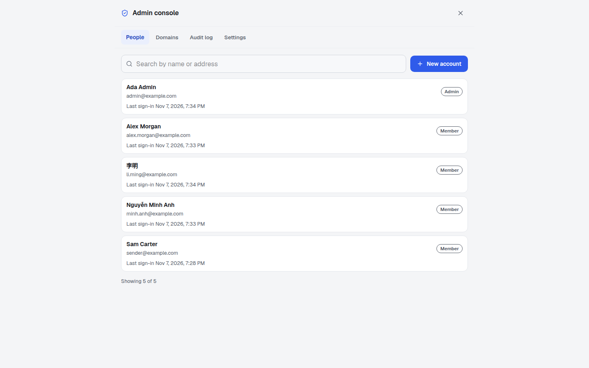
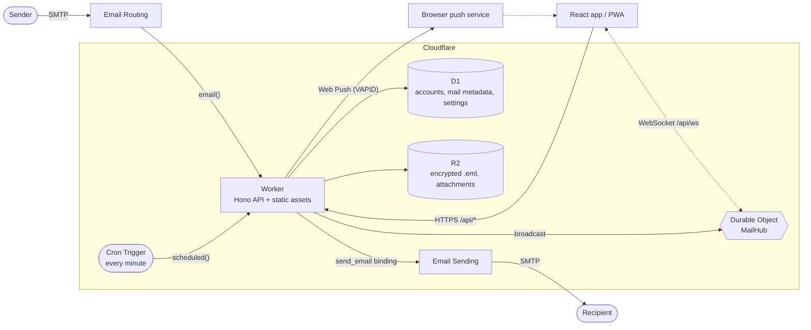

<p align="center">
  <strong>English</strong> ·
  <a href="README.vi.md">Tiếng Việt</a> ·
  <a href="README.zh-CN.md">简体中文</a>
</p>

<p align="center">
  <picture>
    
  </picture>
</p>

<p align="center">
  <strong>A webmail for companies that runs entirely on Cloudflare Workers.<br>Zero servers. Zero cold starts.</strong>
</p>

<p align="center">
  <a href="LICENSE"></a>
  <a href="https://workers.cloudflare.com/"></a>
  
  
  
  
</p>

<p align="center">
  <a href="#quick-start">Quick start</a> ·
  <a href="#features">Features</a> ·
  <a href="#deploy">Deploy</a> ·
  <a href="#documentation">Documentation</a> ·
  <a href="#contributing">Contributing</a>
</p>

## Table of contents

- [What is Edging Mail?](#what-is-edging-mail)
- [Features](#features)
- [Screenshots](#screenshots)
- [Meet Edgar](#meet-edgar)
- [Quick start](#quick-start)
- [Configuration](#configuration)
- [Deploy](#deploy)
- [Architecture](#architecture)
- [Project structure](#project-structure)
- [Scripts](#scripts)
- [Documentation](#documentation)
- [Security](#security)
- [Roadmap and known limitations](#roadmap-and-known-limitations)
- [Contributing](#contributing)
- [Acknowledgements](#acknowledgements)
- [License](#license)

## What is Edging Mail?

Edging Mail is a webmail a company hosts itself, on its own Cloudflare account. Mail arrives through Cloudflare Email Routing, a Worker parses it, encrypts it to the
recipient's own key and stores it: the message rows in D1, the raw messages and attachments in R2. A React app, opened in the browser or installed as a PWA, decrypts
it with the person's password. Replies go out through Cloudflare Email Sending. There is no server, container or queue to run.

How a company uses it:

1. An admin adds the company's mail domains.
2. The admin creates a mailbox for each person: an address and a temporary password for the first sign-in, generated in the admin's browser and valid for 72 hours.
3. Each person signs in on the web or in the installed app, chooses their own password, gets a recovery key to keep, and sets up two-factor sign-in.

The app lives at `/app`. An optional public landing page at `/`, `/en/` and `/zh/` is controlled by the `LANDING_PAGE` variable, see [Configuration](#configuration).

**Scope and limits:**

- **One company per deployment.** There is no sign-up, billing or multi-tenant service: an admin creates every account.
- **Web and HTTP API only.** There is no IMAP, POP3 or SMTP access, so desktop and phone mail apps cannot connect to it.
- **Not done yet:** spam or virus filtering, attachments in drafts, an address book, shared mailboxes or groups, SSO and passkeys. See
  [known limitations](#roadmap-and-known-limitations).

## Features

**Mail**

- Inbox, Sent, Drafts, Snoozed, Starred, Archive, Spam and Trash, plus your own labels.
- Reply, reply all and forward. Replies keep `In-Reply-To` and `References` and share a `thread_id` in storage; the list shows single mails, there is no conversation view yet.
- Search by sender, recipient or subject. Subjects are decrypted and matched in your browser over the mail already loaded; message bodies are not searched.
- Drafts autosave about 1.5 seconds after you stop typing, encrypted in the browser first. Snooze a mail from one minute to 366 days: it returns to the Inbox, unread, in its original place.
- Attachments in both directions and raw `.eml` download.
- Real delivery through Cloudflare Email Sending, always from the sender's own primary address with their display name and signature. A failed send is reported as failed and never saved as sent.

**Accounts and admin console**

- One mailbox per person on the company's own domains: a primary address to sign in and send from, plus optional receive-only aliases. Several admins are allowed, and at least one active admin always remains.
- The admin console has three pages: Users, Domains and Audit log. Admins create accounts, disable or enable them, change roles, edit display names, add or remove aliases, reset two-factor sign-in and delete accounts (with a typed confirmation). They add domains and check their DNS.
- Every admin action is recorded in the audit log.
- Accounts are isolated: each person reaches only their own mail, labels, drafts, settings and push subscriptions.

**Realtime and PWA**

- Live updates over a WebSocket held by one hibernatable Durable Object per person.
- Installable app that opens offline (app shell only; mail is never cached).
- Web Push notifications (RFC 8291 and 8292) with a VAPID key that is generated automatically: nothing to configure, no third-party account needed. They carry the sender's name, never a subject or text. On iPhone and iPad, add the app to the Home Screen first.
- Keyboard shortcuts (`/` search, `c` compose, `j` and `k` to move), light and dark theme, swipe to archive on phones.

**Languages**

- The app is in Vietnamese, English and Simplified Chinese. Each person chooses in Settings (the choice follows them to every device); the sign-in screens have a small language picker, and an admin sets the organisation's default language. How it works and how to fix a translation: [docs/i18n.md](docs/i18n.md).
- Dates, times and numbers follow the language, and push notifications are written in the recipient's language.

**Public landing page**

- Optional: a page served by the Worker at `/` (Vietnamese), `/en/` (English) and `/zh/` (Simplified Chinese), with `robots.txt` and `sitemap.xml`. It is on only when `LANDING_PAGE` is `on`; otherwise `/` goes straight to `/app`.

**Security**

- Mail is encrypted to each person's own key, which their password opens in their own browser (HPKE, RFC 9180, on WebCrypto). The password never leaves the browser.
- Every person gets a recovery key at first sign-in. Someone who forgets their password sets a new one themselves with that key; no admin can reset another person's password.
- Two-factor sign-in with an authenticator app (TOTP) and single-use recovery codes, required for everyone by default.
- Every API route except `/api/health` and `/api/auth/*` needs a signed session cookie. A missing or malformed secret turns sign-in off instead of weakening it.
- Brute-force throttling on sign-in, per client address and per account, and signing out revokes that person's sessions on every device.
- Same-origin only: cross-site requests and cross-origin WebSocket handshakes are refused, and there are no CORS headers.
- HTML mail renders in a sandboxed frame with remote images blocked until you ask; attachments are served as downloads only.

**Developer experience**

- TypeScript throughout, ESLint with typescript-eslint strict type-checked rules, Prettier, and one gate: `npm run check`.
- `npm test` runs the automated test suite (Vitest). It needs no Cloudflare account, secrets or network: the tests bring their own.
- Drizzle ORM schema with plain SQL migrations applied by Wrangler.
- Runs locally with `wrangler dev`: emulated D1, R2 and Durable Objects, a local endpoint to feed it real MIME mail, and simulated sending.
- Deploys with `npm run deploy`.

## Screenshots

<p align="center">
  <picture>
    <source media="(prefers-color-scheme: dark)" srcset="docs/assets/screenshot-desktop-dark.png">
    
  </picture>
  
</p>

<p align="center">
  <picture>
    <source media="(prefers-color-scheme: dark)" srcset="docs/assets/screenshot-admin-dark.png">
    
  </picture>
</p>

## Meet Edgar

<p align="center">
  
</p>

Edgar is a courier pigeon who works on the edge of a cloud, which is where Cloudflare puts all its workers. He carries your mail between SMTP and your browser on an SLA
he wrote himself, and he has never been cold-started. If a delivery fails he says so; he does not pretend.

<p align="center">
  
</p>

## Quick start

Prerequisites: Node.js 24 or newer and npm. You need a Cloudflare account only to [deploy](#deploy), and a deployment needs the Workers Paid plan; local development uses emulated services.

```bash
git clone https://github.com/NoahDuongMaster/edging-mail.git
cd edging-mail
npm install
cp .dev.vars.example .dev.vars    # then set APP_PASSWORD (24+ characters), JWT_SECRET (32+ characters) and DATA_KEY (base64 of 32 bytes)
npm run db:migrate:local          # create the local D1 schema
npm run build                     # Wrangler serves the built client from dist/client
npm run worker:dev                # http://localhost:8787
```

`openssl rand -base64 24` and `openssl rand -hex 32` make good values for `APP_PASSWORD` and `JWT_SECRET`, and `openssl rand -base64 32` makes `DATA_KEY`. The placeholders
in `.dev.vars.example` are invalid on purpose, so sign-in and Setup answer `503` until you replace them. Open `http://localhost:8787/app`. With no account yet, the first
screen is Setup: enter `APP_PASSWORD` as the setup key, an admin address such as `admin@example.com`, a display name and a password (16 characters or more for an admin),
then follow the recovery key and two-factor screens.

**Receive a test email.** Mail enters through the same `email()` handler that Email Routing calls in production. `wrangler dev` exposes it at `/cdn-cgi/handler/email`.
Use the admin address you created in Setup as the recipient:

```bash
cat > hello.eml <<'EOF'
From: Alice <alice@example.org>
To: admin@example.com
Subject: Hello from a real MIME message
Message-ID: <hello-1@example.org>
Content-Type: text/plain; charset=utf-8

Hi! This goes through the same parser and storage as production mail.
EOF

curl -X POST "http://localhost:8787/cdn-cgi/handler/email?from=alice@example.org&to=admin@example.com" --data-binary @hello.eml
```

The mail appears in that account's Inbox. An address that no account or alias owns is rejected and nothing is stored. Sending is simulated locally: the message is written under `.wrangler/tmp/email/` and nothing leaves your machine. For frontend work with
hot reload, run `npm run dev` next to `npm run worker:dev`; see [docs/development.md](docs/development.md). `npm test` runs the automated tests.

## Configuration

Configuration lives in `wrangler.jsonc` (bindings and plain variables), Worker secrets (`wrangler secret put` in production, `.dev.vars` locally) and the in-app
**Settings** screen (per person: display name, signature and account security). Full reference: [docs/configuration.md](docs/configuration.md).

| Name           | Kind   | Required | Constraint                             | Purpose                                                                                                         |
| -------------- | ------ | -------- | -------------------------------------- | --------------------------------------------------------------------------------------------------------------- |
| `APP_PASSWORD` | secret | yes      | at least 24 characters                 | The setup key: used only by first-run Setup and admin break-glass recovery. Nobody signs in with it             |
| `JWT_SECRET`   | secret | yes      | at least 32 characters                 | Random key that signs the session cookie and the two-factor challenge                                           |
| `DATA_KEY`     | secret | yes      | base64 of exactly 32 random bytes      | Seals what the Worker must read back itself: mail that arrived before its owner set up keys, two-factor secrets |
| `DEFAULT_FROM` | var    | no       | a bare email address                   | Prefills the admin address on the Setup screen (also the contact in Web Push requests)                          |
| `APP_NAME`     | var    | no       | default `Edging Mail`                  | Product name in `/api/health` and some push notification titles                                                 |
| `LANDING_PAGE` | var    | no       | `on`; unset or anything else means off | `on` serves the public landing page at `/`, `/en/` and `/zh/`                                                   |

| Binding      | Type                     | Purpose                                                                            |
| ------------ | ------------------------ | ---------------------------------------------------------------------------------- |
| `DB`         | D1 database              | Accounts, domains, audit log, mail metadata and encrypted text, push subscriptions |
| `BUCKET`     | R2 bucket                | Raw `.eml` files and attachments, encrypted                                        |
| `SEND_EMAIL` | `send_email`             | Outbound mail through Cloudflare Email Sending                                     |
| `ASSETS`     | Static assets            | The built React app                                                                |
| `MAIL_HUB`   | Durable Object namespace | Realtime WebSocket fan-out                                                         |

Without `JWT_SECRET` or `DATA_KEY` (or with one that is missing or malformed) sign-in and Setup answer `503`. Without `APP_PASSWORD` (or with one that is too short) people
can still sign in, but Setup and break-glass recovery answer `503`. `DATA_KEY` must not have the same value as `JWT_SECRET` or `APP_PASSWORD`. Web Push needs no
configuration: the key pair is created on first use and kept in the database, sealed so that a copy of the database alone cannot sign pushes (details in
[docs/configuration.md](docs/configuration.md)).

**`DATA_KEY`** is a Worker secret, not a var: base64 of exactly 32 random bytes. Create it with `openssl rand -base64 32`, then run `npx wrangler secret put DATA_KEY`.
Set it **before** you deploy this version. If you lose it, mail that the server sealed and has not yet re-wrapped to its owner's key can no longer be read, and stored
two-factor secrets stop working, so keep a backup of it, the same way you keep the D1 id.

**`LANDING_PAGE`**: the `wrangler.jsonc` in this repository sets `on`, because the maintainer's deployment has a public landing page at `/`, `/en/` and `/zh/`, with `robots.txt` and
`sitemap.xml`. A fork should leave it unset or `off` unless it wants a public page. Unset or `off`: `/` goes straight to `/app`, `/en/`, `/zh/` and `/sitemap.xml` answer `404`, and
`robots.txt` disallows everything. Only the exact value `on` (trimmed, case-insensitive) turns the landing page on.

## Deploy

A deployment needs the Workers Paid plan. Checking a password at sign-in costs about 40 to 50 ms of CPU time (PBKDF2), above the 10 ms the Free plan allows, and Cloudflare Email
Sending also needs the paid plan to send to any recipient.

`wrangler.jsonc` in this repository carries the maintainer's deployment values (its hostname, a D1 id, `DEFAULT_FROM`, and `LANDING_PAGE` set to `on`). A fork must
replace them first. The full walk-through, including DNS and Email Routing, is in [docs/deployment.md](docs/deployment.md). A fork changes:

| Key in `wrangler.jsonc`       | A fork changes it to                                                                        |
| ----------------------------- | ------------------------------------------------------------------------------------------- |
| `routes[0].pattern`           | a hostname on a zone in your Cloudflare account                                             |
| `d1_databases[0].database_id` | the id printed by `wrangler d1 create`                                                      |
| `vars.DEFAULT_FROM`           | optional: an address on one of your domains (it prefills Setup)                             |
| `vars.LANDING_PAGE`           | unset or `off`, unless you want a public landing page (see [Configuration](#configuration)) |

In short:

1. **Custom domain.** Set `routes[0].pattern` to a hostname on a zone in your Cloudflare account. `workers_dev` and `preview_urls` are off, so the app is reachable on
   that hostname only.
2. **Create the storage**, then paste the printed `database_id` into `d1_databases[0].database_id`:
   ```bash
   npx wrangler d1 create edging_mail_db
   npx wrangler r2 bucket create edging-mail-storage
   ```
3. **Migrate and set secrets**, then deploy:
   ```bash
   npm run db:migrate:remote
   npx wrangler secret put APP_PASSWORD
   npx wrangler secret put JWT_SECRET
   npx wrangler secret put DATA_KEY
   npm run deploy
   ```
   `DATA_KEY` is base64 of 32 random bytes (`openssl rand -base64 32`). Set it before the first deploy of this version.
4. **Create the first admin.** Open `/app` on your hostname. With no account yet it shows Setup: enter the setup key (`APP_PASSWORD`), the admin's address, a display name and a
   password of at least 16 characters, then follow the recovery key and two-factor screens. Setup adds the domain of that address. After that, the admin console
   (Domains, Users) is where you add the other domains and create a mailbox for each person.
5. **Receive mail.** In the dashboard (Compute → Email Service → Email Routing) onboard each of the company's domains and set its catch-all rule to the action _Send to a
   Worker_ with the destination `edging-mail`. The Worker delivers by recipient address and rejects addresses that no account or alias owns. Email Routing on the root
   (apex) domain takes over its MX records; this is how the maintainer's own deployment runs. If another mail provider must keep the MX records, one option is to forward
   from that provider to a routing subdomain instead. Email Routing has no catch-all on subdomains, so every address there needs its own rule. The Domains page of the
   admin console has a DNS check that shows whether receiving and sending are set up.
6. **Send mail.** Onboard the domain under Email Sending. It is in beta, and sending to arbitrary recipients needs the Workers Paid plan.

**Workers Builds (deploy on git push):** to migrate and deploy on every push, do two things once in the Cloudflare dashboard: add **Account → D1 → Edit** to the
build's API token (the default token has no D1 permission) and set the deploy command to `npm run db:migrate:remote && npx wrangler deploy`. Without that, run
steps 2 and 3 yourself and migrate again before you push a change that adds a file to `drizzle/`.

**Upgrading an install from before accounts existed:** back up D1, set `DATA_KEY` before you deploy this version, then deploy and open `/app`. Setup takes the old
`APP_PASSWORD` as its setup key, and everyone signs in again. The steps are in [docs/deployment.md](docs/deployment.md). The old mail is converted to the encrypted format by a background job. Copies made before
the job (the backup you took, D1 Time Travel, the free space inside the database file) can still hold it in plaintext until they are deleted or expire; see step 6 of
[docs/deployment.md](docs/deployment.md).

## Architecture



| Layer         | Technology                                                                       |
| ------------- | -------------------------------------------------------------------------------- |
| Runtime       | Cloudflare Workers, Durable Objects, Cron Triggers                               |
| API           | Hono 4, TypeScript 7                                                             |
| Data          | D1 (SQLite) through Drizzle ORM; R2 for blobs                                    |
| Inbound mail  | Cloudflare Email Routing, `postal-mime`                                          |
| Outbound mail | Cloudflare Email Sending (`send_email` binding), `mimetext` for the archive copy |
| Client        | React 19, Vite 8, Tailwind CSS 4, TanStack Query 5, Lucide icons                 |
| Push          | Web Push with VAPID, RFC 8291 and 8292 implemented on WebCrypto                  |
| Encryption    | WebCrypto (AES-256-GCM, PBKDF2, HKDF) and HPKE (RFC 9180) through `@hpke/core`   |
| Tooling       | Wrangler 4, drizzle-kit, Vitest 4, ESLint 9 with typescript-eslint, Prettier 3   |

How the pieces fit, with the data flows and the data model, is in [docs/architecture.md](docs/architecture.md).

## Project structure

```text
.
├── src/
│   ├── worker/              # Cloudflare Worker
│   │   ├── index.ts         # fetch, email() and scheduled() handlers, mail routes
│   │   ├── auth/            # sign-in, sessions, Setup, two-factor, recovery key
│   │   ├── mail/            # message, send and settings routes
│   │   ├── inbound.ts       # works out whose mail an incoming message is
│   │   ├── drafts.ts        # draft autosave API
│   │   ├── push.ts          # Web Push (RFC 8291/8292) and subscription API
│   │   ├── realtime.ts      # MailHub Durable Object and /api/ws
│   │   ├── notify.ts        # new-mail broadcast and push
│   │   ├── snooze.ts        # returns due snoozed mail (cron)
│   │   ├── site/            # landing page, robots.txt, sitemap.xml, the /app shell
│   │   ├── services/        # email-parser.ts (inbound), email-sender.ts (outbound)
│   │   └── db/              # Drizzle schema and D1 client
│   ├── shared/crypto/       # key derivation, key wrapping, message encryption (the Worker imports only its seal-only entry)
│   └── client/              # React app
│       ├── App.tsx          # layout and mailbox state
│       ├── components/      # sidebar, list, reader, compose, settings, mail frame
│       └── lib/             # API client, TanStack Query hooks, realtime, push, drafts
├── test/                    # automated tests (npm test)
├── public/                  # service worker, manifest, icons, _headers
├── drizzle/                 # SQL migrations and drizzle-kit snapshots
├── docs/                    # documentation (assets/ holds the images)
├── wrangler.jsonc           # bindings, route, cron, variables
├── .dev.vars.example        # template for local secrets
└── CONTRIBUTING.md
```

## Scripts

| Script                      | What it does                                                       |
| --------------------------- | ------------------------------------------------------------------ |
| `npm run worker:dev`        | `wrangler dev`: the Worker, D1, R2 and assets on `localhost:8787`  |
| `npm run dev`               | Vite dev server on `localhost:3000`, proxying `/api` to the Worker |
| `npm run build`             | `tsc -b && vite build`: type-check, then bundle into `dist/client` |
| `npm run preview`           | `vite preview`: serve the built client                             |
| `npm run deploy`            | `npm run build && npm run db:migrate:remote && wrangler deploy`    |
| `npm run db:generate`       | `drizzle-kit generate`: new migration from `schema.ts`             |
| `npm run db:migrate:local`  | Apply pending migrations to the local D1                           |
| `npm run db:migrate:remote` | Apply pending migrations to the production D1                      |
| `npm run lint`              | `eslint .` (`lint:fix` adds `--fix`)                               |
| `npm test`                  | `vitest run`: the automated test suite                             |
| `npm run format`            | `prettier --write .` (`format:check` only checks)                  |
| `npm run check`             | `tsc -b`, lint and format check: the gate for every change         |

## Documentation

| Page                                           | Contents                                                                        |
| ---------------------------------------------- | ------------------------------------------------------------------------------- |
| [Architecture](docs/architecture.md)           | Components, data flows, data model, design notes                                |
| [Configuration](docs/configuration.md)         | Variables, secrets, bindings, `wrangler.jsonc`, what a fork changes             |
| [Deployment](docs/deployment.md)               | Step-by-step production setup, domains, Email Routing, Email Sending, upgrading |
| [Mail features](docs/mail-features.md)         | Sending, replies, search, threads, drafts, snooze                               |
| [Realtime, Push and PWA](docs/pwa-and-push.md) | WebSocket events, Web Push, installing the app                                  |
| [Security](docs/security.md)                   | Encryption, sign-in, two-factor, admins, mail sandbox, limits                   |
| [HTTP API](docs/api.md)                        | Every route with auth, body, response and errors                                |
| [Development](docs/development.md)             | Local setup, migrations, tests, checks, commit style                            |

## Security

Each person's mail is encrypted to their own key, which only their password (or their recovery key) opens, in their own browser. The claims below are the ones Edging Mail
makes. The details and the limits are in [docs/security.md](docs/security.md).

### Encryption

- **Encrypted storage.** Subject, snippet, bodies, attachments (content, file name, type) and the raw message are stored encrypted to the owner's key. The server, admins and anyone who can read the database and file storage cannot read them without the owner's password or recovery key. Exceptions: mail that arrived before its owner set up keys is protected only by a server secret until the owner signs in; a new account before its owner's first sign-in; a weak password can be guessed offline by someone holding a copy of the stored data; anyone who holds the person's recovery key.
- **End-to-end.** Mail between people on this deployment is encrypted in the sender's browser to the recipients' keys. Keys are distributed by this server and are not independently verified, and the app code is delivered by the same server.
- **External mail is normal email.** Mail to and from outside addresses travels between mail servers as plain email. Edging Mail sees it when it arrives or leaves, then stores it encrypted.
- **Not encrypted (metadata):** addresses and display names, dates, sizes (of messages, attachments and the stored ciphertext), the number of attachments, folder, flags, labels, the `Message-ID`, `References` and `In-Reply-To` headers and thread ids, the signature in a person's settings, and which aliases an admin has added to an account.
- The password never leaves the browser. While you are signed in, the unlocked key is held by the browser as a non-extractable key; "non-extractable" means only that JavaScript cannot export it, and the key is still stored in the browser profile on the device.

### Admins, passwords and recovery

- **Admins.** No admin can reset another person's password, and an admin has no way in Edging Mail to open the mail of a person who has already signed in and set up their keys. An admin who creates an account knows its temporary password until the person first signs in, and mail that arrives before then is protected only by a server secret. Admins can disable or delete accounts, re-create an address, add or move alias addresses and reset two-factor sign-in; every such change is logged. Whoever holds the setup key can restore an admin's console access with a new key (that admin's old mail stays locked). Whoever controls the Cloudflare account or the deployed code could change the software.
- Every person gets a recovery key at first sign-in. It is shown once, so keep it somewhere safe. Someone who forgets their password sets a new one themselves with that key (Forgot password, on the sign-in screen) and keeps their mail. Doing so ends all their sessions and is recorded in the audit log and in their sign-in history.
- Nobody, admins included, can restore mail without the password or the recovery key. If someone loses both, nobody can open their old mail again: an admin can only delete the account and create a new mailbox.
- A password change is not a key rotation: it protects the same key with the new password and does not change the key the mail is encrypted to. Key rotation is planned for v1.1.
- One residual risk: the admin who creates an account knows its temporary password until the first sign-in, so an admin could sign in first, set up the keys and read the mail that arrives at that address from then on. Mail that already exists is not exposed. The first sign-in is recorded, and the new member sees it in their sign-in history.

### Sign-in and reading

- Two-factor sign-in with an authenticator app (TOTP) and single-use recovery codes, required for everyone by default. Admins always need it. An admin can reset a person's two-factor sign-in, for example after a lost phone; that is logged and ends the person's sessions.
- After repeated wrong passwords, sign-in locks for a while. Signing out, changing your password or resetting it with your recovery key ends your earlier sessions.
- Each person can see their own recent sign-ins, and security events go to the admin audit log.
- HTML mail opens in an isolated frame (sandbox), and remote images stay blocked until the reader allows them.

Encryption protects stored mail. It does not stop someone who controls the Cloudflare account or the deployed code from changing the software, so give that access only to people you trust.

**Report a vulnerability privately:** open the **Security** tab of this repository and choose **Report a vulnerability**. Please do not file a public issue for
something exploitable. Never commit secrets: `.dev.vars` and `.env*` are gitignored.

## Roadmap and known limitations

Argon2id key derivation for admins and key rotation are planned for v1.1.

Known limitations today:

- **Images over `http://` never load.** HTML mail may show `https` images only, and only after you press _Show images_.
- **Mark all as read is missing at phone widths.** The button lives in the desktop list header.
- **The whole deployment needs the Workers Paid plan**, not only sending: a password check at sign-in takes about 40 to 50 ms of CPU time, more than the Free plan's 10 ms.
- **Email Sending is beta** and needs the Workers Paid plan for arbitrary recipients; the daily quota starts low on new accounts.
- **Receiving at the root domain needs Email Routing there.** It takes over the domain's MX records, and the maintainer's own deployment runs this way. Forwarding from another mail provider to a routing subdomain is an option for companies that cannot move their MX records; that forwarding flow has not been run end to end.
- **Search does not read message bodies,** because they are encrypted. Subjects are decrypted and matched in the browser, over the mail already loaded.
- **Mail from before an upgrade can survive as plaintext in old copies.** The conversion encrypts it in the live database and in R2 (no plaintext object is left), but a backup you took, D1 Time Travel (30 days on Workers Paid) and the free space of the database file can still hold the plaintext. Only deleting your copies and letting the platform's own copies expire removes it. Mail received after Setup is sealed on arrival.
- **No spam or virus filtering, no attachments in drafts, no address book, no conversation view.**
- **Very large mails** may fail to store: bodies live in D1, which caps a row at 2 MB. Expected from the documented limit, not tested.
- **Google Fonts.** The page loads the Geist fonts from Google, so the browser contacts Google when the app opens.
- Tested in Chromium and Firefox; the cryptography known-answer tests also run in a WebKit engine (WPE); not yet verified on real Safari or iPhone.
- Not covered by the tests here, so smoke-test it after the first deploy: real Cloudflare behaviour (Email Routing and Email Sending, the real push services, real D1 and R2 limits, CPU time and billing per request); real https (the `__Host-` session cookie, HSTS, the 400 ms sign-in floor over a real connection, a WebSocket close at the end of a session); and real Safari and iPhone. A ten-minute list is in [docs/deployment.md](docs/deployment.md#after-the-first-deploy-a-ten-minute-check).

Ideas that would make good contributions: self-hosted fonts, mark-all-as-read on phones, attachments in drafts.

## Contributing

Issues and pull requests are welcome. Read [CONTRIBUTING.md](CONTRIBUTING.md) first: it covers setup, `npm run check`, commit style and how to propose a change.

## Acknowledgements

Built on the Cloudflare developer platform and its documentation, [Hono](https://hono.dev), [Drizzle ORM](https://orm.drizzle.team), [React](https://react.dev),
[Vite](https://vite.dev), [Tailwind CSS](https://tailwindcss.com), [TanStack Query](https://tanstack.com/query), [Lucide](https://lucide.dev),
[postal-mime](https://github.com/postalsys/postal-mime) and [mimetext](https://github.com/muratgozel/MIMEText). The UI font is Geist by Vercel. Badges come from
[Shields.io](https://shields.io). The README layout follows [standard-readme](https://github.com/RichardLitt/standard-readme) and
[Make a README](https://www.makeareadme.com/).

## License

[MIT](LICENSE) © Noah Duong

The third-party software and data this project ships or uses, each with its licence, are listed in [NOTICE](NOTICE). No font file is shipped.
