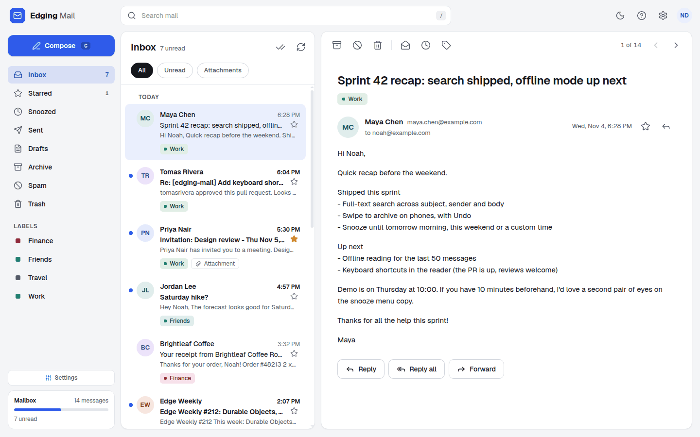
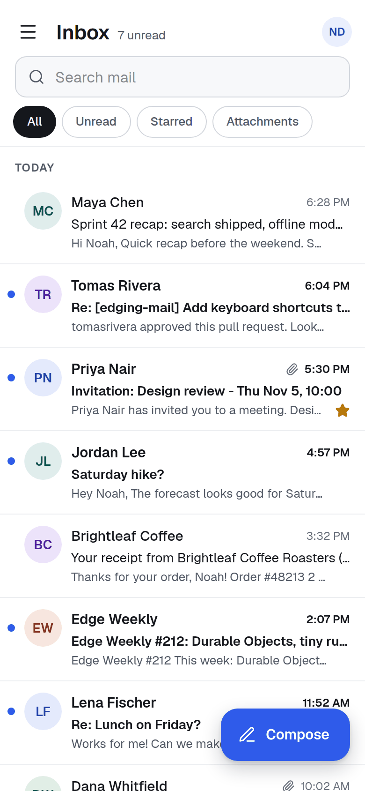
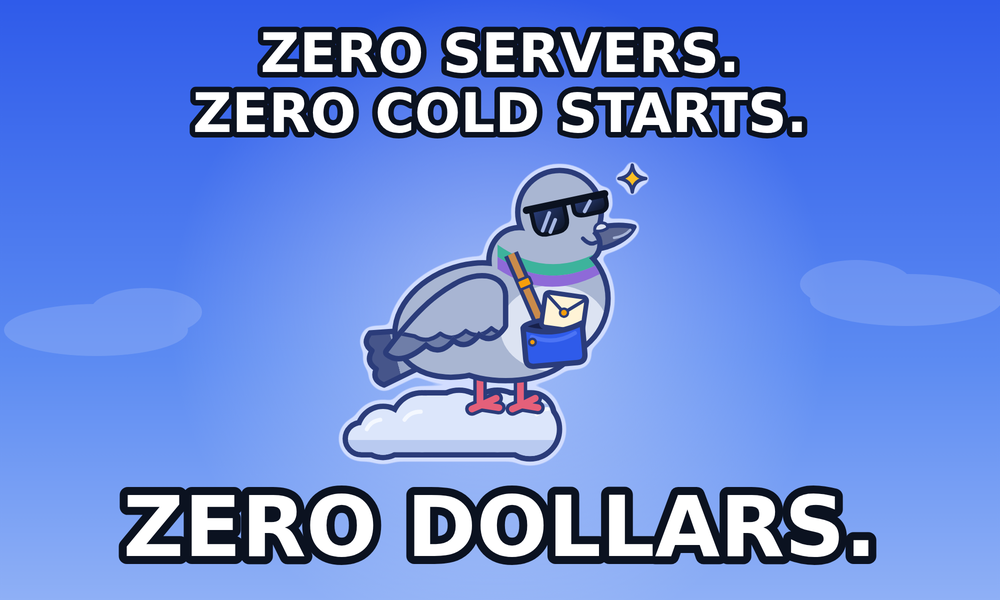
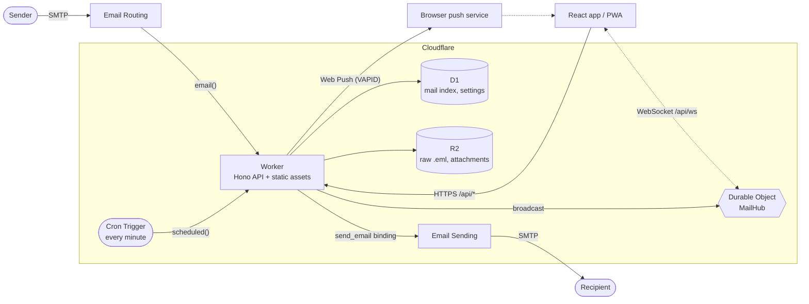

<p align="center">
  <picture>
    
  </picture>
</p>

<p align="center">
  <strong>A single-user webmail that runs entirely on Cloudflare Workers.<br>Zero servers. Zero cold starts. Zero dollars to get started.</strong>
</p>

<p align="center">
  <a href="LICENSE"></a>
  <a href="https://workers.cloudflare.com/"></a>
  
  
  
  
</p>

<p align="center">
  <a href="#quick-start">Quick start</a> ·
  <a href="#features">Features</a> ·
  <a href="#deploy">Deploy</a> ·
  <a href="#documentation">Documentation</a> ·
  <a href="#contributing">Contributing</a>
</p>

## Table of contents

- [What is Edging Mail?](#what-is-edging-mail)
- [Features](#features)
- [Screenshots](#screenshots)
- [Meet Edgar](#meet-edgar)
- [Quick start](#quick-start)
- [Configuration](#configuration)
- [Deploy](#deploy)
- [Architecture](#architecture)
- [Project structure](#project-structure)
- [Scripts](#scripts)
- [Documentation](#documentation)
- [Security](#security)
- [Roadmap and known limitations](#roadmap-and-known-limitations)
- [Contributing](#contributing)
- [Acknowledgements](#acknowledgements)
- [License](#license)

## What is Edging Mail?

Edging Mail is a webmail you host yourself, on your own Cloudflare account. Mail arrives through Cloudflare Email Routing, a Worker parses it and stores the index in
D1 and the raw messages and attachments in R2. A React app behind a single password reads it. Replies go out through Cloudflare Email Sending. There is no server,
container or queue to run.

**Scope and limits:**

- **Single-user by design.** One password, one mailbox owner, one set of settings. It is not a multi-tenant service: there are no accounts, sharing or admin console.
- **Web and HTTP API only.** There is no IMAP, POP3 or SMTP access, so desktop and phone mail apps cannot connect to it.
- **Not done yet:** multiple users, spam or virus filtering, two-factor login, attachments in drafts, an address book, automated tests. See
  [known limitations](#roadmap-and-known-limitations).

## Features

**Mail**

- Inbox, Sent, Drafts, Snoozed, Starred, Archive, Spam and Trash, plus your own labels.
- Reply, reply all and forward. Replies keep `In-Reply-To` and `References` and share a `thread_id` in storage; the list shows single mails, there is no conversation view yet.
- Search over subject, sender, recipients and snippet.
- Drafts autosave about 1.5 seconds after you stop typing. Snooze a mail from one minute to 366 days: it returns to the Inbox, unread, in its original place.
- Attachments in both directions and raw `.eml` download.
- Real delivery through Cloudflare Email Sending with your display name, signature and sender address. A failed send is reported as failed and never saved as sent.

**Realtime and PWA**

- Live updates over a WebSocket held by one hibernatable Durable Object.
- Installable app that opens offline (app shell only; mail is never cached).
- Web Push notifications with your own VAPID key (RFC 8291 and 8292), no third-party account needed. On iPhone and iPad, add the app to the Home Screen first.
- Keyboard shortcuts (`/` search, `c` compose, `j` and `k` to move), light and dark theme, swipe to archive on phones.

**Security**

- Every API route except `/api/health` and `/api/auth/*` needs a signed session cookie. Missing or short secrets disable login instead of weakening it.
- Brute-force throttling on login, and sign-out revokes every session issued before it.
- Same-origin only: cross-site requests and cross-origin WebSocket handshakes are refused, and there are no CORS headers.
- HTML mail renders in a sandboxed frame with remote images blocked until you ask; attachments are served as downloads only.

**Developer experience**

- TypeScript throughout, ESLint with typescript-eslint strict type-checked rules, Prettier, and one gate: `npm run check`.
- Drizzle ORM schema with plain SQL migrations applied by Wrangler.
- Runs locally with `wrangler dev`: emulated D1, R2 and Durable Objects, a local endpoint to feed it real MIME mail, and simulated sending.
- Deploys with `npm run deploy`.

## Screenshots

<p align="center">
  <picture>
    <source media="(prefers-color-scheme: dark)" srcset="docs/assets/screenshot-desktop-dark.png">
    
  </picture>
  
</p>

## Meet Edgar

<p align="center">
  
</p>

Edgar is a courier pigeon who works on the edge of a cloud, which is where Cloudflare puts all its workers. He carries your mail between SMTP and your browser on an SLA
he wrote himself, and he has never been cold-started. If a delivery fails he says so; he does not pretend.

<p align="center">
  
</p>

## Quick start

Prerequisites: Node.js 24 or newer and npm. You need a Cloudflare account only to [deploy](#deploy); local development uses emulated services.

```bash
git clone https://github.com/NoahDuongMaster/edging-mail.git
cd edging-mail
npm install
cp .dev.vars.example .dev.vars    # then set APP_PASSWORD (12+ characters) and JWT_SECRET (32+ characters)
npm run db:migrate:local          # create the local D1 schema
npm run build                     # Wrangler serves the built client from dist/client
npm run worker:dev                # http://localhost:8787
```

`openssl rand -base64 24` and `openssl rand -hex 32` make good values for the two secrets. The placeholders in `.dev.vars.example` are too short on purpose, so login
answers `503` until you replace them. Open `http://localhost:8787` and sign in with `APP_PASSWORD`.

**Receive a test email.** Mail enters through the same `email()` handler that Email Routing calls in production. `wrangler dev` exposes it at `/cdn-cgi/handler/email`:

```bash
cat > hello.eml <<'EOF'
From: Alice <alice@example.org>
To: you@example.com
Subject: Hello from a real MIME message
Message-ID: <hello-1@example.org>
Content-Type: text/plain; charset=utf-8

Hi! This goes through the same parser and storage as production mail.
EOF

curl -X POST "http://localhost:8787/cdn-cgi/handler/email?from=alice@example.org&to=you@example.com" --data-binary @hello.eml
```

The mail appears in the Inbox. Sending is simulated locally: the message is written under `.wrangler/tmp/email/` and nothing leaves your machine. For frontend work with
hot reload, run `npm run dev` next to `npm run worker:dev`; see [docs/development.md](docs/development.md).

## Configuration

Configuration lives in `wrangler.jsonc` (bindings and plain variables), Worker secrets (`wrangler secret put` in production, `.dev.vars` locally) and the in-app
**Settings** screen (display name, signature, sender address). Full reference: [docs/configuration.md](docs/configuration.md).

| Name                | Kind   | Required | Constraint                  | Purpose                                                         |
| ------------------- | ------ | -------- | --------------------------- | --------------------------------------------------------------- |
| `APP_PASSWORD`      | secret | yes      | at least 12 characters      | The password you type on the login screen                       |
| `JWT_SECRET`        | secret | yes      | at least 32 characters      | Random key that signs the session cookie                        |
| `DEFAULT_FROM`      | var    | no       | a bare email address        | Sender address used until you save one in Settings              |
| `APP_NAME`          | var    | no       | default `Edging Mail`       | Product name in `/api/health` and some push notification titles |
| `VAPID_PUBLIC_KEY`  | var    | for push | base64url P-256 public key  | Web Push key pair, public half                                  |
| `VAPID_SUBJECT`     | var    | for push | `mailto:` or `https://` URL | Contact for the push services                                   |
| `VAPID_PRIVATE_KEY` | secret | for push | base64url P-256 private key | Web Push key pair, private half                                 |

| Binding      | Type                     | Purpose                                        |
| ------------ | ------------------------ | ---------------------------------------------- |
| `DB`         | D1 database              | Mail index, settings, push subscriptions       |
| `BUCKET`     | R2 bucket                | Raw `.eml` files and attachments               |
| `SEND_EMAIL` | `send_email`             | Outbound mail through Cloudflare Email Sending |
| `ASSETS`     | Static assets            | The built React app                            |
| `MAIL_HUB`   | Durable Object namespace | Realtime WebSocket fan-out                     |

Without `APP_PASSWORD` or `JWT_SECRET` (or with one that is too short) login answers `503` and nothing else is reachable. Push works only when all three VAPID values are set.

**VAPID keys.** Generate the Web Push key pair once. Put the public key and the subject under `vars` in `wrangler.jsonc` (or in `.dev.vars` locally) and store the private
key as a secret:

```bash
node -e "const k=require('node:crypto').generateKeyPairSync('ec',{namedCurve:'P-256'}).privateKey.export({format:'jwk'});const b=(s)=>Buffer.from(s,'base64url');console.log('VAPID_PUBLIC_KEY='+Buffer.concat([Buffer.from([4]),b(k.x),b(k.y)]).toString('base64url'));console.log('VAPID_PRIVATE_KEY='+k.d)"
```

## Deploy

`wrangler.jsonc` in this repository carries the maintainer's deployment values (hostname `mail.duongnamtruong.com`, a D1 id, `DEFAULT_FROM`). A fork must replace
them first. The full walk-through, including DNS and Email Routing, is in [docs/deployment.md](docs/deployment.md). In short:

1. **Custom domain.** Set `routes[0].pattern` to a hostname on a zone in your Cloudflare account. `workers_dev` and `preview_urls` are off, so the app is reachable on
   that hostname only.
2. **Create the storage**, then paste the printed `database_id` into `d1_databases[0].database_id`:
   ```bash
   npx wrangler d1 create edging_mail_db
   npx wrangler r2 bucket create edging-mail-storage
   ```
3. **Migrate and set secrets** (plus the VAPID values if you want push), then deploy:
   ```bash
   npm run db:migrate:remote
   npx wrangler secret put APP_PASSWORD
   npx wrangler secret put JWT_SECRET
   npm run deploy
   ```
4. **Receive mail.** In the dashboard (Compute → Email Service → Email Routing) onboard your domain and add a routing rule with the action _Send to a Worker_ and the
   destination `edging-mail`. Receiving at the root domain needs Email Routing on that domain, which takes over its MX records. If another provider must keep them,
   forward one address to a routing subdomain instead (the maintainer forwards from Proton).
5. **Send mail.** Onboard the domain under Email Sending. It is in beta, and sending to arbitrary recipients needs the Workers Paid plan.

**Workers Builds (deploy on git push):** the API token Cloudflare creates for it has no D1 permission, so a build can neither create the database nor run migrations.
Run steps 2 and 3 yourself, and migrate again before you push a change that adds a file to `drizzle/`.

## Architecture



| Layer         | Technology                                                                       |
| ------------- | -------------------------------------------------------------------------------- |
| Runtime       | Cloudflare Workers, Durable Objects, Cron Triggers                               |
| API           | Hono 4, TypeScript 7                                                             |
| Data          | D1 (SQLite) through Drizzle ORM; R2 for blobs                                    |
| Inbound mail  | Cloudflare Email Routing, `postal-mime`                                          |
| Outbound mail | Cloudflare Email Sending (`send_email` binding), `mimetext` for the archive copy |
| Client        | React 19, Vite 8, Tailwind CSS 4, TanStack Query 5, Lucide icons                 |
| Push          | Web Push with VAPID, RFC 8291 and 8292 implemented on WebCrypto                  |
| Tooling       | Wrangler 4, drizzle-kit, ESLint 9 with typescript-eslint, Prettier 3             |

How the pieces fit, with the data flows and the data model, is in [docs/architecture.md](docs/architecture.md).

## Project structure

```text
.
├── src/
│   ├── worker/              # Cloudflare Worker
│   │   ├── index.ts         # fetch, email() and scheduled() handlers, mail routes
│   │   ├── auth.ts          # login, session cookie, brute-force throttle
│   │   ├── drafts.ts        # draft autosave API
│   │   ├── push.ts          # Web Push (RFC 8291/8292) and subscription API
│   │   ├── realtime.ts      # MailHub Durable Object and /api/ws
│   │   ├── notify.ts        # new-mail broadcast and push
│   │   ├── snooze.ts        # returns due snoozed mail (cron)
│   │   ├── services/        # email-parser.ts (inbound), email-sender.ts (outbound)
│   │   └── db/              # Drizzle schema and D1 client
│   └── client/              # React app
│       ├── App.tsx          # layout and mailbox state
│       ├── components/      # sidebar, list, reader, compose, settings, mail frame
│       └── lib/             # API client, TanStack Query hooks, realtime, push, drafts
├── public/                  # service worker, manifest, icons, _headers
├── drizzle/                 # SQL migrations and drizzle-kit snapshots
├── docs/                    # documentation (assets/ holds the images)
├── wrangler.jsonc           # bindings, route, cron, variables
├── .dev.vars.example        # template for local secrets
└── CONTRIBUTING.md
```

## Scripts

| Script                      | What it does                                                       |
| --------------------------- | ------------------------------------------------------------------ |
| `npm run worker:dev`        | `wrangler dev`: the Worker, D1, R2 and assets on `localhost:8787`  |
| `npm run dev`               | Vite dev server on `localhost:3000`, proxying `/api` to the Worker |
| `npm run build`             | `tsc -b && vite build`: type-check, then bundle into `dist/client` |
| `npm run preview`           | `vite preview`: serve the built client                             |
| `npm run deploy`            | `npm run build && wrangler deploy`                                 |
| `npm run db:generate`       | `drizzle-kit generate`: new migration from `schema.ts`             |
| `npm run db:migrate:local`  | Apply pending migrations to the local D1                           |
| `npm run db:migrate:remote` | Apply pending migrations to the production D1                      |
| `npm run lint`              | `eslint .` (`lint:fix` adds `--fix`)                               |
| `npm run format`            | `prettier --write .` (`format:check` only checks)                  |
| `npm run check`             | `tsc -b`, lint and format check: the gate for every change         |

## Documentation

| Page                                           | Contents                                                            |
| ---------------------------------------------- | ------------------------------------------------------------------- |
| [Architecture](docs/architecture.md)           | Components, data flows, data model, design notes                    |
| [Configuration](docs/configuration.md)         | Variables, secrets, bindings, `wrangler.jsonc`, what a fork changes |
| [Deployment](docs/deployment.md)               | Step-by-step production setup, Email Routing and Email Sending      |
| [Mail features](docs/mail-features.md)         | Sending, replies, search, threads, drafts, snooze                   |
| [Realtime, Push and PWA](docs/pwa-and-push.md) | WebSocket events, Web Push, installing the app                      |
| [Security](docs/security.md)                   | Login, throttling, mail sandbox, headers, hardening                 |
| [HTTP API](docs/api.md)                        | Every route with auth, body, response and errors                    |
| [Development](docs/development.md)             | Local setup, migrations, checks, commit style                       |

## Security

Everything private sits behind one password and a signed, `HttpOnly` session cookie; routes fail closed; login is throttled; mail is untrusted input and is rendered in a
sandbox. The details and the limits (no second factor, no end-to-end encryption, Cloudflare can read what it stores) are in [docs/security.md](docs/security.md).

**Report a vulnerability privately:** open the **Security** tab of this repository and choose **Report a vulnerability**. Please do not file a public issue for
something exploitable. Never commit secrets: `.dev.vars` and `.env*` are gitignored.

## Roadmap and known limitations

Known limitations today:

- **One user.** Multi-user support is not planned; it is a different product.
- **Images over `http://` never load.** HTML mail may show `https` images only, and only after you press _Show images_.
- **Mark all as read is missing at phone widths.** The button lives in the desktop list header.
- **Email Sending is beta** and needs the Workers Paid plan for arbitrary recipients; the daily quota starts low on new accounts.
- **Receiving at the root domain needs Email Routing there.** The maintainer's setup forwards from Proton to a subdomain; that forwarding flow has not been run end to end.
- **No spam or virus filtering, no second factor, no attachments in drafts, no address book, no conversation view.**
- **No automated tests yet.** `npm run check` (types, lint, format) is the only gate.
- **Very large mails** may fail to store: bodies live in D1, which caps a row at 2 MB. Expected from the documented limit, not tested.
- **Google Fonts.** The page loads the Geist fonts from Google, so the browser contacts Google when the app opens.

Ideas that would make good contributions: a test suite, self-hosted fonts, mark-all-as-read on phones, attachments in drafts, a second login factor.

## Contributing

Issues and pull requests are welcome. Read [CONTRIBUTING.md](CONTRIBUTING.md) first: it covers setup, `npm run check`, commit style and how to propose a change.

## Acknowledgements

Built on the Cloudflare developer platform and its documentation, [Hono](https://hono.dev), [Drizzle ORM](https://orm.drizzle.team), [React](https://react.dev),
[Vite](https://vite.dev), [Tailwind CSS](https://tailwindcss.com), [TanStack Query](https://tanstack.com/query), [Lucide](https://lucide.dev),
[postal-mime](https://github.com/postalsys/postal-mime) and [mimetext](https://github.com/muratgozel/MIMEText). The UI font is Geist by Vercel. Badges come from
[Shields.io](https://shields.io). The README layout follows [standard-readme](https://github.com/RichardLitt/standard-readme) and
[Make a README](https://www.makeareadme.com/).

## License

[MIT](LICENSE) © Noah Duong
