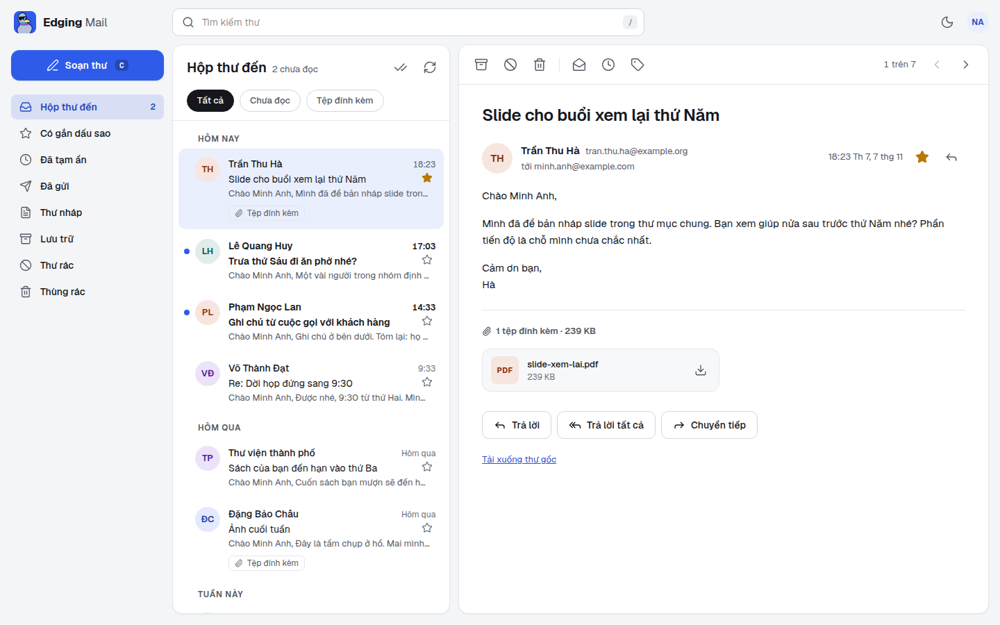
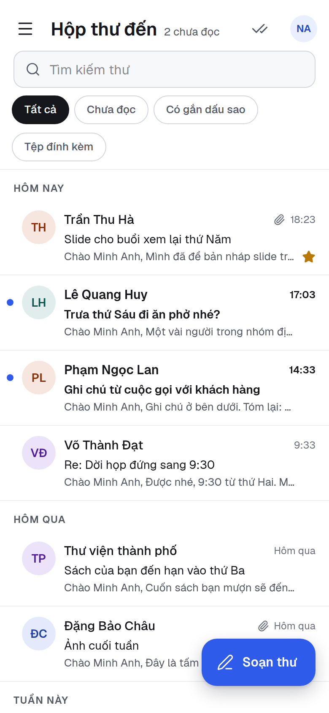
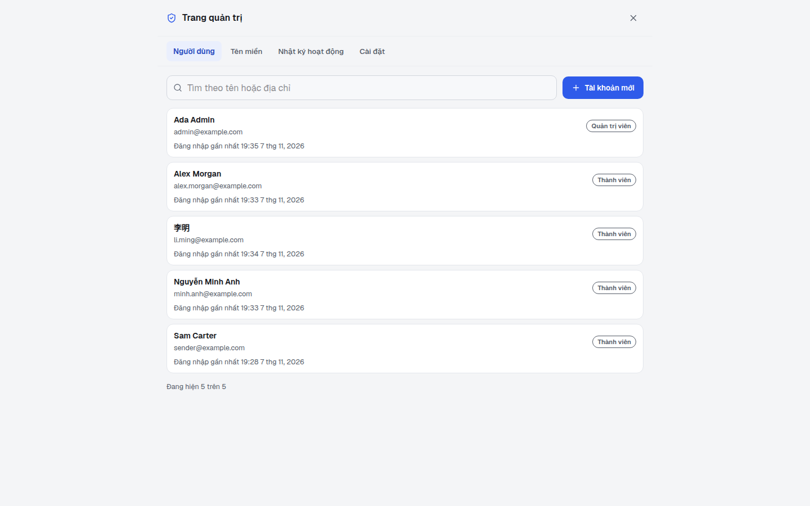
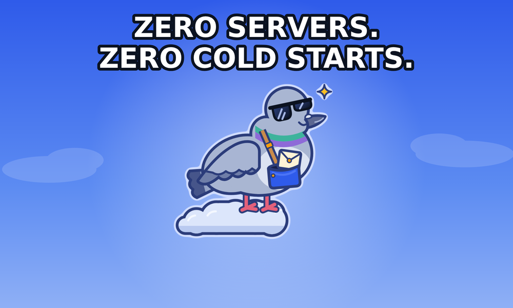
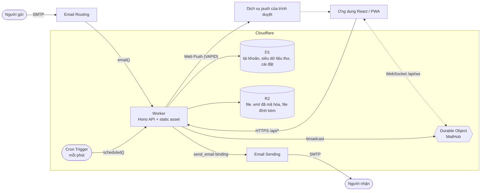

<p align="center">
  <a href="README.md">English</a> ·
  <strong>Tiếng Việt</strong> ·
  <a href="README.zh-CN.md">简体中文</a>
</p>

<p align="center">
  <picture>
    
  </picture>
</p>

<p align="center">
  <strong>Webmail cho công ty, chạy hoàn toàn trên Cloudflare Workers.<br>Không server. Không cold start.</strong>
</p>

> Các trang tài liệu chi tiết trong thư mục docs/ hiện chỉ có bản tiếng Anh.

<p align="center">
  <a href="LICENSE"></a>
  <a href="https://workers.cloudflare.com/"></a>
  
  
  
  
</p>

<p align="center">
  <a href="#bắt-đầu-nhanh">Bắt đầu nhanh</a> ·
  <a href="#tính-năng">Tính năng</a> ·
  <a href="#deploy">Deploy</a> ·
  <a href="#tài-liệu">Tài liệu</a> ·
  <a href="#đóng-góp">Đóng góp</a>
</p>

## Mục lục

- [Edging Mail là gì?](#edging-mail-là-gì)
- [Tính năng](#tính-năng)
- [Ảnh chụp màn hình](#ảnh-chụp-màn-hình)
- [Gặp gỡ Edgar](#gặp-gỡ-edgar)
- [Bắt đầu nhanh](#bắt-đầu-nhanh)
- [Cấu hình](#cấu-hình)
- [Deploy](#deploy)
- [Kiến trúc](#kiến-trúc)
- [Cấu trúc dự án](#cấu-trúc-dự-án)
- [Các script](#các-script)
- [Tài liệu](#tài-liệu)
- [Bảo mật](#bảo-mật)
- [Lộ trình và hạn chế đã biết](#lộ-trình-và-hạn-chế-đã-biết)
- [Đóng góp](#đóng-góp)
- [Lời cảm ơn](#lời-cảm-ơn)
- [Giấy phép](#giấy-phép)

## Edging Mail là gì?

Edging Mail là một webmail do công ty tự host, chạy trên chính tài khoản Cloudflare của công ty. Thư đến qua Cloudflare Email Routing, một Worker phân tích thư, mã hóa bằng
khóa riêng của người nhận rồi lưu lại: các dòng thư vào D1, thư gốc và file đính kèm vào R2. Ứng dụng React, mở trên trình duyệt hoặc cài như một PWA, giải mã thư bằng
mật khẩu của từng người. Thư trả lời được gửi đi qua Cloudflare Email Sending. Không có server, container hay hàng đợi nào để bạn phải vận hành.

Cách một công ty dùng:

1. Quản trị viên thêm các tên miền email của công ty.
2. Quản trị viên tạo hộp thư cho từng người: một địa chỉ và một mật khẩu tạm cho lần đăng nhập đầu, do trình duyệt của quản trị viên tạo ra và có hiệu lực 72 giờ.
3. Mỗi người đăng nhập trên web hoặc trong ứng dụng đã cài, tự đặt mật khẩu của mình, nhận một khóa khôi phục để tự cất giữ, rồi thiết lập đăng nhập hai lớp.

Ứng dụng nằm ở `/app`. Một trang giới thiệu công khai (không bắt buộc) ở `/`, `/en/` và `/zh/` do biến `LANDING_PAGE` điều khiển, xem [Cấu hình](#cấu-hình).

**Phạm vi và giới hạn:**

- **Mỗi lần triển khai phục vụ một công ty.** Không có đăng ký tự do, thanh toán hay dịch vụ multi-tenant: quản trị viên tạo mọi tài khoản.
- **Chỉ có web và HTTP API.** Không có truy cập IMAP, POP3 hay SMTP, nên các ứng dụng mail trên máy tính và điện thoại không thể kết nối tới.
- **Chưa có:** lọc spam hoặc virus, file đính kèm trong thư nháp, sổ địa chỉ, hộp thư dùng chung hoặc nhóm, SSO và passkey. Xem
  [các hạn chế đã biết](#lộ-trình-và-hạn-chế-đã-biết).

## Tính năng

**Email**

- Inbox, Sent, Drafts, Snoozed, Starred, Archive, Spam và Trash, cùng các nhãn do bạn tự tạo.
- Trả lời, trả lời tất cả và chuyển tiếp. Thư trả lời giữ nguyên `In-Reply-To` và `References`, đồng thời dùng chung một `thread_id` khi lưu trữ; danh sách hiển thị
  từng thư riêng lẻ, chưa có chế độ xem theo cuộc hội thoại.
- Tìm kiếm theo người gửi, người nhận hoặc tiêu đề. Tiêu đề được giải mã và so khớp ngay trong trình duyệt, trên số thư đã tải; nội dung thư không được tìm.
- Thư nháp tự động lưu khoảng 1.5 giây sau khi bạn ngừng gõ, và được mã hóa trong trình duyệt trước khi lưu. Snooze một email từ một phút đến 366 ngày: đến hạn, email quay về Inbox ở trạng thái chưa đọc, đúng vị trí
  ban đầu.
- File đính kèm cả khi nhận lẫn khi gửi, và tải xuống file `.eml` gốc.
- Gửi thư thật qua Cloudflare Email Sending, luôn từ địa chỉ chính của người gửi, với tên hiển thị và chữ ký của họ. Gửi lỗi thì báo lỗi, không bao giờ được lưu như đã gửi.

**Tài khoản và trang quản trị**

- Mỗi người một hộp thư trên các tên miền của chính công ty: một địa chỉ chính để đăng nhập và gửi thư, cùng các địa chỉ phụ (alias) chỉ để nhận, không bắt buộc. Cho phép nhiều quản trị viên, và luôn còn ít nhất một quản trị viên đang hoạt động.
- Trang quản trị có ba mục: Users, Domains và Audit log. Quản trị viên tạo tài khoản, khóa hoặc mở lại, đổi vai trò, sửa tên hiển thị, thêm hoặc bỏ địa chỉ phụ, đặt lại đăng nhập hai lớp và xóa tài khoản (có nhập xác nhận). Họ cũng thêm tên miền và kiểm tra DNS của tên miền.
- Mọi thao tác của quản trị viên đều được ghi vào nhật ký (Audit log).
- Các tài khoản tách biệt nhau: mỗi người chỉ truy cập được thư, nhãn, thư nháp, cài đặt và push subscription của chính mình.

**Realtime và PWA**

- Cập nhật trực tiếp qua WebSocket, do một Durable Object hỗ trợ hibernation cho mỗi người đảm nhiệm.
- Cài đặt được như một ứng dụng và mở được khi offline (chỉ app shell; thư không bao giờ bị cache).
- Thông báo Web Push (RFC 8291 và 8292) với khóa VAPID được tạo tự động: không cần cấu hình gì, không cần tài khoản của bên thứ ba. Thông báo chỉ có tên người gửi, không bao giờ có tiêu đề hay nội dung thư. Trên iPhone và iPad, hãy thêm ứng dụng vào Màn hình chính
  (Home Screen) trước.
- Phím tắt (`/` tìm kiếm, `c` soạn thư, `j` và `k` để di chuyển), giao diện sáng và tối, vuốt để archive thư trên điện thoại.

**Ngôn ngữ**

- Ứng dụng có tiếng Việt, tiếng Anh và tiếng Trung giản thể. Mỗi người tự chọn trong Settings (lựa chọn đi theo họ trên mọi thiết bị); các màn hình đăng nhập có bộ chọn ngôn ngữ nhỏ, và quản trị viên đặt ngôn ngữ mặc định của tổ chức. Cách hoạt động và cách sửa bản dịch: [docs/i18n.md](docs/i18n.md).
- Ngày, giờ và số theo ngôn ngữ đã chọn, và thông báo đẩy được viết bằng ngôn ngữ của người nhận.

**Trang giới thiệu công khai**

- Không bắt buộc: một trang do Worker phục vụ tại `/` (tiếng Việt), `/en/` (tiếng Anh) và `/zh/` (tiếng Trung giản thể), kèm `robots.txt` và `sitemap.xml`. Trang chỉ bật khi `LANDING_PAGE` là `on`; nếu không, `/` chuyển thẳng sang `/app`.

**Bảo mật**

- Thư được mã hóa bằng khóa riêng của từng người, và khóa này được mở bằng mật khẩu ngay trong trình duyệt của họ (HPKE, RFC 9180, trên WebCrypto). Mật khẩu không bao giờ rời khỏi trình duyệt.
- Mỗi người nhận một khóa khôi phục ở lần đăng nhập đầu. Ai quên mật khẩu thì tự đặt mật khẩu mới bằng khóa này; không quản trị viên nào đặt lại được mật khẩu của người khác.
- Đăng nhập hai lớp bằng ứng dụng xác thực (TOTP) kèm mã khôi phục chỉ dùng được một lần, mặc định bắt buộc với mọi người.
- Mọi API route, trừ `/api/health` và `/api/auth/*`, đều cần cookie phiên đã ký. Thiếu secret hoặc secret sai định dạng thì đăng nhập bị tắt chứ không bị hạ mức bảo
  mật.
- Giới hạn tốc độ chống brute-force khi đăng nhập, theo từng địa chỉ client và từng tài khoản; đăng xuất sẽ thu hồi các phiên của người đó trên mọi thiết bị.
- Chỉ chấp nhận same-origin: request cross-site và WebSocket handshake cross-origin đều bị từ chối, và không có CORS header nào.
- Email HTML được hiển thị trong frame sandbox, ảnh từ xa bị chặn cho đến khi bạn yêu cầu hiển thị; file đính kèm chỉ được phục vụ dưới dạng tải xuống.

**Trải nghiệm developer**

- TypeScript xuyên suốt, ESLint với bộ rule strict type-checked của typescript-eslint, Prettier, và một cổng kiểm tra duy nhất: `npm run check`.
- `npm test` chạy bộ test tự động (Vitest). Không cần tài khoản Cloudflare, secret hay mạng: các test tự mang theo những thứ chúng cần.
- Schema Drizzle ORM cùng các migration SQL thuần do Wrangler áp dụng.
- Chạy local bằng `wrangler dev`: D1, R2 và Durable Object được giả lập, có endpoint local để đưa vào thư MIME thật, và việc gửi thư được mô phỏng.
- Deploy bằng `npm run deploy`.

## Ảnh chụp màn hình

<p align="center">
  <picture>
    <source media="(prefers-color-scheme: dark)" srcset="docs/assets/screenshot-desktop-dark.vi.png">
    
  </picture>
  
</p>

<p align="center">
  <picture>
    <source media="(prefers-color-scheme: dark)" srcset="docs/assets/screenshot-admin-dark.vi.png">
    
  </picture>
</p>

## Gặp gỡ Edgar

<p align="center">
  
</p>

Edgar là một chú bồ câu đưa thư làm việc ở rìa đám mây (edge), nơi Cloudflare bố trí toàn bộ worker của mình. Anh chàng chuyển thư của bạn giữa SMTP và trình
duyệt theo một bản SLA do chính anh soạn, và chưa một lần phải cold start. Nếu chuyến giao thư nào thất bại, anh sẽ nói thẳng chứ không giả vờ như chưa có chuyện gì.

<p align="center">
  
</p>

## Bắt đầu nhanh

Yêu cầu: Node.js 24 trở lên và npm. Bạn chỉ cần tài khoản Cloudflare khi [deploy](#deploy), và một bản deploy cần gói Workers Paid; phát triển local dùng các dịch vụ giả lập.

```bash
git clone https://github.com/NoahDuongMaster/edging-mail.git
cd edging-mail
npm install
cp .dev.vars.example .dev.vars    # then set APP_PASSWORD (24+ characters), JWT_SECRET (32+ characters) and DATA_KEY (base64 of 32 bytes)
npm run db:migrate:local          # create the local D1 schema
npm run build                     # Wrangler serves the built client from dist/client
npm run worker:dev                # http://localhost:8787
```

`openssl rand -base64 24` và `openssl rand -hex 32` sinh ra giá trị phù hợp cho `APP_PASSWORD` và `JWT_SECRET`, còn `openssl rand -base64 32` dùng cho `DATA_KEY`. Các giá trị
mẫu trong `.dev.vars.example` cố ý để không hợp lệ, nên đăng nhập và Setup sẽ trả về `503` cho đến khi bạn thay chúng. Mở `http://localhost:8787/app`. Khi chưa có tài khoản
nào, màn hình đầu tiên là Setup: nhập `APP_PASSWORD` làm khóa thiết lập (setup key), một địa chỉ admin như `admin@example.com`, tên hiển thị và mật khẩu (từ 16 ký tự trở lên
với quản trị viên), rồi làm theo các màn hình khóa khôi phục và đăng nhập hai lớp.

**Nhận một email thử.** Thư đi vào qua đúng `email()` handler mà Email Routing gọi trên production. `wrangler dev` cung cấp handler này tại `/cdn-cgi/handler/email`.
Hãy dùng địa chỉ admin bạn đã tạo ở Setup làm người nhận:

```bash
cat > hello.eml <<'EOF'
From: Alice <alice@example.org>
To: admin@example.com
Subject: Hello from a real MIME message
Message-ID: <hello-1@example.org>
Content-Type: text/plain; charset=utf-8

Hi! This goes through the same parser and storage as production mail.
EOF

curl -X POST "http://localhost:8787/cdn-cgi/handler/email?from=alice@example.org&to=admin@example.com" --data-binary @hello.eml
```

Thư xuất hiện trong Inbox của tài khoản đó. Địa chỉ không thuộc tài khoản hay alias nào sẽ bị từ chối và không có gì được lưu. Việc gửi thư được mô phỏng ở local: thư được ghi vào `.wrangler/tmp/email/` và không có gì rời khỏi máy bạn. Khi làm frontend với hot reload,
hãy chạy `npm run dev` song song với `npm run worker:dev`; xem [docs/development.md](docs/development.md). `npm test` chạy bộ test tự động.

## Cấu hình

Cấu hình nằm ở `wrangler.jsonc` (binding và các biến thông thường), secret của Worker (`wrangler secret put` trên production, `.dev.vars` ở local) và màn hình
**Settings** trong ứng dụng (của từng người: tên hiển thị, chữ ký và bảo mật tài khoản). Tài liệu tham chiếu đầy đủ: [docs/configuration.md](docs/configuration.md).

| Tên            | Loại   | Bắt buộc | Ràng buộc                                      | Mục đích                                                                                                                                 |
| -------------- | ------ | -------- | ---------------------------------------------- | ---------------------------------------------------------------------------------------------------------------------------------------- |
| `APP_PASSWORD` | secret | có       | ít nhất 24 ký tự                               | Khóa thiết lập (setup key): chỉ dùng cho Setup lần đầu và khôi phục khẩn cấp (break-glass) của quản trị viên. Không ai đăng nhập bằng nó |
| `JWT_SECRET`   | secret | có       | ít nhất 32 ký tự                               | Khóa ngẫu nhiên dùng để ký cookie phiên và thử thách đăng nhập hai lớp                                                                   |
| `DATA_KEY`     | secret | có       | base64 của đúng 32 byte ngẫu nhiên             | Mã hóa những gì Worker phải tự đọc lại: thư đến trước khi chủ hộp thư thiết lập khóa, các TOTP secret của đăng nhập hai lớp              |
| `DEFAULT_FROM` | var    | không    | một địa chỉ email thuần                        | Điền sẵn địa chỉ admin ở màn hình Setup (đồng thời là địa chỉ liên hệ trong các request Web Push)                                        |
| `APP_NAME`     | var    | không    | mặc định `Edging Mail`                         | Tên sản phẩm trong `/api/health` và tiêu đề của một số push notification                                                                 |
| `LANDING_PAGE` | var    | không    | `on`; không đặt hoặc giá trị khác nghĩa là tắt | `on` bật trang giới thiệu công khai ở `/`, `/en/` và `/zh/`                                                                              |

| Binding      | Loại                     | Mục đích                                                                                |
| ------------ | ------------------------ | --------------------------------------------------------------------------------------- |
| `DB`         | Database D1              | Tài khoản, tên miền, nhật ký, siêu dữ liệu thư và phần chữ đã mã hóa, push subscription |
| `BUCKET`     | Bucket R2                | File `.eml` gốc và file đính kèm, đã mã hóa                                             |
| `SEND_EMAIL` | `send_email`             | Gửi thư đi qua Cloudflare Email Sending                                                 |
| `ASSETS`     | Static asset             | Ứng dụng React đã build                                                                 |
| `MAIL_HUB`   | Durable Object namespace | Fan-out WebSocket realtime                                                              |

Thiếu `JWT_SECRET` hoặc `DATA_KEY` (hoặc một trong hai bị thiếu hay sai định dạng) thì đăng nhập và Setup trả về `503`. Thiếu `APP_PASSWORD` (hoặc quá ngắn) thì mọi người vẫn đăng nhập
được, nhưng Setup và khôi phục khẩn cấp trả về `503`. `DATA_KEY` không được trùng giá trị với `JWT_SECRET` hay `APP_PASSWORD`. Web Push không cần cấu hình: cặp khóa được tạo
ở lần dùng đầu tiên và lưu trong database, được mã hóa sao cho riêng một bản sao database thì không ký được push (chi tiết trong [docs/configuration.md](docs/configuration.md)).

**`DATA_KEY`** là một secret của Worker, không phải var: base64 của đúng 32 byte ngẫu nhiên. Tạo bằng `openssl rand -base64 32`, rồi chạy `npx wrangler secret put DATA_KEY`.
Hãy đặt nó **trước khi** deploy phiên bản này. Nếu mất nó, thư mà máy chủ đã mã hóa nhưng chưa được bọc lại bằng khóa của chủ hộp thư sẽ không đọc được nữa, và các TOTP secret đã lưu sẽ hỏng, nên hãy sao lưu nó giống như cách bạn giữ D1 id.

**`LANDING_PAGE`**: `wrangler.jsonc` trong repository này đặt giá trị `on`, vì bản deploy của maintainer có trang giới thiệu công khai ở `/`, `/en/` và `/zh/`, kèm `robots.txt` và
`sitemap.xml`. Nếu fork, hãy để trống hoặc đặt `off`, trừ khi bạn muốn có trang công khai. Khi chưa đặt hoặc là `off`: `/` chuyển thẳng sang `/app`, `/en/`, `/zh/` và `/sitemap.xml`
trả về `404`, còn `robots.txt` cấm toàn bộ. Chỉ đúng giá trị `on` (bỏ khoảng trắng hai đầu, không phân biệt hoa thường) mới bật trang giới thiệu.

## Deploy

Một bản deploy cần gói Workers Paid. Bước kiểm tra mật khẩu khi đăng nhập tốn khoảng 40 đến 50 ms thời gian CPU (PBKDF2), vượt mức 10 ms của gói Free, và Cloudflare Email Sending
cũng cần gói trả phí để gửi tới người nhận bất kỳ.

`wrangler.jsonc` trong repository này chứa các giá trị deploy của maintainer (hostname của họ, một D1 id, `DEFAULT_FROM`, và `LANDING_PAGE` đặt là `on`). Nếu fork, bạn phải
thay chúng trước. Hướng dẫn đầy đủ, gồm cả DNS và Email Routing, nằm trong [docs/deployment.md](docs/deployment.md). Bản fork cần đổi:

| Khóa trong `wrangler.jsonc`   | Bản fork đổi thành                                                                              |
| ----------------------------- | ----------------------------------------------------------------------------------------------- |
| `routes[0].pattern`           | một hostname thuộc một zone trong tài khoản Cloudflare của bạn                                  |
| `d1_databases[0].database_id` | id do `wrangler d1 create` in ra                                                                |
| `vars.DEFAULT_FROM`           | không bắt buộc: một địa chỉ trên tên miền của bạn (dùng để điền sẵn ở Setup)                    |
| `vars.LANDING_PAGE`           | để trống hoặc `off`, trừ khi bạn muốn có trang giới thiệu công khai (xem [Cấu hình](#cấu-hình)) |

Tóm tắt:

1. **Custom domain.** Đặt `routes[0].pattern` thành một hostname thuộc một zone trong tài khoản Cloudflare của bạn. `workers_dev` và `preview_urls` đang tắt, nên ứng dụng
   chỉ truy cập được qua hostname đó.
2. **Tạo nơi lưu trữ**, rồi dán `database_id` được in ra vào `d1_databases[0].database_id`:
   ```bash
   npx wrangler d1 create edging_mail_db
   npx wrangler r2 bucket create edging-mail-storage
   ```
3. **Migrate và đặt secret**, rồi deploy:
   ```bash
   npm run db:migrate:remote
   npx wrangler secret put APP_PASSWORD
   npx wrangler secret put JWT_SECRET
   npx wrangler secret put DATA_KEY
   npm run deploy
   ```
   `DATA_KEY` là base64 của 32 byte ngẫu nhiên (`openssl rand -base64 32`). Hãy đặt nó trước lần deploy đầu tiên của phiên bản này.
4. **Tạo admin đầu tiên.** Mở `/app` trên hostname của bạn. Khi chưa có tài khoản nào, trang hiện màn hình Setup: nhập khóa thiết lập (`APP_PASSWORD`), địa chỉ của admin, tên hiển thị
   và mật khẩu dài ít nhất 16 ký tự, rồi làm theo các màn hình khóa khôi phục và đăng nhập hai lớp. Setup tự thêm tên miền của địa chỉ đó. Sau đó, bạn dùng trang quản trị
   (Domains, Users) để thêm các tên miền còn lại và tạo hộp thư cho từng người.
5. **Nhận thư.** Trong dashboard (Compute → Email Service → Email Routing), onboard từng tên miền của công ty và đặt catch-all rule thành action _Send to a Worker_ với destination
   `edging-mail`. Worker chuyển thư theo địa chỉ người nhận và từ chối những địa chỉ không thuộc tài khoản hay alias nào. Bật Email Routing trên root domain (apex) thì Email
   Routing sẽ chiếm quyền quản lý các bản ghi MX của domain đó; bản deploy của maintainer chạy theo cách này. Nếu một nhà cung cấp mail khác cần giữ các bản ghi MX, một lựa chọn
   là forward từ nhà cung cấp đó sang một subdomain dùng cho routing. Email Routing không có catch-all trên subdomain, nên mỗi địa chỉ ở đó cần một rule riêng. Mục Domains của
   trang quản trị có chức năng kiểm tra DNS, cho biết việc nhận và gửi thư đã được thiết lập chưa.
6. **Gửi thư.** Onboard domain trong mục Email Sending. Dịch vụ này đang ở giai đoạn beta, và muốn gửi tới người nhận bất kỳ thì cần gói Workers Paid.

**Workers Builds (deploy khi git push):** để mỗi lần push đều tự migrate rồi deploy, hãy làm hai việc một lần trong dashboard Cloudflare: thêm quyền **Account → D1 → Edit**
cho API token của lần build (token mặc định không có quyền D1) và đặt deploy command thành `npm run db:migrate:remote && npx wrangler deploy`. Nếu không, hãy tự làm
bước 2 và 3, và migrate lại trước khi push một thay đổi có thêm file vào `drizzle/`.

**Nâng cấp bản cài đặt có từ trước khi có tài khoản:** sao lưu D1, đặt `DATA_KEY` trước khi deploy phiên bản này, rồi deploy và mở `/app`. Setup dùng `APP_PASSWORD` cũ làm khóa
thiết lập, và mọi người đăng nhập lại một lần. Các bước nằm trong [docs/deployment.md](docs/deployment.md). Thư cũ được chuyển sang định dạng mã hóa bởi một tác vụ nền. Các bản sao được tạo trước
tác vụ đó (bản sao lưu bạn đã làm, D1 Time Travel, vùng trống bên trong file cơ sở dữ liệu) vẫn có thể còn giữ thư ở dạng chưa mã hóa cho đến khi chúng bị xóa hoặc hết hạn; xem
bước 6 trong [docs/deployment.md](docs/deployment.md).

## Kiến trúc



| Tầng    | Công nghệ                                                                          |
| ------- | ---------------------------------------------------------------------------------- |
| Runtime | Cloudflare Workers, Durable Objects, Cron Triggers                                 |
| API     | Hono 4, TypeScript 7                                                               |
| Dữ liệu | D1 (SQLite) qua Drizzle ORM; R2 cho blob                                           |
| Thư đến | Cloudflare Email Routing, `postal-mime`                                            |
| Thư đi  | Cloudflare Email Sending (binding `send_email`), `mimetext` để tạo bản sao lưu trữ |
| Client  | React 19, Vite 8, Tailwind CSS 4, TanStack Query 5, icon Lucide                    |
| Push    | Web Push với VAPID, RFC 8291 và 8292 được triển khai trên WebCrypto                |
| Mã hóa  | WebCrypto (AES-256-GCM, PBKDF2, HKDF) và HPKE (RFC 9180) qua `@hpke/core`          |
| Công cụ | Wrangler 4, drizzle-kit, Vitest 4, ESLint 9 cùng typescript-eslint, Prettier 3     |

Cách các thành phần khớp với nhau, kèm luồng dữ liệu và mô hình dữ liệu, nằm trong [docs/architecture.md](docs/architecture.md).

## Cấu trúc dự án

```text
.
├── src/
│   ├── worker/              # Cloudflare Worker
│   │   ├── index.ts         # fetch, email() and scheduled() handlers, mail routes
│   │   ├── auth/            # sign-in, sessions, Setup, two-factor, recovery key
│   │   ├── mail/            # message, send and settings routes
│   │   ├── inbound.ts       # works out whose mail an incoming message is
│   │   ├── drafts.ts        # draft autosave API
│   │   ├── push.ts          # Web Push (RFC 8291/8292) and subscription API
│   │   ├── realtime.ts      # MailHub Durable Object and /api/ws
│   │   ├── notify.ts        # new-mail broadcast and push
│   │   ├── snooze.ts        # returns due snoozed mail (cron)
│   │   ├── site/            # landing page, robots.txt, sitemap.xml, the /app shell
│   │   ├── services/        # email-parser.ts (inbound), email-sender.ts (outbound)
│   │   └── db/              # Drizzle schema and D1 client
│   ├── shared/crypto/       # key derivation, key wrapping, message encryption (the Worker imports only its seal-only entry)
│   └── client/              # React app
│       ├── App.tsx          # layout and mailbox state
│       ├── components/      # sidebar, list, reader, compose, settings, mail frame
│       └── lib/             # API client, TanStack Query hooks, realtime, push, drafts
├── test/                    # automated tests (npm test)
├── public/                  # service worker, manifest, icons, _headers
├── drizzle/                 # SQL migrations and drizzle-kit snapshots
├── docs/                    # documentation (assets/ holds the images)
├── wrangler.jsonc           # bindings, route, cron, variables
├── .dev.vars.example        # template for local secrets
└── CONTRIBUTING.md
```

## Các script

| Script                      | Chức năng                                                                  |
| --------------------------- | -------------------------------------------------------------------------- |
| `npm run worker:dev`        | `wrangler dev`: Worker, D1, R2 và asset tại `localhost:8787`               |
| `npm run dev`               | Vite dev server tại `localhost:3000`, proxy `/api` tới Worker              |
| `npm run build`             | `tsc -b && vite build`: kiểm tra kiểu, rồi bundle vào `dist/client`        |
| `npm run preview`           | `vite preview`: chạy bản client đã build                                   |
| `npm run deploy`            | `npm run build && npm run db:migrate:remote && wrangler deploy`            |
| `npm run db:generate`       | `drizzle-kit generate`: tạo migration mới từ `schema.ts`                   |
| `npm run db:migrate:local`  | Áp dụng các migration đang chờ vào D1 local                                |
| `npm run db:migrate:remote` | Áp dụng các migration đang chờ vào D1 production                           |
| `npm run lint`              | `eslint .` (`lint:fix` thêm `--fix`)                                       |
| `npm test`                  | `vitest run`: bộ test tự động                                              |
| `npm run format`            | `prettier --write .` (`format:check` chỉ kiểm tra)                         |
| `npm run check`             | `tsc -b`, lint và kiểm tra format: cổng kiểm tra bắt buộc cho mọi thay đổi |

## Tài liệu

| Trang                                         | Nội dung                                                                         |
| --------------------------------------------- | -------------------------------------------------------------------------------- |
| [Kiến trúc](docs/architecture.md)             | Các thành phần, luồng dữ liệu, mô hình dữ liệu, ghi chú thiết kế                 |
| [Cấu hình](docs/configuration.md)             | Biến, secret, binding, `wrangler.jsonc`, những gì một bản fork cần đổi           |
| [Deploy](docs/deployment.md)                  | Thiết lập production từng bước, tên miền, Email Routing, Email Sending, nâng cấp |
| [Tính năng email](docs/mail-features.md)      | Gửi thư, trả lời, tìm kiếm, thread, thư nháp, snooze                             |
| [Realtime, Push và PWA](docs/pwa-and-push.md) | Sự kiện WebSocket, Web Push, cài đặt ứng dụng                                    |
| [Bảo mật](docs/security.md)                   | Mã hóa, đăng nhập, đăng nhập hai lớp, quản trị viên, sandbox cho email, giới hạn |
| [HTTP API](docs/api.md)                       | Mọi route cùng xác thực, body, response và lỗi                                   |
| [Phát triển](docs/development.md)             | Thiết lập local, migration, test, kiểm tra, quy ước commit                       |

## Bảo mật

Thư của mỗi người được mã hóa bằng khóa riêng của họ, và chỉ mật khẩu (hoặc khóa khôi phục) của họ mới mở được khóa này, ngay trong trình duyệt của họ. Những điều dưới đây là các
khẳng định của Edging Mail. Chi tiết và các giới hạn nằm trong [docs/security.md](docs/security.md).

### Mã hóa

- **Lưu trữ được mã hóa.** Tiêu đề, đoạn trích, nội dung thư, file đính kèm (nội dung, tên file, loại file) và bản gốc của thư được lưu dưới dạng mã hóa bằng khóa của chủ hộp thư. Máy chủ, quản trị viên và bất kỳ ai đọc được cơ sở dữ liệu và kho lưu trữ file đều không đọc được chúng nếu không có mật khẩu hoặc khóa khôi phục của chủ hộp thư. Ngoại lệ: thư đến trước khi chủ hộp thư thiết lập khóa chỉ được bảo vệ bằng một secret của máy chủ cho đến khi chủ hộp thư đăng nhập; tài khoản mới trước lần đăng nhập đầu tiên của chủ hộp thư; mật khẩu yếu có thể bị dò ra ngoại tuyến (offline) bởi người giữ một bản sao dữ liệu đã lưu; bất kỳ ai giữ khóa khôi phục của người đó.
- **Đầu cuối (end-to-end).** Thư giữa những người trên cùng bản triển khai này được mã hóa trong trình duyệt của người gửi, bằng khóa của người nhận. Khóa do chính máy chủ này phân phối và không được kiểm chứng độc lập, còn mã của ứng dụng cũng do máy chủ đó gửi tới.
- **Thư bên ngoài là email thông thường.** Thư gửi tới hoặc nhận từ địa chỉ bên ngoài đi giữa các máy chủ mail dưới dạng email thường. Edging Mail thấy thư lúc thư đến hoặc đi, rồi mới lưu lại ở dạng mã hóa.
- **Không được mã hóa (siêu dữ liệu):** địa chỉ và tên hiển thị, ngày giờ, dung lượng (của thư, của file đính kèm và của bản mã hóa đã lưu), số lượng file đính kèm, thư mục, cờ (flag), nhãn, các header `Message-ID`, `References` và `In-Reply-To` cùng mã thread, chữ ký trong phần cài đặt của từng người, và những địa chỉ phụ mà quản trị viên đã thêm vào một tài khoản.
- Mật khẩu không bao giờ rời khỏi trình duyệt. Khi bạn đang đăng nhập, trình duyệt giữ khóa đã mở ở dạng non-extractable; "non-extractable" chỉ có nghĩa là JavaScript không export được khóa đó, còn khóa vẫn được lưu trong hồ sơ trình duyệt (browser profile) trên thiết bị.

### Quản trị viên, mật khẩu và khôi phục

- **Quản trị viên.** Không quản trị viên nào đặt lại được mật khẩu của người khác, và trong Edging Mail không có cách nào để quản trị viên mở thư của người đã đăng nhập và thiết lập khóa mã hóa của mình. Quản trị viên tạo tài khoản biết mật khẩu tạm của tài khoản đó cho tới khi chủ hộp thư đăng nhập lần đầu, và thư đến trước lúc đó chỉ được bảo vệ bằng khóa của máy chủ. Vì vậy chỉ nên tạo tài khoản khi người đó sẵn sàng đăng nhập. Quản trị viên có thể khóa hoặc xóa tài khoản, tạo lại một địa chỉ, thêm hoặc chuyển địa chỉ phụ và đặt lại đăng nhập hai lớp; mọi thay đổi như vậy đều được ghi vào nhật ký, và người đó được báo khi đăng nhập hai lớp của họ bị đặt lại. Ai nắm khóa thiết lập đều có thể khôi phục quyền vào trang quản trị cho một quản trị viên bằng một khóa mã hóa mới (thư cũ của quản trị viên đó vẫn bị khóa). Bất kỳ ai nắm quyền tài khoản Cloudflare hoặc mã đã triển khai đều có thể thay đổi phần mềm.
- Mỗi người nhận một khóa khôi phục ở lần đăng nhập đầu. Khóa chỉ hiện một lần, nên hãy cất ở nơi an toàn. Ai quên mật khẩu thì tự đặt mật khẩu mới bằng khóa này (mục Forgot password ở màn hình đăng nhập) và giữ nguyên thư. Thao tác này làm mọi phiên đăng nhập của người đó hết hiệu lực, và được ghi vào nhật ký (audit log) cùng lịch sử đăng nhập của người đó.
- Không ai, kể cả quản trị viên, khôi phục được thư nếu thiếu mật khẩu hoặc khóa khôi phục. Mất cả hai thì thư cũ không ai mở được nữa: quản trị viên chỉ có thể xóa tài khoản đó và tạo một hộp thư mới.
- Đổi mật khẩu không phải là xoay khóa (key rotation): vẫn là khóa cũ, chỉ được bảo vệ bằng mật khẩu mới, nên khóa dùng để mã hóa thư không đổi. Xoay khóa nằm trong kế hoạch của v1.1.
- Một rủi ro còn lại: quản trị viên tạo tài khoản biết mật khẩu tạm của tài khoản đó cho đến lần đăng nhập đầu tiên, nên một quản trị viên có thể đăng nhập trước, thiết lập khóa rồi đọc thư gửi tới địa chỉ đó từ lúc ấy. Thư đã có từ trước thì không bị lộ. Lần đăng nhập đầu tiên được ghi lại, và thành viên thật sẽ thấy nó trong lịch sử đăng nhập của mình.

### Đăng nhập và đọc thư

- Đăng nhập hai lớp bằng ứng dụng xác thực (TOTP) kèm mã khôi phục chỉ dùng được một lần, mặc định bắt buộc với mọi người; quản trị viên thì luôn phải bật. Quản trị viên có thể đặt lại đăng nhập hai lớp của một người, ví dụ khi họ mất điện thoại; thao tác này được ghi nhật ký và làm các phiên đăng nhập của người đó hết hiệu lực.
- Nhập sai mật khẩu nhiều lần liền thì đăng nhập bị khóa một lúc. Khi đăng xuất, đổi mật khẩu hoặc đặt lại mật khẩu bằng khóa khôi phục, các phiên đăng nhập cũ hết hiệu lực.
- Mỗi người xem được các lần đăng nhập gần đây của mình, còn các sự kiện bảo mật được ghi vào nhật ký của quản trị viên.
- Thư HTML mở trong khung cách ly (sandbox). Ảnh từ bên ngoài chỉ tải khi người đọc bấm cho phép.

Mã hóa bảo vệ thư đang lưu. Nó không ngăn được người kiểm soát tài khoản Cloudflare hoặc mã đang chạy sửa phần mềm, nên chỉ giao quyền này cho người thật sự tin cậy.

**Báo cáo lỗ hổng bảo mật một cách riêng tư:** mở tab **Security** của repository này và chọn **Report a vulnerability**. Vui lòng không tạo issue công khai cho lỗi có
thể bị khai thác. Đừng bao giờ commit secret: `.dev.vars` và `.env*` đã nằm trong gitignore.

## Lộ trình và hạn chế đã biết

Dẫn xuất khóa bằng Argon2id cho quản trị viên và xoay khóa (key rotation) được lên kế hoạch cho v1.1.

Các hạn chế hiện tại:

- **Ảnh qua `http://` không bao giờ được tải.** Email HTML chỉ có thể hiển thị ảnh `https`, và chỉ sau khi bạn bấm _Show images_.
- **Trên điện thoại chưa có chức năng đánh dấu tất cả là đã đọc.** Nút này nằm ở phần đầu danh sách trên desktop.
- **Cả bản deploy cần gói Workers Paid**, không chỉ việc gửi thư: bước kiểm tra mật khẩu khi đăng nhập tốn khoảng 40 đến 50 ms thời gian CPU, nhiều hơn mức 10 ms của gói Free.
- **Email Sending đang ở giai đoạn beta** và cần gói Workers Paid để gửi tới người nhận bất kỳ; hạn mức mỗi ngày khởi đầu khá thấp trên các tài khoản mới.
- **Nhận thư ở root domain đòi hỏi Email Routing trên chính domain đó.** Email Routing sẽ chiếm quyền quản lý các bản ghi MX của domain, và bản deploy của maintainer chạy theo cách này. Forward từ một nhà cung cấp mail khác sang một subdomain dùng cho routing là một lựa chọn cho những công ty không thể chuyển MX; luồng forward này chưa được chạy
  thử từ đầu đến cuối.
- **Tìm kiếm không đọc nội dung thư**, vì nội dung được mã hóa. Tiêu đề được giải mã và so khớp trong trình duyệt, trên số thư đã tải.
- **Thư từ trước lần nâng cấp có thể còn tồn tại ở dạng chưa mã hóa trong các bản sao cũ.** Việc chuyển đổi mã hóa thư trong cơ sở dữ liệu đang chạy và trong R2 (không còn đối tượng chưa mã hóa nào), nhưng bản sao lưu bạn đã làm, D1 Time Travel (30 ngày trên Workers Paid) và vùng trống của file cơ sở dữ liệu vẫn có thể còn giữ bản chưa mã hóa. Chỉ có xóa các bản sao của bạn và chờ các bản sao của nền tảng hết hạn mới loại bỏ được nó. Thư nhận sau Setup được mã hóa ngay khi đến.
- **Không lọc spam hoặc virus, không có file đính kèm trong thư nháp, không có sổ địa chỉ, không có chế độ xem theo cuộc hội thoại.**
- **Email rất lớn** có thể không lưu được: phần nội dung nằm trong D1, vốn giới hạn mỗi dòng tối đa 2 MB. Đây là dự đoán dựa trên giới hạn đã được tài liệu hóa, chưa được kiểm thử.
- **Google Fonts.** Trang tải font Geist từ Google, nên trình duyệt sẽ kết nối tới Google khi ứng dụng được mở.
- Đã kiểm thử trên Chromium và Firefox; các bài kiểm thử đáp án biết trước (known-answer test) của phần mã hóa cũng chạy trên một engine WebKit (WPE); chưa được xác minh trên Safari hay iPhone thật.
- Các bài kiểm thử ở đây không bao phủ những phần sau, nên hãy kiểm tra thử ngay sau lần deploy đầu tiên: hành vi thật của Cloudflare (Email Routing và Email Sending, các dịch vụ push thật, giới hạn thật của D1 và R2, thời gian CPU và chi phí tính theo từng request); https thật (cookie phiên `__Host-`, HSTS, mức tối thiểu 400 ms của bước đăng nhập qua một kết nối thật, việc đóng WebSocket khi phiên kết thúc); và Safari, iPhone thật. Danh sách kiểm tra mười phút nằm trong [docs/deployment.md](docs/deployment.md#after-the-first-deploy-a-ten-minute-check).

Một số ý tưởng đáng để đóng góp: font tự host, đánh dấu tất cả đã đọc trên điện thoại, file đính kèm trong thư nháp.

## Đóng góp

Chào đón mọi issue và pull request. Hãy đọc [CONTRIBUTING.md](CONTRIBUTING.md) trước: trong đó có hướng dẫn thiết lập, `npm run check`, quy ước commit và cách đề xuất
một thay đổi.

## Lời cảm ơn

Được xây dựng trên nền tảng dành cho developer của Cloudflare cùng tài liệu của nền tảng này, [Hono](https://hono.dev), [Drizzle ORM](https://orm.drizzle.team),
[React](https://react.dev), [Vite](https://vite.dev), [Tailwind CSS](https://tailwindcss.com), [TanStack Query](https://tanstack.com/query), [Lucide](https://lucide.dev),
[postal-mime](https://github.com/postalsys/postal-mime) và [mimetext](https://github.com/muratgozel/MIMEText). Font giao diện là Geist của Vercel. Badge lấy từ
[Shields.io](https://shields.io). Bố cục README tham khảo [standard-readme](https://github.com/RichardLitt/standard-readme) và
[Make a README](https://www.makeareadme.com/).

## Giấy phép

[MIT](LICENSE) © Noah Duong

Phần mềm và dữ liệu của bên thứ ba mà dự án đóng gói hoặc sử dụng, kèm giấy phép của từng thành phần, được liệt kê trong [NOTICE](NOTICE). Dự án không đóng gói tệp phông chữ nào.
