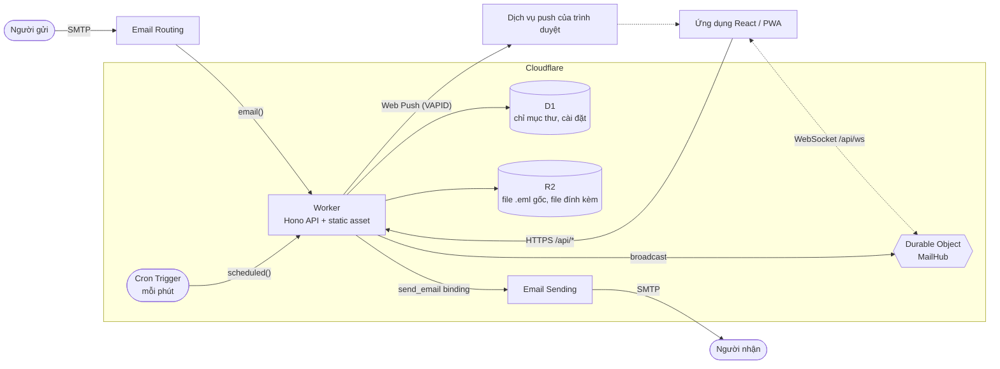

<p align="center">
  <a href="README.md">English</a> ·
  <strong>Tiếng Việt</strong> ·
  <a href="README.zh-CN.md">简体中文</a>
</p>

<p align="center">
  <picture>
    
  </picture>
</p>

<p align="center">
  <strong>Webmail một người dùng, chạy hoàn toàn trên Cloudflare Workers.<br>Không server. Không cold start. Không tốn một đồng để bắt đầu.</strong>
</p>

> Các trang tài liệu chi tiết trong thư mục docs/ hiện chỉ có bản tiếng Anh.

<p align="center">
  <a href="LICENSE"></a>
  <a href="https://workers.cloudflare.com/"></a>
  
  
  
  
</p>

<p align="center">
  <a href="#bắt-đầu-nhanh">Bắt đầu nhanh</a> ·
  <a href="#tính-năng">Tính năng</a> ·
  <a href="#deploy">Deploy</a> ·
  <a href="#tài-liệu">Tài liệu</a> ·
  <a href="#đóng-góp">Đóng góp</a>
</p>

## Mục lục

- [Edging Mail là gì?](#edging-mail-là-gì)
- [Tính năng](#tính-năng)
- [Ảnh chụp màn hình](#ảnh-chụp-màn-hình)
- [Gặp gỡ Edgar](#gặp-gỡ-edgar)
- [Bắt đầu nhanh](#bắt-đầu-nhanh)
- [Cấu hình](#cấu-hình)
- [Deploy](#deploy)
- [Kiến trúc](#kiến-trúc)
- [Cấu trúc dự án](#cấu-trúc-dự-án)
- [Các script](#các-script)
- [Tài liệu](#tài-liệu)
- [Bảo mật](#bảo-mật)
- [Lộ trình và hạn chế đã biết](#lộ-trình-và-hạn-chế-đã-biết)
- [Đóng góp](#đóng-góp)
- [Lời cảm ơn](#lời-cảm-ơn)
- [Giấy phép](#giấy-phép)

## Edging Mail là gì?

Edging Mail là một webmail do bạn tự host, chạy trên chính tài khoản Cloudflare của bạn. Thư đến qua Cloudflare Email Routing, một Worker phân tích thư rồi lưu chỉ mục
vào D1, còn thư gốc và file đính kèm thì lưu vào R2. Một ứng dụng React đứng sau một mật khẩu duy nhất sẽ hiển thị thư. Thư trả lời được gửi đi qua Cloudflare Email
Sending. Không có server, container hay hàng đợi nào để bạn phải vận hành.

**Phạm vi và giới hạn:**

- **Một người dùng, có chủ đích.** Một mật khẩu, một chủ hộp thư, một bộ cài đặt. Đây không phải dịch vụ multi-tenant: không có tài khoản, chia sẻ hay trang quản trị.
- **Chỉ có web và HTTP API.** Không có truy cập IMAP, POP3 hay SMTP, nên các ứng dụng mail trên máy tính và điện thoại không thể kết nối tới.
- **Chưa có:** nhiều người dùng, lọc spam hoặc virus, xác thực hai yếu tố, file đính kèm trong thư nháp, sổ địa chỉ, test tự động. Xem
  [các hạn chế đã biết](#lộ-trình-và-hạn-chế-đã-biết).

## Tính năng

**Email**

- Inbox, Sent, Drafts, Snoozed, Starred, Archive, Spam và Trash, cùng các nhãn do bạn tự tạo.
- Trả lời, trả lời tất cả và chuyển tiếp. Thư trả lời giữ nguyên `In-Reply-To` và `References`, đồng thời dùng chung một `thread_id` khi lưu trữ; danh sách hiển thị
  từng thư riêng lẻ, chưa có chế độ xem theo cuộc hội thoại.
- Tìm kiếm theo tiêu đề, người gửi, người nhận và đoạn trích.
- Thư nháp tự động lưu khoảng 1.5 giây sau khi bạn ngừng gõ. Snooze một email từ một phút đến 366 ngày: đến hạn, email quay về Inbox ở trạng thái chưa đọc, đúng vị trí
  ban đầu.
- File đính kèm cả khi nhận lẫn khi gửi, và tải xuống file `.eml` gốc.
- Gửi thư thật qua Cloudflare Email Sending, với tên hiển thị, chữ ký và địa chỉ người gửi của bạn. Gửi lỗi thì báo lỗi, không bao giờ được lưu như đã gửi.

**Realtime và PWA**

- Cập nhật trực tiếp qua WebSocket, do một Durable Object hỗ trợ hibernation đảm nhiệm.
- Cài đặt được như một ứng dụng và mở được khi offline (chỉ app shell; thư không bao giờ bị cache).
- Thông báo Web Push (RFC 8291 và 8292) với khóa VAPID được tạo tự động: không cần cấu hình gì, không cần tài khoản của bên thứ ba. Trên iPhone và iPad, hãy thêm ứng dụng vào Màn hình chính
  (Home Screen) trước.
- Phím tắt (`/` tìm kiếm, `c` soạn thư, `j` và `k` để di chuyển), giao diện sáng và tối, vuốt để archive thư trên điện thoại.

**Bảo mật**

- Mọi API route, trừ `/api/health` và `/api/auth/*`, đều cần cookie phiên đã ký. Thiếu secret hoặc secret quá ngắn thì đăng nhập bị vô hiệu hóa chứ không bị hạ mức bảo
  mật.
- Giới hạn tốc độ chống brute-force khi đăng nhập; đăng xuất sẽ thu hồi mọi phiên đã cấp trước đó.
- Chỉ chấp nhận same-origin: request cross-site và WebSocket handshake cross-origin đều bị từ chối, và không có CORS header nào.
- Email HTML được hiển thị trong frame sandbox, ảnh từ xa bị chặn cho đến khi bạn yêu cầu hiển thị; file đính kèm chỉ được phục vụ dưới dạng tải xuống.

**Trải nghiệm developer**

- TypeScript xuyên suốt, ESLint với bộ rule strict type-checked của typescript-eslint, Prettier, và một cổng kiểm tra duy nhất: `npm run check`.
- Schema Drizzle ORM cùng các migration SQL thuần do Wrangler áp dụng.
- Chạy local bằng `wrangler dev`: D1, R2 và Durable Object được giả lập, có endpoint local để đưa vào thư MIME thật, và việc gửi thư được mô phỏng.
- Deploy bằng `npm run deploy`.

## Ảnh chụp màn hình

<p align="center">
  <picture>
    <source media="(prefers-color-scheme: dark)" srcset="docs/assets/screenshot-desktop-dark.png">
    
  </picture>
  
</p>

## Gặp gỡ Edgar

<p align="center">
  
</p>

Edgar là một chú bồ câu đưa thư làm việc ở rìa đám mây (edge), nơi Cloudflare bố trí toàn bộ worker của mình. Anh chàng chuyển thư của bạn giữa SMTP và trình
duyệt theo một bản SLA do chính anh soạn, và chưa một lần phải cold start. Nếu chuyến giao thư nào thất bại, anh sẽ nói thẳng chứ không giả vờ như chưa có chuyện gì.

<p align="center">
  
</p>

## Bắt đầu nhanh

Yêu cầu: Node.js 24 trở lên và npm. Bạn chỉ cần tài khoản Cloudflare khi [deploy](#deploy); phát triển local dùng các dịch vụ giả lập.

```bash
git clone https://github.com/NoahDuongMaster/edging-mail.git
cd edging-mail
npm install
cp .dev.vars.example .dev.vars    # then set APP_PASSWORD (12+ characters) and JWT_SECRET (32+ characters)
npm run db:migrate:local          # create the local D1 schema
npm run build                     # Wrangler serves the built client from dist/client
npm run worker:dev                # http://localhost:8787
```

`openssl rand -base64 24` và `openssl rand -hex 32` sinh ra giá trị phù hợp cho hai secret này. Các giá trị mẫu trong `.dev.vars.example` cố ý để quá ngắn, nên đăng nhập
sẽ trả về `503` cho đến khi bạn thay chúng. Mở `http://localhost:8787` và đăng nhập bằng `APP_PASSWORD`.

**Nhận một email thử.** Thư đi vào qua đúng `email()` handler mà Email Routing gọi trên production. `wrangler dev` cung cấp handler này tại `/cdn-cgi/handler/email`:

```bash
cat > hello.eml <<'EOF'
From: Alice <alice@example.org>
To: you@example.com
Subject: Hello from a real MIME message
Message-ID: <hello-1@example.org>
Content-Type: text/plain; charset=utf-8

Hi! This goes through the same parser and storage as production mail.
EOF

curl -X POST "http://localhost:8787/cdn-cgi/handler/email?from=alice@example.org&to=you@example.com" --data-binary @hello.eml
```

Thư xuất hiện trong Inbox. Việc gửi thư được mô phỏng ở local: thư được ghi vào `.wrangler/tmp/email/` và không có gì rời khỏi máy bạn. Khi làm frontend với hot reload,
hãy chạy `npm run dev` song song với `npm run worker:dev`; xem [docs/development.md](docs/development.md).

## Cấu hình

Cấu hình nằm ở `wrangler.jsonc` (binding và các biến thông thường), secret của Worker (`wrangler secret put` trên production, `.dev.vars` ở local) và màn hình
**Settings** trong ứng dụng (tên hiển thị, chữ ký, địa chỉ người gửi). Tài liệu tham chiếu đầy đủ: [docs/configuration.md](docs/configuration.md).

| Tên            | Loại   | Bắt buộc | Ràng buộc               | Mục đích                                                                 |
| -------------- | ------ | -------- | ----------------------- | ------------------------------------------------------------------------ |
| `APP_PASSWORD` | secret | có       | ít nhất 12 ký tự        | Mật khẩu bạn nhập ở màn hình đăng nhập                                   |
| `JWT_SECRET`   | secret | có       | ít nhất 32 ký tự        | Khóa ngẫu nhiên dùng để ký cookie phiên                                  |
| `DEFAULT_FROM` | var    | không    | một địa chỉ email thuần | Địa chỉ người gửi dùng cho đến khi bạn lưu một địa chỉ trong Settings    |
| `APP_NAME`     | var    | không    | mặc định `Edging Mail`  | Tên sản phẩm trong `/api/health` và tiêu đề của một số push notification |

| Binding      | Loại                     | Mục đích                                |
| ------------ | ------------------------ | --------------------------------------- |
| `DB`         | Database D1              | Chỉ mục thư, cài đặt, push subscription |
| `BUCKET`     | Bucket R2                | File `.eml` gốc và file đính kèm        |
| `SEND_EMAIL` | `send_email`             | Gửi thư đi qua Cloudflare Email Sending |
| `ASSETS`     | Static asset             | Ứng dụng React đã build                 |
| `MAIL_HUB`   | Durable Object namespace | Fan-out WebSocket realtime              |

Thiếu `APP_PASSWORD` hoặc `JWT_SECRET` (hoặc một trong hai quá ngắn) thì đăng nhập trả về `503` và không truy cập được gì khác. Web Push không cần cấu hình: cặp khóa được tạo ở lần dùng đầu tiên và lưu trong database, được mã hóa bằng một khóa dẫn xuất từ `JWT_SECRET`.
Đổi `JWT_SECRET` sẽ đặt lại cặp khóa này, và mọi thiết bị phải bật lại thông báo.

## Deploy

`wrangler.jsonc` trong repository này chứa các giá trị deploy của maintainer (hostname `mail.duongnamtruong.com`, một D1 id, `DEFAULT_FROM`). Nếu fork, bạn phải thay chúng
trước. Hướng dẫn đầy đủ, gồm cả DNS và Email Routing, nằm trong [docs/deployment.md](docs/deployment.md). Tóm tắt:

1. **Custom domain.** Đặt `routes[0].pattern` thành một hostname thuộc một zone trong tài khoản Cloudflare của bạn. `workers_dev` và `preview_urls` đang tắt, nên ứng dụng
   chỉ truy cập được qua hostname đó.
2. **Tạo nơi lưu trữ**, rồi dán `database_id` được in ra vào `d1_databases[0].database_id`:
   ```bash
   npx wrangler d1 create edging_mail_db
   npx wrangler r2 bucket create edging-mail-storage
   ```
3. **Migrate và đặt secret**, rồi deploy:
   ```bash
   npm run db:migrate:remote
   npx wrangler secret put APP_PASSWORD
   npx wrangler secret put JWT_SECRET
   npm run deploy
   ```
4. **Nhận thư.** Trong dashboard (Compute → Email Service → Email Routing), onboard domain của bạn và thêm một routing rule với action _Send to a Worker_ và destination
   `edging-mail`. Muốn nhận thư ở root domain thì phải bật Email Routing trên domain đó, và Email Routing sẽ chiếm quyền quản lý các bản ghi MX của domain. Nếu một nhà
   cung cấp khác cần giữ các bản ghi đó, hãy forward một địa chỉ sang một subdomain dùng cho routing (maintainer forward từ Proton).
5. **Gửi thư.** Onboard domain trong mục Email Sending. Dịch vụ này đang ở giai đoạn beta, và muốn gửi tới người nhận bất kỳ thì cần gói Workers Paid.

**Workers Builds (deploy khi git push):** để mỗi lần push đều tự migrate rồi deploy, hãy làm hai việc một lần trong dashboard Cloudflare: thêm quyền **Account → D1 → Edit**
cho API token của lần build (token mặc định không có quyền D1) và đặt deploy command thành `npm run db:migrate:remote && npx wrangler deploy`. Nếu không, hãy tự làm
bước 2 và 3, và migrate lại trước khi push một thay đổi có thêm file vào `drizzle/`.

## Kiến trúc



| Tầng    | Công nghệ                                                                          |
| ------- | ---------------------------------------------------------------------------------- |
| Runtime | Cloudflare Workers, Durable Objects, Cron Triggers                                 |
| API     | Hono 4, TypeScript 7                                                               |
| Dữ liệu | D1 (SQLite) qua Drizzle ORM; R2 cho blob                                           |
| Thư đến | Cloudflare Email Routing, `postal-mime`                                            |
| Thư đi  | Cloudflare Email Sending (binding `send_email`), `mimetext` để tạo bản sao lưu trữ |
| Client  | React 19, Vite 8, Tailwind CSS 4, TanStack Query 5, icon Lucide                    |
| Push    | Web Push với VAPID, RFC 8291 và 8292 được triển khai trên WebCrypto                |
| Công cụ | Wrangler 4, drizzle-kit, ESLint 9 cùng typescript-eslint, Prettier 3               |

Cách các thành phần khớp với nhau, kèm luồng dữ liệu và mô hình dữ liệu, nằm trong [docs/architecture.md](docs/architecture.md).

## Cấu trúc dự án

```text
.
├── src/
│   ├── worker/              # Cloudflare Worker
│   │   ├── index.ts         # fetch, email() and scheduled() handlers, mail routes
│   │   ├── auth.ts          # login, session cookie, brute-force throttle
│   │   ├── drafts.ts        # draft autosave API
│   │   ├── push.ts          # Web Push (RFC 8291/8292) and subscription API
│   │   ├── realtime.ts      # MailHub Durable Object and /api/ws
│   │   ├── notify.ts        # new-mail broadcast and push
│   │   ├── snooze.ts        # returns due snoozed mail (cron)
│   │   ├── services/        # email-parser.ts (inbound), email-sender.ts (outbound)
│   │   └── db/              # Drizzle schema and D1 client
│   └── client/              # React app
│       ├── App.tsx          # layout and mailbox state
│       ├── components/      # sidebar, list, reader, compose, settings, mail frame
│       └── lib/             # API client, TanStack Query hooks, realtime, push, drafts
├── public/                  # service worker, manifest, icons, _headers
├── drizzle/                 # SQL migrations and drizzle-kit snapshots
├── docs/                    # documentation (assets/ holds the images)
├── wrangler.jsonc           # bindings, route, cron, variables
├── .dev.vars.example        # template for local secrets
└── CONTRIBUTING.md
```

## Các script

| Script                      | Chức năng                                                                  |
| --------------------------- | -------------------------------------------------------------------------- |
| `npm run worker:dev`        | `wrangler dev`: Worker, D1, R2 và asset tại `localhost:8787`               |
| `npm run dev`               | Vite dev server tại `localhost:3000`, proxy `/api` tới Worker              |
| `npm run build`             | `tsc -b && vite build`: kiểm tra kiểu, rồi bundle vào `dist/client`        |
| `npm run preview`           | `vite preview`: chạy bản client đã build                                   |
| `npm run deploy`            | `npm run build && npm run db:migrate:remote && wrangler deploy`            |
| `npm run db:generate`       | `drizzle-kit generate`: tạo migration mới từ `schema.ts`                   |
| `npm run db:migrate:local`  | Áp dụng các migration đang chờ vào D1 local                                |
| `npm run db:migrate:remote` | Áp dụng các migration đang chờ vào D1 production                           |
| `npm run lint`              | `eslint .` (`lint:fix` thêm `--fix`)                                       |
| `npm run format`            | `prettier --write .` (`format:check` chỉ kiểm tra)                         |
| `npm run check`             | `tsc -b`, lint và kiểm tra format: cổng kiểm tra bắt buộc cho mọi thay đổi |

## Tài liệu

| Trang                                         | Nội dung                                                                  |
| --------------------------------------------- | ------------------------------------------------------------------------- |
| [Kiến trúc](docs/architecture.md)             | Các thành phần, luồng dữ liệu, mô hình dữ liệu, ghi chú thiết kế          |
| [Cấu hình](docs/configuration.md)             | Biến, secret, binding, `wrangler.jsonc`, những gì một bản fork cần đổi    |
| [Deploy](docs/deployment.md)                  | Thiết lập production từng bước, Email Routing và Email Sending            |
| [Tính năng email](docs/mail-features.md)      | Gửi thư, trả lời, tìm kiếm, thread, thư nháp, snooze                      |
| [Realtime, Push và PWA](docs/pwa-and-push.md) | Sự kiện WebSocket, Web Push, cài đặt ứng dụng                             |
| [Bảo mật](docs/security.md)                   | Đăng nhập, giới hạn tốc độ, sandbox cho email, header, tăng cường bảo mật |
| [HTTP API](docs/api.md)                       | Mọi route cùng xác thực, body, response và lỗi                            |
| [Phát triển](docs/development.md)             | Thiết lập local, migration, kiểm tra, quy ước commit                      |

## Bảo mật

Mọi thứ riêng tư đều nằm sau một mật khẩu và một cookie phiên đã ký, `HttpOnly`; các route luôn đóng khi có sự cố (fail closed); đăng nhập bị giới hạn tốc độ;
email là dữ liệu đầu vào không đáng tin và được hiển thị trong sandbox. Chi tiết và các giới hạn (không có yếu tố xác thực thứ hai, không mã hóa đầu cuối, Cloudflare đọc
được những gì nó lưu) nằm trong [docs/security.md](docs/security.md).

**Báo cáo lỗ hổng bảo mật một cách riêng tư:** mở tab **Security** của repository này và chọn **Report a vulnerability**. Vui lòng không tạo issue công khai cho lỗi có
thể bị khai thác. Đừng bao giờ commit secret: `.dev.vars` và `.env*` đã nằm trong gitignore.

## Lộ trình và hạn chế đã biết

Các hạn chế hiện tại:

- **Một người dùng.** Không có kế hoạch hỗ trợ nhiều người dùng; đó là một sản phẩm khác.
- **Ảnh qua `http://` không bao giờ được tải.** Email HTML chỉ có thể hiển thị ảnh `https`, và chỉ sau khi bạn bấm _Show images_.
- **Trên điện thoại chưa có chức năng đánh dấu tất cả là đã đọc.** Nút này nằm ở phần đầu danh sách trên desktop.
- **Email Sending đang ở giai đoạn beta** và cần gói Workers Paid để gửi tới người nhận bất kỳ; hạn mức mỗi ngày khởi đầu khá thấp trên các tài khoản mới.
- **Nhận thư ở root domain đòi hỏi Email Routing trên chính domain đó.** Cách cài của maintainer là forward từ Proton sang một subdomain; luồng forward này chưa được chạy
  thử từ đầu đến cuối.
- **Không lọc spam hoặc virus, không có xác thực hai yếu tố, không có file đính kèm trong thư nháp, không có sổ địa chỉ, không có chế độ xem theo cuộc hội thoại.**
- **Chưa có test tự động.** `npm run check` (kiểu, lint, format) là cổng kiểm tra duy nhất.
- **Email rất lớn** có thể không lưu được: phần nội dung nằm trong D1, vốn giới hạn mỗi dòng tối đa 2 MB. Đây là dự đoán dựa trên giới hạn đã được tài liệu hóa, chưa được kiểm thử.
- **Google Fonts.** Trang tải font Geist từ Google, nên trình duyệt sẽ kết nối tới Google khi ứng dụng được mở.

Một số ý tưởng đáng để đóng góp: bộ test, font tự host, đánh dấu tất cả đã đọc trên điện thoại, file đính kèm trong thư nháp, yếu tố đăng nhập thứ hai.

## Đóng góp

Chào đón mọi issue và pull request. Hãy đọc [CONTRIBUTING.md](CONTRIBUTING.md) trước: trong đó có hướng dẫn thiết lập, `npm run check`, quy ước commit và cách đề xuất
một thay đổi.

## Lời cảm ơn

Được xây dựng trên nền tảng dành cho developer của Cloudflare cùng tài liệu của nền tảng này, [Hono](https://hono.dev), [Drizzle ORM](https://orm.drizzle.team),
[React](https://react.dev), [Vite](https://vite.dev), [Tailwind CSS](https://tailwindcss.com), [TanStack Query](https://tanstack.com/query), [Lucide](https://lucide.dev),
[postal-mime](https://github.com/postalsys/postal-mime) và [mimetext](https://github.com/muratgozel/MIMEText). Font giao diện là Geist của Vercel. Badge lấy từ
[Shields.io](https://shields.io). Bố cục README tham khảo [standard-readme](https://github.com/RichardLitt/standard-readme) và
[Make a README](https://www.makeareadme.com/).

## Giấy phép

[MIT](LICENSE) © Noah Duong
