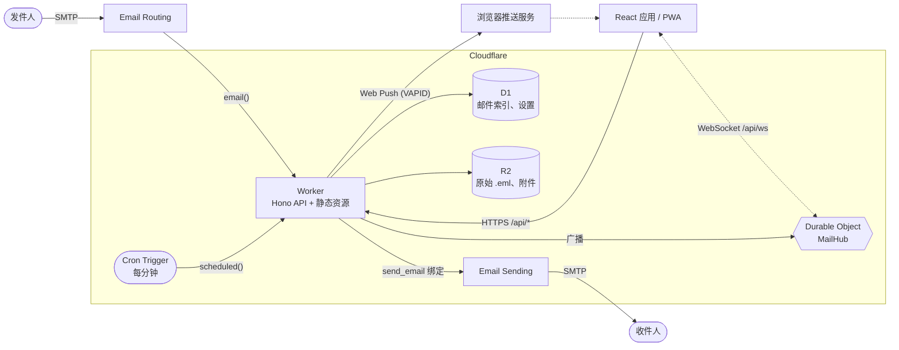

<p align="center">
  <a href="README.md">English</a> ·
  <a href="README.vi.md">Tiếng Việt</a> ·
  <strong>简体中文</strong>
</p>

<p align="center">
  <picture>
    
  </picture>
</p>

<p align="center">
  <strong>完全运行在 Cloudflare Workers 上的单用户 webmail。<br>零服务器，零冷启动，零成本起步。</strong>
</p>

<p align="center">
  <a href="LICENSE"></a>
  <a href="https://workers.cloudflare.com/"></a>
  
  
  
  
</p>

<p align="center">
  <a href="#快速开始">快速开始</a> ·
  <a href="#功能特性">功能特性</a> ·
  <a href="#部署">部署</a> ·
  <a href="#文档">文档</a> ·
  <a href="#参与贡献">参与贡献</a>
</p>

> **说明**：`docs/` 目录下的详细文档目前仅提供英文版。

## 目录

- [什么是 Edging Mail？](#什么是-edging-mail)
- [功能特性](#功能特性)
- [截图](#截图)
- [认识 Edgar](#认识-edgar)
- [快速开始](#快速开始)
- [配置](#配置)
- [部署](#部署)
- [架构](#架构)
- [项目结构](#项目结构)
- [脚本](#脚本)
- [文档](#文档)
- [安全](#安全)
- [路线图与已知限制](#路线图与已知限制)
- [参与贡献](#参与贡献)
- [致谢](#致谢)
- [许可证](#许可证)

## 什么是 Edging Mail？

Edging Mail 是一个自托管的 webmail，部署在你自己的 Cloudflare 账号下。邮件经由 Cloudflare Email Routing 到达，由 Worker 解析后，把索引存入 D1，把原始邮件和附件存入 R2。一个只靠单一密码保护的 React 应用负责读取这些邮件。回信通过 Cloudflare Email Sending 发出。你不需要运行任何服务器、容器或队列。

**适用范围与限制**：

- **设计上就是单用户**：一个密码、一位邮箱所有者、一套设置。它不是多租户服务，没有账号体系、共享功能或管理后台。
- **只提供 Web 和 HTTP API**：不支持 IMAP、POP3 和 SMTP 访问，所以桌面端和手机上的邮件客户端无法连接。
- **尚未实现**：多用户、垃圾邮件或病毒过滤、双因素登录、草稿附件、通讯录、自动化测试。参见[已知限制](#路线图与已知限制)。

## 功能特性

**邮件**

- 收件箱、已发送、草稿、已延后、星标、归档、垃圾邮件和回收站，另外还有你自己的标签。
- 支持回复、回复全部和转发。回复会保留 `In-Reply-To` 和 `References`，并在存储中共用同一个 `thread_id`；列表按单封邮件展示，暂时还没有会话视图。
- 可按主题、发件人、收件人和摘要搜索。
- 停止输入约 1.5 秒后自动保存草稿。邮件可以延后 1 分钟到 366 天：到期后它会以未读状态回到收件箱，仍排在原来的位置。
- 收发都支持附件，并可下载原始 `.eml` 文件。
- 通过 Cloudflare Email Sending 真实发信，使用你自己的显示名称、签名和发件地址。发送失败就如实报告失败，绝不会存成已发送。

**实时与 PWA**

- 通过 WebSocket 实时更新，连接由一个支持休眠的 Durable Object 持有。
- 可安装的应用，离线也能打开（仅限应用外壳；邮件内容从不缓存）。
- 使用你自己的 VAPID 密钥发送 Web Push 推送通知（RFC 8291 和 8292），无需任何第三方账号。在 iPhone 和 iPad 上，需要先把应用添加到主屏幕。
- 键盘快捷键（`/` 搜索，`c` 写邮件，`j` 和 `k` 上下移动）、浅色和深色主题，手机上支持滑动归档。

**安全**

- 除 `/api/health` 和 `/api/auth/*` 外，所有 API 路由都需要带签名的会话 cookie。密钥缺失或过短时会直接禁用登录，而不是降低防护强度。
- 登录有防暴力破解的限流，退出登录会使此前签发的所有会话失效。
- 仅限同源：跨站请求和跨源 WebSocket 握手都会被拒绝，也不返回任何 CORS 头。
- HTML 邮件在沙箱 iframe 中渲染，远程图片在你主动允许前一律拦截；附件只以下载形式提供。

**开发体验**

- 全栈 TypeScript；ESLint 使用 typescript-eslint 的 strict type-checked 规则；Prettier 格式化；统一的检查入口：`npm run check`。
- 用 Drizzle ORM 定义 schema，迁移是纯 SQL 文件，由 Wrangler 执行。
- 用 `wrangler dev` 即可在本地运行：D1、R2 和 Durable Object 均为模拟实现，并提供本地端点用于投喂真实的 MIME 邮件，发信也是模拟的。
- 一条 `npm run deploy` 即可部署。

## 截图

<p align="center">
  <picture>
    <source media="(prefers-color-scheme: dark)" srcset="docs/assets/screenshot-desktop-dark.png">
    
  </picture>
  
</p>

## 认识 Edgar

<p align="center">
  
</p>

Edgar 是一只信鸽，在云朵的边缘上班，Cloudflare 把所有的 Worker（打工人）都安排在了那里。他在 SMTP 和你的浏览器之间送信，遵守的 SLA 是自己写的，而且从没被冷启动过。送信失败时他会如实相告，从不假装一切顺利。

<p align="center">
  
</p>

## 快速开始

前置条件：Node.js 24 或更高版本，以及 npm。只有[部署](#部署)时才需要 Cloudflare 账号，本地开发使用的是模拟服务。

```bash
git clone https://github.com/NoahDuongMaster/edging-mail.git
cd edging-mail
npm install
cp .dev.vars.example .dev.vars    # then set APP_PASSWORD (12+ characters) and JWT_SECRET (32+ characters)
npm run db:migrate:local          # create the local D1 schema
npm run build                     # Wrangler serves the built client from dist/client
npm run worker:dev                # http://localhost:8787
```

这两个密钥可以用 `openssl rand -base64 24` 和 `openssl rand -hex 32` 生成。`.dev.vars.example` 里的占位值故意设得很短，所以在你替换它们之前，登录接口会返回 `503`。打开 `http://localhost:8787`，用 `APP_PASSWORD` 登录。

**接收一封测试邮件**：邮件走的是与生产环境相同的 `email()` 处理器，也就是线上 Email Routing 调用的那个。`wrangler dev` 把它暴露在 `/cdn-cgi/handler/email`：

```bash
cat > hello.eml <<'EOF'
From: Alice <alice@example.org>
To: you@example.com
Subject: Hello from a real MIME message
Message-ID: <hello-1@example.org>
Content-Type: text/plain; charset=utf-8

Hi! This goes through the same parser and storage as production mail.
EOF

curl -X POST "http://localhost:8787/cdn-cgi/handler/email?from=alice@example.org&to=you@example.com" --data-binary @hello.eml
```

邮件会出现在收件箱里。本地发信是模拟的：邮件会写入 `.wrangler/tmp/email/`，不会有任何内容离开你的机器。需要带热更新的前端开发时，在运行 `npm run worker:dev` 的同时再运行 `npm run dev`，详见 [docs/development.md](docs/development.md)。

## 配置

配置分布在三处：`wrangler.jsonc`（绑定和普通变量）、Worker secret（生产环境用 `wrangler secret put`，本地用 `.dev.vars`），以及应用内的**设置**页面（显示名称、签名、发件地址）。完整参考见 [docs/configuration.md](docs/configuration.md)。

| 名称                | 类型   | 是否必填 | 约束                        | 用途                                                |
| ------------------- | ------ | -------- | --------------------------- | --------------------------------------------------- |
| `APP_PASSWORD`      | secret | 必填     | 至少 12 个字符              | 你在登录页输入的密码                                |
| `JWT_SECRET`        | secret | 必填     | 至少 32 个字符              | 用来给会话 cookie 签名的随机密钥                    |
| `DEFAULT_FROM`      | var    | 可选     | 不带显示名的邮箱地址        | 在你于设置中保存发件地址之前使用的发件地址          |
| `APP_NAME`          | var    | 可选     | 默认 `Edging Mail`          | 出现在 `/api/health` 和部分推送通知标题中的产品名称 |
| `VAPID_PUBLIC_KEY`  | var    | 推送必填 | base64url 编码的 P-256 公钥 | Web Push 密钥对的公钥部分                           |
| `VAPID_SUBJECT`     | var    | 推送必填 | `mailto:` 或 `https://` URL | 推送服务用来联系你的方式                            |
| `VAPID_PRIVATE_KEY` | secret | 推送必填 | base64url 编码的 P-256 私钥 | Web Push 密钥对的私钥部分                           |

| 绑定         | 类型                    | 用途                                   |
| ------------ | ----------------------- | -------------------------------------- |
| `DB`         | D1 数据库               | 邮件索引、设置、推送订阅               |
| `BUCKET`     | R2 存储桶               | 原始 `.eml` 文件和附件                 |
| `SEND_EMAIL` | `send_email`            | 通过 Cloudflare Email Sending 发出邮件 |
| `ASSETS`     | 静态资源                | 构建好的 React 应用                    |
| `MAIL_HUB`   | Durable Object 命名空间 | 实时 WebSocket 消息的广播分发          |

缺少 `APP_PASSWORD` 或 `JWT_SECRET`（或者其中一个太短）时，登录接口会返回 `503`，其余接口一律无法访问。只有三个 VAPID 值全部设置好，推送才能工作。

**VAPID 密钥**：Web Push 密钥对只需生成一次。把公钥和 subject 放在 `wrangler.jsonc` 的 `vars` 下（本地则放进 `.dev.vars`），私钥则作为 secret 保存：

```bash
node -e "const k=require('node:crypto').generateKeyPairSync('ec',{namedCurve:'P-256'}).privateKey.export({format:'jwk'});const b=(s)=>Buffer.from(s,'base64url');console.log('VAPID_PUBLIC_KEY='+Buffer.concat([Buffer.from([4]),b(k.x),b(k.y)]).toString('base64url'));console.log('VAPID_PRIVATE_KEY='+k.d)"
```

## 部署

本仓库里的 `wrangler.jsonc` 写的是维护者自己的部署参数（主机名 `mail.duongnamtruong.com`、一个 D1 id、`DEFAULT_FROM`）。如果你 fork 了本项目，必须先把它们换成你自己的。包括 DNS 和 Email Routing 在内的完整步骤见 [docs/deployment.md](docs/deployment.md)。简要流程如下：

1. **自定义域名**：把 `routes[0].pattern` 设为你 Cloudflare 账号下某个 zone 里的主机名。`workers_dev` 和 `preview_urls` 均已关闭，因此应用只能通过该主机名访问。
2. **创建存储**，然后把打印出的 `database_id` 粘贴到 `d1_databases[0].database_id`：
   ```bash
   npx wrangler d1 create edging_mail_db
   npx wrangler r2 bucket create edging-mail-storage
   ```
3. **执行迁移并设置 secret**（如果要用推送，还要设置 VAPID 的值），然后部署：
   ```bash
   npm run db:migrate:remote
   npx wrangler secret put APP_PASSWORD
   npx wrangler secret put JWT_SECRET
   npm run deploy
   ```
4. **接收邮件**：在控制台（Compute → Email Service → Email Routing）中接入你的域名，并添加一条路由规则，动作选 _Send to a Worker_，目标选 `edging-mail`。在根域名上收信，需要在该域名上启用 Email Routing，它会接管该域名的 MX 记录。如果必须把 MX 记录留给其他服务商，就改为把某个地址转发到一个用于路由的子域名（维护者就是从 Proton 转发过来的）。
5. **发送邮件**：在 Email Sending 下接入该域名。它目前处于 beta 阶段，向任意收件人发信需要 Workers Paid 套餐。

**Workers Builds（push 到 git 时自动部署）**：Cloudflare 为它创建的 API token 没有 D1 权限，所以构建过程既不能创建数据库，也不能执行迁移。请自行完成第 2、3 步，并且在推送新增了 `drizzle/` 文件的改动之前，先重新执行一次迁移。

## 架构



| 层级   | 技术                                                                      |
| ------ | ------------------------------------------------------------------------- |
| 运行时 | Cloudflare Workers、Durable Objects、Cron Triggers                        |
| API    | Hono 4、TypeScript 7                                                      |
| 数据   | 通过 Drizzle ORM 访问 D1 (SQLite)；R2 存放 blob                           |
| 收信   | Cloudflare Email Routing、`postal-mime`                                   |
| 发信   | Cloudflare Email Sending（`send_email` 绑定）、用 `mimetext` 生成存档副本 |
| 客户端 | React 19、Vite 8、Tailwind CSS 4、TanStack Query 5、Lucide 图标           |
| 推送   | 基于 VAPID 的 Web Push，RFC 8291 和 8292 在 WebCrypto 上实现              |
| 工具链 | Wrangler 4、drizzle-kit、ESLint 9（搭配 typescript-eslint）、Prettier 3   |

各组件如何配合，以及数据流和数据模型，见 [docs/architecture.md](docs/architecture.md)。

## 项目结构

```text
.
├── src/
│   ├── worker/              # Cloudflare Worker
│   │   ├── index.ts         # fetch, email() and scheduled() handlers, mail routes
│   │   ├── auth.ts          # login, session cookie, brute-force throttle
│   │   ├── drafts.ts        # draft autosave API
│   │   ├── push.ts          # Web Push (RFC 8291/8292) and subscription API
│   │   ├── realtime.ts      # MailHub Durable Object and /api/ws
│   │   ├── notify.ts        # new-mail broadcast and push
│   │   ├── snooze.ts        # returns due snoozed mail (cron)
│   │   ├── services/        # email-parser.ts (inbound), email-sender.ts (outbound)
│   │   └── db/              # Drizzle schema and D1 client
│   └── client/              # React app
│       ├── App.tsx          # layout and mailbox state
│       ├── components/      # sidebar, list, reader, compose, settings, mail frame
│       └── lib/             # API client, TanStack Query hooks, realtime, push, drafts
├── public/                  # service worker, manifest, icons, _headers
├── drizzle/                 # SQL migrations and drizzle-kit snapshots
├── docs/                    # documentation (assets/ holds the images)
├── wrangler.jsonc           # bindings, route, cron, variables
├── .dev.vars.example        # template for local secrets
└── CONTRIBUTING.md
```

## 脚本

| 脚本                        | 作用                                                                 |
| --------------------------- | -------------------------------------------------------------------- |
| `npm run worker:dev`        | `wrangler dev`：在 `localhost:8787` 上运行 Worker、D1、R2 和静态资源 |
| `npm run dev`               | 运行在 `localhost:3000` 的 Vite 开发服务器，把 `/api` 代理到 Worker  |
| `npm run build`             | `tsc -b && vite build`：先做类型检查，再打包到 `dist/client`         |
| `npm run preview`           | `vite preview`：预览构建好的客户端                                   |
| `npm run deploy`            | `npm run build && wrangler deploy`                                   |
| `npm run db:generate`       | `drizzle-kit generate`：根据 `schema.ts` 生成新的迁移                |
| `npm run db:migrate:local`  | 把待执行的迁移应用到本地 D1                                          |
| `npm run db:migrate:remote` | 把待执行的迁移应用到生产环境的 D1                                    |
| `npm run lint`              | `eslint .`（`lint:fix` 会加上 `--fix`）                              |
| `npm run format`            | `prettier --write .`（`format:check` 只检查，不改文件）              |
| `npm run check`             | `tsc -b`、lint 和格式检查：每一次改动都必须通过的关卡                |

## 文档

| 页面                                     | 内容                                                             |
| ---------------------------------------- | ---------------------------------------------------------------- |
| [架构](docs/architecture.md)             | 组件、数据流、数据模型、设计说明                                 |
| [配置](docs/configuration.md)            | 变量、secret、绑定、`wrangler.jsonc`，以及 fork 后需要改动的内容 |
| [部署](docs/deployment.md)               | 分步骤的生产环境搭建，Email Routing 与 Email Sending             |
| [邮件功能](docs/mail-features.md)        | 发送、回复、搜索、会话、草稿、延后                               |
| [实时、推送与 PWA](docs/pwa-and-push.md) | WebSocket 事件、Web Push、安装应用                               |
| [安全](docs/security.md)                 | 登录、限流、邮件沙箱、响应头、加固                               |
| [HTTP API](docs/api.md)                  | 每个路由的认证方式、请求体、响应和错误                           |
| [开发](docs/development.md)              | 本地环境搭建、迁移、检查、commit 风格                            |

## 安全

所有私密内容都放在一个密码和一个带签名的 `HttpOnly` 会话 cookie 之后；路由遵循 fail closed 原则（默认拒绝）；登录有限流；邮件被视为不可信输入，并在沙箱中渲染。具体细节和局限（不支持双因素认证、没有端到端加密、Cloudflare 能读取它所存储的内容）见 [docs/security.md](docs/security.md)。

**请私下报告安全漏洞**：打开本仓库的 **Security** 标签页，选择 **Report a vulnerability**。请不要为可被利用的问题提交公开 issue。永远不要提交 secret：`.dev.vars` 和 `.env*` 已被 gitignore。

## 路线图与已知限制

目前已知的限制：

- **只有一个用户**：不计划支持多用户，那是另一个产品了。
- **`http://` 图片一律不加载**：HTML 邮件只会显示 `https` 图片，而且要在你点击 _Show images_ 之后才会显示。
- **手机宽度下没有“全部标为已读”**：这个按钮位于桌面端的列表标题栏里。
- **Email Sending 仍处于 beta 阶段**，向任意收件人发信需要 Workers Paid 套餐；新账号的每日配额起初很低。
- **在根域名上收信，需要在该域名上启用 Email Routing**：维护者的做法是从 Proton 转发到一个子域名，这套转发流程还没有做过完整的端到端验证。
- **没有垃圾邮件或病毒过滤，没有双因素认证，草稿不支持附件，没有通讯录，没有会话视图。**
- **还没有自动化测试**：`npm run check`（类型、lint、格式）是唯一的关卡。
- **超大邮件**可能存储失败：邮件正文存放在 D1 中，而 D1 限制单行最大 2 MB。这是根据文档中的限制推断的，尚未实际测试。
- **Google Fonts**：页面会从 Google 加载 Geist 字体，因此打开应用时浏览器会连接 Google。

欢迎贡献的方向：测试套件、自托管字体、手机端的“全部标为已读”、草稿附件、双因素登录。

## 参与贡献

欢迎提交 issue 和 pull request。请先阅读 [CONTRIBUTING.md](CONTRIBUTING.md)：里面介绍了环境搭建、`npm run check`、commit 风格以及如何提出改动。

## 致谢

本项目基于 Cloudflare 开发者平台及其文档构建，并使用了 [Hono](https://hono.dev)、[Drizzle ORM](https://orm.drizzle.team)、[React](https://react.dev)、[Vite](https://vite.dev)、[Tailwind CSS](https://tailwindcss.com)、[TanStack Query](https://tanstack.com/query)、[Lucide](https://lucide.dev)、[postal-mime](https://github.com/postalsys/postal-mime) 和 [mimetext](https://github.com/muratgozel/MIMEText)。界面字体是 Vercel 出品的 Geist。徽章来自 [Shields.io](https://shields.io)。README 的版式参考了 [standard-readme](https://github.com/RichardLitt/standard-readme) 和 [Make a README](https://www.makeareadme.com/)。

## 许可证

[MIT](LICENSE) © Noah Duong
