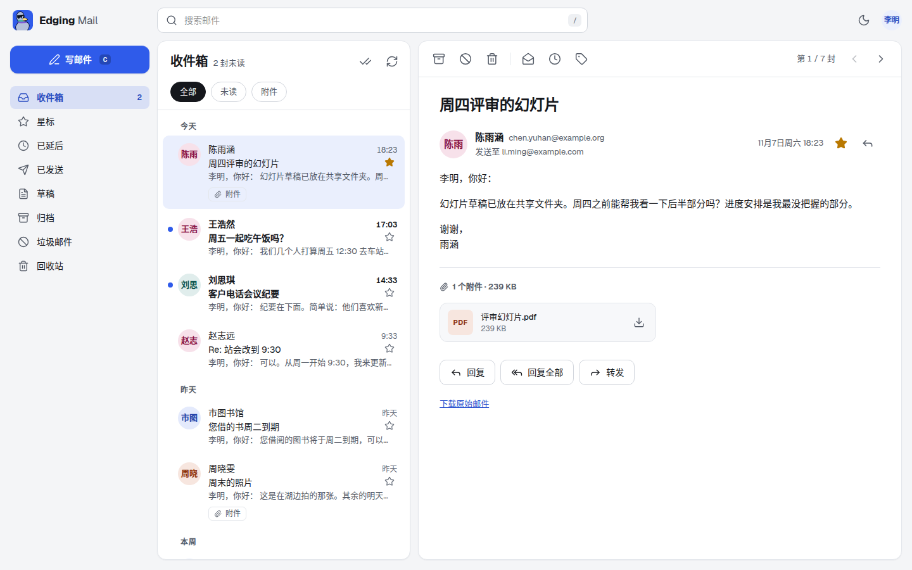
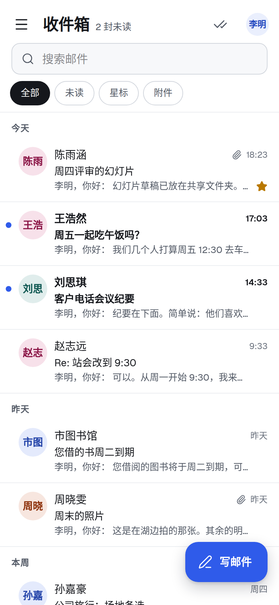
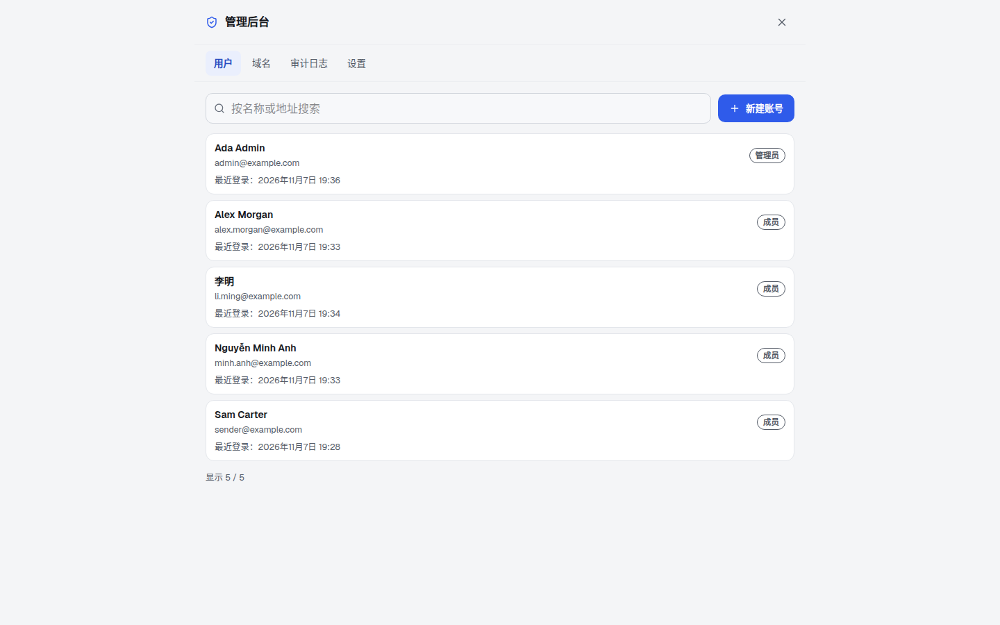
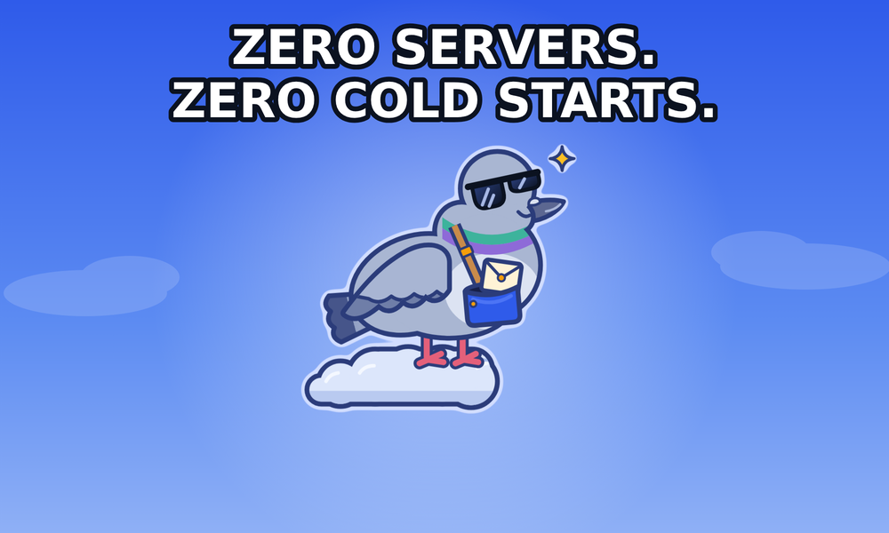
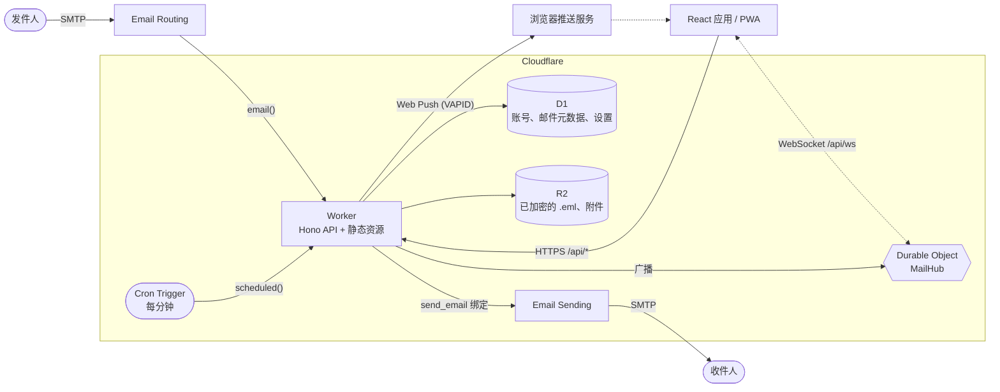

<p align="center">
  <a href="README.md">English</a> ·
  <a href="README.vi.md">Tiếng Việt</a> ·
  <strong>简体中文</strong>
</p>

<p align="center">
  <picture>
    
  </picture>
</p>

<p align="center">
  <strong>面向公司、完全运行在 Cloudflare Workers 上的 webmail。<br>零服务器，零冷启动。</strong>
</p>

<p align="center">
  <a href="LICENSE"></a>
  <a href="https://workers.cloudflare.com/"></a>
  
  
  
  
</p>

<p align="center">
  <a href="#快速开始">快速开始</a> ·
  <a href="#功能特性">功能特性</a> ·
  <a href="#部署">部署</a> ·
  <a href="#文档">文档</a> ·
  <a href="#参与贡献">参与贡献</a>
</p>

> **说明**：`docs/` 目录下的详细文档目前仅提供英文版。

## 目录

- [什么是 Edging Mail？](#什么是-edging-mail)
- [功能特性](#功能特性)
- [截图](#截图)
- [认识 Edgar](#认识-edgar)
- [快速开始](#快速开始)
- [配置](#配置)
- [部署](#部署)
- [架构](#架构)
- [项目结构](#项目结构)
- [脚本](#脚本)
- [文档](#文档)
- [安全](#安全)
- [路线图与已知限制](#路线图与已知限制)
- [参与贡献](#参与贡献)
- [致谢](#致谢)
- [许可证](#许可证)

## 什么是 Edging Mail？

Edging Mail 是一个由公司自行托管的 webmail，部署在公司自己的 Cloudflare 账号下。邮件经由 Cloudflare Email Routing 到达，由 Worker 解析后，用收件人自己的密钥加密再存储：邮件记录存入 D1，原始邮件和附件存入 R2。React 应用可以在浏览器中打开，也可以安装为 PWA，用每个人自己的密码解密邮件。回信通过 Cloudflare Email Sending 发出。你不需要运行任何服务器、容器或队列。

公司使用它的流程：

1. 管理员添加公司的邮件域名。
2. 管理员为每个人创建邮箱：一个地址，加上首次登录用的临时密码。临时密码在管理员的浏览器中生成，有效期 72 小时。
3. 每个人在网页或已安装的应用中登录，自己设置密码，领取一把恢复密钥自行保管，再设置双因素登录。

应用位于 `/app`。可选的公开介绍页位于 `/`、`/en/` 和 `/zh/`，由 `LANDING_PAGE` 变量控制，见[配置](#配置)。

**适用范围与限制**：

- **每次部署服务一家公司**：没有自助注册和计费，也不是多租户服务，所有账号都由管理员创建。
- **只提供 Web 和 HTTP API**：不支持 IMAP、POP3 和 SMTP 访问，所以桌面端和手机上的邮件客户端无法连接。
- **尚未实现**：垃圾邮件或病毒过滤、草稿附件、通讯录、共享邮箱或群组、SSO 和 passkey。参见[已知限制](#路线图与已知限制)。

## 功能特性

**邮件**

- 收件箱、已发送、草稿、已延后、星标、归档、垃圾邮件和回收站，另外还有你自己的标签。
- 支持回复、回复全部和转发。回复会保留 `In-Reply-To` 和 `References`，并在存储中共用同一个 `thread_id`；列表按单封邮件展示，暂时还没有会话视图。
- 可按发件人、收件人或主题搜索。主题在你的浏览器中解密并匹配，范围是已加载的邮件；邮件正文不在搜索范围内。
- 停止输入约 1.5 秒后自动保存草稿，保存前先在浏览器中加密。邮件可以延后 1 分钟到 366 天：到期后它会以未读状态回到收件箱，仍排在原来的位置。
- 收发都支持附件，并可下载原始 `.eml` 文件。
- 通过 Cloudflare Email Sending 真实发信，始终使用发件人自己的主地址，并带上其显示名称和签名。发送失败就如实报告失败，绝不会存成已发送。

**账号与管理后台**

- 每人一个邮箱，使用公司自己的域名：一个用于登录和发信的主地址，外加可选的、只收不发的别名。允许有多位管理员，并且始终至少保留一位处于启用状态的管理员。
- 管理后台有三个页面：Users、Domains 和 Audit log。管理员可以创建账号、停用或启用账号、更改角色、修改显示名称、添加或删除别名、重置双因素登录，以及删除账号（需要输入确认）。他们还可以添加域名并检查其 DNS。
- 管理员的每一项操作都会记录在审计日志（Audit log）中。
- 账号之间相互隔离：每个人只能访问自己的邮件、标签、草稿、设置和推送订阅。

**实时与 PWA**

- 通过 WebSocket 实时更新，每个人对应一个支持休眠的 Durable Object 来持有连接。
- 可安装的应用，离线也能打开（仅限应用外壳；邮件内容从不缓存）。
- Web Push 推送通知（RFC 8291 和 8292）使用自动生成的 VAPID 密钥，无需任何配置，也无需第三方账号。通知只带发件人名称，从不包含主题或正文。在 iPhone 和 iPad 上，需要先把应用添加到主屏幕。
- 键盘快捷键（`/` 搜索，`c` 写邮件，`j` 和 `k` 上下移动）、浅色和深色主题，手机上支持滑动归档。

**语言**

- 应用提供越南语、英语和简体中文。每个人在 Settings 中自行选择（选择会跟着账号到每台设备）；登录界面有一个小型语言选择器，管理员可以设置组织的默认语言。工作方式和如何修正译文见 [docs/i18n.md](docs/i18n.md)。
- 日期、时间和数字跟随所选语言，推送通知则按收件人的语言撰写。

**公开介绍页**

- 可选：由 Worker 在 `/`（越南语）、`/en/`（英语）和 `/zh/`（简体中文）提供的页面，并附带 `robots.txt` 和 `sitemap.xml`。只有 `LANDING_PAGE` 为 `on` 时才启用；否则 `/` 直接跳转到 `/app`。

**安全**

- 邮件用每个人自己的密钥加密，这把密钥由其密码在其本人的浏览器中解开（HPKE，RFC 9180，基于 WebCrypto）。密码从不离开浏览器。
- 每个人在首次登录时会得到一把恢复密钥。忘记密码的人用这把密钥自行设置新密码；任何管理员都无法重置他人的密码。
- 双因素登录使用验证器应用（TOTP）和一次性恢复码，默认对所有人强制开启。
- 除 `/api/health` 和 `/api/auth/*` 外，所有 API 路由都需要带签名的会话 cookie。密钥缺失或格式不正确时会直接关闭登录，而不是降低防护强度。
- 登录有防暴力破解的限流（按客户端地址和按账号分别计算），退出登录会使该用户在所有设备上的会话失效。
- 仅限同源：跨站请求和跨源 WebSocket 握手都会被拒绝，也不返回任何 CORS 头。
- HTML 邮件在沙箱 iframe 中渲染，远程图片在你主动允许前一律拦截；附件只以下载形式提供。

**开发体验**

- 全栈 TypeScript；ESLint 使用 typescript-eslint 的 strict type-checked 规则；Prettier 格式化；统一的检查入口：`npm run check`。
- `npm test` 运行自动化测试套件（Vitest）。它不需要 Cloudflare 账号、密钥或网络：测试自带所需的一切。
- 用 Drizzle ORM 定义 schema，迁移是纯 SQL 文件，由 Wrangler 执行。
- 用 `wrangler dev` 即可在本地运行：D1、R2 和 Durable Object 均为模拟实现，并提供本地端点用于投喂真实的 MIME 邮件，发信也是模拟的。
- 一条 `npm run deploy` 即可部署。

## 截图

<p align="center">
  <picture>
    <source media="(prefers-color-scheme: dark)" srcset="docs/assets/screenshot-desktop-dark.zh-CN.png">
    
  </picture>
  
</p>

<p align="center">
  <picture>
    <source media="(prefers-color-scheme: dark)" srcset="docs/assets/screenshot-admin-dark.zh-CN.png">
    
  </picture>
</p>

## 认识 Edgar

<p align="center">
  
</p>

Edgar 是一只信鸽，在云朵的边缘上班，Cloudflare 把所有的 Worker（打工人）都安排在了那里。他在 SMTP 和你的浏览器之间送信，遵守的 SLA 是自己写的，而且从没被冷启动过。送信失败时他会如实相告，从不假装一切顺利。

<p align="center">
  
</p>

## 快速开始

前置条件：Node.js 24 或更高版本，以及 npm。只有[部署](#部署)时才需要 Cloudflare 账号，且部署需要 Workers Paid 套餐；本地开发使用的是模拟服务。

```bash
git clone https://github.com/NoahDuongMaster/edging-mail.git
cd edging-mail
npm install
cp .dev.vars.example .dev.vars    # then set APP_PASSWORD (24+ characters), JWT_SECRET (32+ characters) and DATA_KEY (base64 of 32 bytes)
npm run db:migrate:local          # create the local D1 schema
npm run build                     # Wrangler serves the built client from dist/client
npm run worker:dev                # http://localhost:8787
```

`APP_PASSWORD` 和 `JWT_SECRET` 可以分别用 `openssl rand -base64 24` 和 `openssl rand -hex 32` 生成，`DATA_KEY` 用 `openssl rand -base64 32`。`.dev.vars.example` 里的占位值故意设为无效，所以在你替换它们之前，登录和 Setup 都会返回 `503`。打开 `http://localhost:8787/app`。还没有任何账号时，第一个界面是 Setup：把 `APP_PASSWORD` 作为设置密钥（setup key）填入，再填管理员地址（例如 `admin@example.com`）、显示名称和密码（管理员密码至少 16 个字符），然后按提示完成恢复密钥和双因素登录。

**接收一封测试邮件**：邮件走的是与生产环境相同的 `email()` 处理器，也就是线上 Email Routing 调用的那个。`wrangler dev` 把它暴露在 `/cdn-cgi/handler/email`。收件人请用你在 Setup 中创建的管理员地址：

```bash
cat > hello.eml <<'EOF'
From: Alice <alice@example.org>
To: admin@example.com
Subject: Hello from a real MIME message
Message-ID: <hello-1@example.org>
Content-Type: text/plain; charset=utf-8

Hi! This goes through the same parser and storage as production mail.
EOF

curl -X POST "http://localhost:8787/cdn-cgi/handler/email?from=alice@example.org&to=admin@example.com" --data-binary @hello.eml
```

邮件会出现在该账号的收件箱里。不属于任何账号或别名的地址会被拒收，不会存储任何内容。本地发信是模拟的：邮件会写入 `.wrangler/tmp/email/`，不会有任何内容离开你的机器。需要带热更新的前端开发时，在运行 `npm run worker:dev` 的同时再运行 `npm run dev`，详见 [docs/development.md](docs/development.md)。`npm test` 会运行自动化测试。

## 配置

配置分布在三处：`wrangler.jsonc`（绑定和普通变量）、Worker secret（生产环境用 `wrangler secret put`，本地用 `.dev.vars`），以及应用内的**设置**页面（每个人各自的显示名称、签名和账号安全选项）。完整参考见 [docs/configuration.md](docs/configuration.md)。

| 名称           | 类型   | 是否必填 | 约束                               | 用途                                                                                       |
| -------------- | ------ | -------- | ---------------------------------- | ------------------------------------------------------------------------------------------ |
| `APP_PASSWORD` | secret | 必填     | 至少 24 个字符                     | 设置密钥（setup key）：只用于首次 Setup 和管理员的紧急恢复（break-glass），没有人用它登录  |
| `JWT_SECRET`   | secret | 必填     | 至少 32 个字符                     | 用来给会话 cookie 和双因素登录挑战签名的随机密钥                                           |
| `DATA_KEY`     | secret | 必填     | 恰好 32 个随机字节的 base64        | 加密 Worker 必须自己读回的内容：在其所有者设置密钥之前到达的邮件、双因素登录的 TOTP secret |
| `DEFAULT_FROM` | var    | 可选     | 不带显示名的邮箱地址               | 在 Setup 页面预填管理员地址（同时也是 Web Push 请求中的联系地址）                          |
| `APP_NAME`     | var    | 可选     | 默认 `Edging Mail`                 | 出现在 `/api/health` 和部分推送通知标题中的产品名称                                        |
| `LANDING_PAGE` | var    | 可选     | `on`；未设置或其他任何值都表示关闭 | `on` 时在 `/`、`/en/` 和 `/zh/` 提供公开介绍页                                             |

| 绑定         | 类型                    | 用途                                                     |
| ------------ | ----------------------- | -------------------------------------------------------- |
| `DB`         | D1 数据库               | 账号、域名、审计日志、邮件元数据和已加密的文本、推送订阅 |
| `BUCKET`     | R2 存储桶               | 原始 `.eml` 文件和附件（已加密）                         |
| `SEND_EMAIL` | `send_email`            | 通过 Cloudflare Email Sending 发出邮件                   |
| `ASSETS`     | 静态资源                | 构建好的 React 应用                                      |
| `MAIL_HUB`   | Durable Object 命名空间 | 实时 WebSocket 消息的广播分发                            |

缺少 `JWT_SECRET` 或 `DATA_KEY`（或者其中一个缺失、格式不正确）时，登录和 Setup 都会返回 `503`。缺少 `APP_PASSWORD`（或者太短）时，大家仍然可以登录，但 Setup 和紧急恢复会返回 `503`。`DATA_KEY` 的值不能与 `JWT_SECRET` 或 `APP_PASSWORD` 相同。Web Push 无需任何配置：密钥对会在首次使用时自动创建并保存在数据库中，加密方式保证仅凭数据库副本无法签发推送（详见 [docs/configuration.md](docs/configuration.md)）。

**`DATA_KEY`** 是 Worker secret，不是 var：恰好 32 个随机字节的 base64。用 `openssl rand -base64 32` 生成，然后运行 `npx wrangler secret put DATA_KEY`。请在部署这个版本**之前**设置好它。一旦丢失，由服务器加密、还没有改用其所有者密钥重新封装的邮件将无法读取，已保存的双因素登录 secret 也会失效，所以请像保管 D1 id 一样备份它。

**`LANDING_PAGE`**：本仓库的 `wrangler.jsonc` 把它设为 `on`，因为维护者的部署有一个位于 `/`、`/en/` 和 `/zh/` 的公开介绍页，并带有 `robots.txt` 和 `sitemap.xml`。fork 之后应当保持未设置或设为 `off`，除非你想要一个公开页面。未设置或为 `off` 时：`/` 直接跳转到 `/app`，`/en/`、`/zh/` 和 `/sitemap.xml` 返回 `404`，`robots.txt` 禁止所有抓取。只有恰好等于 `on` 的值（去掉首尾空格，不区分大小写）才会启用介绍页。

## 部署

部署需要 Workers Paid 套餐。登录时校验密码要花约 40 到 50 毫秒 CPU 时间（PBKDF2），超出了免费套餐允许的 10 毫秒；Cloudflare Email Sending 向任意收件人发信同样需要付费套餐。

本仓库里的 `wrangler.jsonc` 写的是维护者自己的部署参数（它的主机名、一个 D1 id、`DEFAULT_FROM`，以及设为 `on` 的 `LANDING_PAGE`）。如果你 fork 了本项目，必须先把它们换成你自己的。包括 DNS 和 Email Routing 在内的完整步骤见 [docs/deployment.md](docs/deployment.md)。fork 需要改的地方：

| `wrangler.jsonc` 中的键       | fork 后应改为                                                   |
| ----------------------------- | --------------------------------------------------------------- |
| `routes[0].pattern`           | 你 Cloudflare 账号下某个 zone 里的主机名                        |
| `d1_databases[0].database_id` | `wrangler d1 create` 打印出的 id                                |
| `vars.DEFAULT_FROM`           | 可选：你自己域名下的一个地址（用于在 Setup 页面预填）           |
| `vars.LANDING_PAGE`           | 保持未设置或设为 `off`，除非你想要公开介绍页（见[配置](#配置)） |

简要流程如下：

1. **自定义域名**：把 `routes[0].pattern` 设为你 Cloudflare 账号下某个 zone 里的主机名。`workers_dev` 和 `preview_urls` 均已关闭，因此应用只能通过该主机名访问。
2. **创建存储**，然后把打印出的 `database_id` 粘贴到 `d1_databases[0].database_id`：
   ```bash
   npx wrangler d1 create edging_mail_db
   npx wrangler r2 bucket create edging-mail-storage
   ```
3. **执行迁移并设置 secret**，然后部署：
   ```bash
   npm run db:migrate:remote
   npx wrangler secret put APP_PASSWORD
   npx wrangler secret put JWT_SECRET
   npx wrangler secret put DATA_KEY
   npm run deploy
   ```
   `DATA_KEY` 是 32 个随机字节的 base64（`openssl rand -base64 32`）。请在首次部署这个版本之前设置好。
4. **创建第一位管理员**：在你的主机名下打开 `/app`。还没有任何账号时，它会显示 Setup：填入设置密钥（`APP_PASSWORD`）、管理员地址、显示名称和至少 16 个字符的密码，然后按提示完成恢复密钥和双因素登录。Setup 会自动加入该地址所在的域名。之后，在管理后台（Domains、Users）里添加其余域名，并为每个人创建邮箱。
5. **接收邮件**：在控制台（Compute → Email Service → Email Routing）中接入公司的每个域名，把它的 catch-all 规则设为动作 _Send to a Worker_，目标选 `edging-mail`。Worker 按收件人地址投递，并拒收不属于任何账号或别名的地址。在根域名（apex）上启用 Email Routing，它会接管该域名的 MX 记录；维护者自己的部署就是这样运行的。如果其他邮件服务商必须保留 MX 记录，一个可选的做法是改为从该服务商转发到一个用于路由的子域名。Email Routing 在子域名上没有 catch-all，所以那里的每个地址都需要单独一条规则。管理后台的 Domains 页面带有 DNS 检查，可以看到收信和发信是否已设置好。
6. **发送邮件**：在 Email Sending 下接入该域名。它目前处于 beta 阶段，向任意收件人发信需要 Workers Paid 套餐。

**Workers Builds（push 到 git 时自动部署）**：想让每次 push 都自动迁移再部署，只需在 Cloudflare 控制台里一次性做两件事：给构建所用的 API token 加上 **Account → D1 → Edit** 权限（默认 token 没有 D1 权限），并把部署命令（deploy command）设为 `npm run db:migrate:remote && npx wrangler deploy`。否则请自行完成第 2、3 步，并且在推送新增了 `drizzle/` 文件的改动之前，先重新执行一次迁移。

**升级在有账号体系之前就已安装的实例**：先备份 D1，在部署这个版本之前设置好 `DATA_KEY`，然后部署并打开 `/app`。Setup 把旧的 `APP_PASSWORD` 当作设置密钥，所有人需要重新登录一次。具体步骤见 [docs/deployment.md](docs/deployment.md)。旧邮件由后台任务转换为加密格式。在该任务运行之前做的副本（你做的备份、D1 Time Travel、数据库文件内部的空闲空间），在被删除或过期之前，仍可能以明文保存着这些邮件；见 [docs/deployment.md](docs/deployment.md) 的第 6 步。

## 架构



| 层级   | 技术                                                                              |
| ------ | --------------------------------------------------------------------------------- |
| 运行时 | Cloudflare Workers、Durable Objects、Cron Triggers                                |
| API    | Hono 4、TypeScript 7                                                              |
| 数据   | 通过 Drizzle ORM 访问 D1 (SQLite)；R2 存放 blob                                   |
| 收信   | Cloudflare Email Routing、`postal-mime`                                           |
| 发信   | Cloudflare Email Sending（`send_email` 绑定）、用 `mimetext` 生成存档副本         |
| 客户端 | React 19、Vite 8、Tailwind CSS 4、TanStack Query 5、Lucide 图标                   |
| 推送   | 基于 VAPID 的 Web Push，RFC 8291 和 8292 在 WebCrypto 上实现                      |
| 加密   | WebCrypto（AES-256-GCM、PBKDF2、HKDF）和 HPKE（RFC 9180，通过 `@hpke/core`）      |
| 工具链 | Wrangler 4、drizzle-kit、Vitest 4、ESLint 9（搭配 typescript-eslint）、Prettier 3 |

各组件如何配合，以及数据流和数据模型，见 [docs/architecture.md](docs/architecture.md)。

## 项目结构

```text
.
├── src/
│   ├── worker/              # Cloudflare Worker
│   │   ├── index.ts         # fetch, email() and scheduled() handlers, mail routes
│   │   ├── auth/            # sign-in, sessions, Setup, two-factor, recovery key
│   │   ├── mail/            # message, send and settings routes
│   │   ├── inbound.ts       # works out whose mail an incoming message is
│   │   ├── drafts.ts        # draft autosave API
│   │   ├── push.ts          # Web Push (RFC 8291/8292) and subscription API
│   │   ├── realtime.ts      # MailHub Durable Object and /api/ws
│   │   ├── notify.ts        # new-mail broadcast and push
│   │   ├── snooze.ts        # returns due snoozed mail (cron)
│   │   ├── site/            # landing page, robots.txt, sitemap.xml, the /app shell
│   │   ├── services/        # email-parser.ts (inbound), email-sender.ts (outbound)
│   │   └── db/              # Drizzle schema and D1 client
│   ├── shared/crypto/       # key derivation, key wrapping, message encryption (the Worker imports only its seal-only entry)
│   └── client/              # React app
│       ├── App.tsx          # layout and mailbox state
│       ├── components/      # sidebar, list, reader, compose, settings, mail frame
│       └── lib/             # API client, TanStack Query hooks, realtime, push, drafts
├── test/                    # automated tests (npm test)
├── public/                  # service worker, manifest, icons, _headers
├── drizzle/                 # SQL migrations and drizzle-kit snapshots
├── docs/                    # documentation (assets/ holds the images)
├── wrangler.jsonc           # bindings, route, cron, variables
├── .dev.vars.example        # template for local secrets
└── CONTRIBUTING.md
```

## 脚本

| 脚本                        | 作用                                                                 |
| --------------------------- | -------------------------------------------------------------------- |
| `npm run worker:dev`        | `wrangler dev`：在 `localhost:8787` 上运行 Worker、D1、R2 和静态资源 |
| `npm run dev`               | 运行在 `localhost:3000` 的 Vite 开发服务器，把 `/api` 代理到 Worker  |
| `npm run build`             | `tsc -b && vite build`：先做类型检查，再打包到 `dist/client`         |
| `npm run preview`           | `vite preview`：预览构建好的客户端                                   |
| `npm run deploy`            | `npm run build && npm run db:migrate:remote && wrangler deploy`      |
| `npm run db:generate`       | `drizzle-kit generate`：根据 `schema.ts` 生成新的迁移                |
| `npm run db:migrate:local`  | 把待执行的迁移应用到本地 D1                                          |
| `npm run db:migrate:remote` | 把待执行的迁移应用到生产环境的 D1                                    |
| `npm run lint`              | `eslint .`（`lint:fix` 会加上 `--fix`）                              |
| `npm test`                  | `vitest run`：自动化测试套件                                         |
| `npm run format`            | `prettier --write .`（`format:check` 只检查，不改文件）              |
| `npm run check`             | `tsc -b`、lint 和格式检查：每一次改动都必须通过的关卡                |

## 文档

| 页面                                     | 内容                                                             |
| ---------------------------------------- | ---------------------------------------------------------------- |
| [架构](docs/architecture.md)             | 组件、数据流、数据模型、设计说明                                 |
| [配置](docs/configuration.md)            | 变量、secret、绑定、`wrangler.jsonc`，以及 fork 后需要改动的内容 |
| [部署](docs/deployment.md)               | 分步骤的生产环境搭建，域名、Email Routing、Email Sending、升级   |
| [邮件功能](docs/mail-features.md)        | 发送、回复、搜索、会话、草稿、延后                               |
| [实时、推送与 PWA](docs/pwa-and-push.md) | WebSocket 事件、Web Push、安装应用                               |
| [安全](docs/security.md)                 | 加密、登录、双因素、管理员、邮件沙箱、限制                       |
| [HTTP API](docs/api.md)                  | 每个路由的认证方式、请求体、响应和错误                           |
| [开发](docs/development.md)              | 本地环境搭建、迁移、测试、检查、commit 风格                      |

## 安全

每个人的邮件都用其自己的密钥加密，只有其密码（或恢复密钥）才能在其本人的浏览器中解开这把密钥。下面是 Edging Mail 的各项声明。细节和局限见 [docs/security.md](docs/security.md)。

### 加密

- **加密存储**：邮件的主题、摘要、正文、附件（内容、文件名、类型）和原始邮件，都以加密到所有者密钥的方式存储。服务器、管理员以及任何能读取数据库和文件存储的人，没有所有者的密码或恢复密钥就读不了它们。例外：在所有者设置密钥之前到达的邮件，在所有者登录之前只受服务器 secret 保护；所有者首次登录之前的新账号；弱密码可能被持有已存储数据副本的人离线猜出；任何持有此人恢复密钥的人。
- **端到端**：同一个部署上的人之间的邮件，在发件人的浏览器中加密到收件人的密钥。密钥由这台服务器分发，没有经过独立验证，而且应用代码也由同一台服务器提供。
- **外部邮件是普通邮件**：往来于外部地址的邮件，在邮件服务器之间以普通邮件传输。Edging Mail 会在邮件到达或发出时看到它，然后以加密形式存储。
- **未加密（元数据）**：地址和显示名称、日期、大小（邮件、附件和已存储密文的大小）、附件数量、文件夹、标记、标签、`Message-ID`、`References` 和 `In-Reply-To` 头以及会话（thread）id、每个人设置里的签名，以及管理员为某个账号添加了哪些别名。
- 密码从不离开浏览器。登录期间，已解开的密钥由浏览器以 non-extractable 密钥的形式持有；“non-extractable”只表示 JavaScript 无法导出它，这把密钥仍然保存在设备上的浏览器配置文件（profile）里。

### 管理员、密码与恢复

- **管理员**：任何管理员都无法重置他人的密码；对于已经登录并设置好密钥的人，管理员在 Edging Mail 中没有办法打开其邮件。创建账号的管理员在对方首次登录之前知道该账号的临时密码，在此之前到达的邮件只受服务器密钥保护。因此，请在对方准备好登录时再创建账号。管理员可以停用或删除账号、重新创建一个地址、添加或转移别名地址，以及重置双因素登录；这些更改都会记入日志，双因素登录被重置时，当事人会收到提醒。持有设置密钥的人可以用一把新密钥恢复某位管理员对管理后台的访问（该管理员的旧邮件仍处于锁定状态）。掌控 Cloudflare 账号或已部署代码的人都可能修改软件。
- 每个人在首次登录时会得到一把恢复密钥。它只显示一次，请妥善保管。忘记密码的人用这把密钥自行设置新密码（登录页上的 Forgot password），邮件原样保留。这样做会使此人的所有会话失效，并记入审计日志和此人的登录记录。
- 没有密码或恢复密钥，任何人（包括管理员）都无法恢复邮件。如果有人同时丢了两者，就没有人能再打开他的旧邮件：管理员只能删除该账号，再新建一个邮箱。
- 修改密码不等于密钥轮换：密钥还是原来那把，只是改由新密码保护，邮件所加密到的密钥并没有变。密钥轮换计划在 v1.1 中提供。
- 一个遗留风险：创建账号的管理员在首次登录之前知道该账号的临时密码，所以管理员有可能抢先登录、设置密钥，并从那一刻起读到发给该地址的邮件。此前已有的邮件不会暴露。首次登录会被记录下来，真正的成员也会在自己的登录记录里看到它。

### 登录与阅读

- 双因素登录使用验证器应用（TOTP）和一次性恢复码，默认对所有人强制开启；管理员则始终必须开启。管理员可以重置某个人的双因素登录，例如在对方丢了手机之后；这会被记入日志，并使该用户的会话失效。
- 多次输错密码后，登录会被锁定一段时间。退出登录、修改密码，或用恢复密钥重置密码，都会使此前的会话失效。
- 每个人都能看到自己最近的登录记录，安全事件会写入管理员的审计日志。
- HTML 邮件在隔离的 iframe（沙箱）中打开，远程图片在读者允许之前一律拦截。

加密保护的是已存储的邮件。它挡不住控制 Cloudflare 账号或已部署代码的人去改动软件，所以只把这种权限交给你信得过的人。

**请私下报告安全漏洞**：打开本仓库的 **Security** 标签页，选择 **Report a vulnerability**。请不要为可被利用的问题提交公开 issue。永远不要提交 secret：`.dev.vars` 和 `.env*` 已被 gitignore。

## 路线图与已知限制

为管理员引入 Argon2id 密钥派生，以及密钥轮换，计划在 v1.1 中提供。

目前已知的限制：

- **`http://` 图片一律不加载**：HTML 邮件只会显示 `https` 图片，而且要在你点击 _Show images_ 之后才会显示。
- **手机宽度下没有“全部标为已读”**：这个按钮位于桌面端的列表标题栏里。
- **整个部署都需要 Workers Paid 套餐**，不只是发信：登录时校验密码要花约 40 到 50 毫秒 CPU 时间，超出了免费套餐的 10 毫秒。
- **Email Sending 仍处于 beta 阶段**，向任意收件人发信需要 Workers Paid 套餐；新账号的每日配额起初很低。
- **在根域名上收信，需要在该域名上启用 Email Routing**：它会接管该域名的 MX 记录，维护者自己的部署就是这样运行的。从其他邮件服务商转发到一个用于路由的子域名，是给无法迁移 MX 记录的公司准备的可选做法；这套转发流程还没有做过完整的端到端验证。
- **搜索不读取邮件正文**，因为正文是加密的。主题在浏览器中解密并匹配，范围是已加载的邮件。
- **升级之前的邮件，可能以明文留在旧副本里**：转换会把它们在线上数据库和 R2 中加密（不会留下明文对象），但你做过的备份、D1 Time Travel（Workers Paid 上为 30 天）以及数据库文件的空闲空间，仍可能保留着明文。只有删除你自己的副本，并等平台自己的副本过期，才能清除。Setup 之后收到的邮件在到达时即被加密。
- **没有垃圾邮件或病毒过滤，草稿不支持附件，没有通讯录，没有会话视图。**
- **超大邮件**可能存储失败：邮件正文存放在 D1 中，而 D1 限制单行最大 2 MB。这是根据文档中的限制推断的，尚未实际测试。
- **Google Fonts**：页面会从 Google 加载 Geist 字体，因此打开应用时浏览器会连接 Google。
- 已在 Chromium 和 Firefox 中测试；加密部分的已知答案测试（known-answer test）也在 WebKit 引擎（WPE）中运行；尚未在真实的 Safari 或 iPhone 上验证。
- 这里的测试没有覆盖以下内容，因此首次部署后请自行做一次冒烟测试：真实的 Cloudflare 行为（Email Routing 和 Email Sending、真实的推送服务、真实的 D1 和 R2 限制、每个请求的 CPU 时间和计费）；真实的 https（`__Host-` 会话 cookie、HSTS、真实连接上登录耗时 400 毫秒的下限、会话结束时 WebSocket 的关闭）；以及真实的 Safari 和 iPhone。十分钟检查清单见 [docs/deployment.md](docs/deployment.md#after-the-first-deploy-a-ten-minute-check)。

欢迎贡献的方向：自托管字体、手机端的“全部标为已读”、草稿附件。

## 参与贡献

欢迎提交 issue 和 pull request。请先阅读 [CONTRIBUTING.md](CONTRIBUTING.md)：里面介绍了环境搭建、`npm run check`、commit 风格以及如何提出改动。

## 致谢

本项目基于 Cloudflare 开发者平台及其文档构建，并使用了 [Hono](https://hono.dev)、[Drizzle ORM](https://orm.drizzle.team)、[React](https://react.dev)、[Vite](https://vite.dev)、[Tailwind CSS](https://tailwindcss.com)、[TanStack Query](https://tanstack.com/query)、[Lucide](https://lucide.dev)、[postal-mime](https://github.com/postalsys/postal-mime) 和 [mimetext](https://github.com/muratgozel/MIMEText)。界面字体是 Vercel 出品的 Geist。徽章来自 [Shields.io](https://shields.io)。README 的版式参考了 [standard-readme](https://github.com/RichardLitt/standard-readme) 和 [Make a README](https://www.makeareadme.com/)。

## 许可证

[MIT](LICENSE) © Noah Duong

本项目附带或使用的第三方软件和数据及其各自的许可证列在 [NOTICE](NOTICE) 中。本项目不附带任何字体文件。
