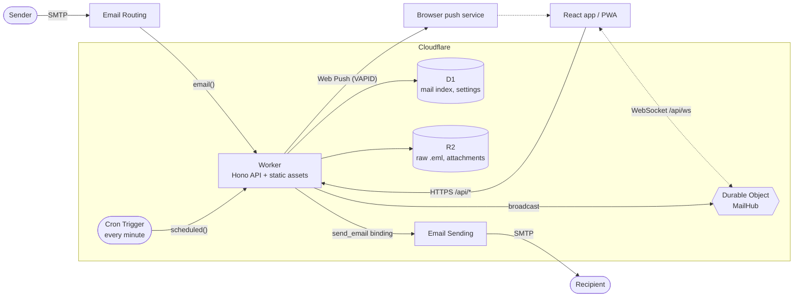

# Architecture

Edging Mail is one Cloudflare Worker plus the storage and messaging services around it. There is no server, container or queue to run.

## Components

| Part            | Where                                 | Job                                                                                                 |
| --------------- | ------------------------------------- | --------------------------------------------------------------------------------------------------- |
| Worker entry    | `src/worker/index.ts`                 | Three handlers: `fetch` (API and static assets), `email` (inbound mail), `scheduled` (snooze cron)  |
| HTTP API        | `src/worker/*.ts` (Hono)              | Auth, mail, drafts, settings, push, WebSocket upgrade. See the [API reference](api.md)              |
| Inbound parser  | `src/worker/services/email-parser.ts` | Parses a raw message with `postal-mime`, stores the `.eml` and attachments in R2 and the rows in D1 |
| Outbound sender | `src/worker/services/email-sender.ts` | Validates a send request, calls the `send_email` binding, stores the Sent copy                      |
| `MailHub`       | `src/worker/realtime.ts`              | One Durable Object holding every open WebSocket; fans events out to them                            |
| Web Push        | `src/worker/push.ts`                  | RFC 8291 payload encryption and RFC 8292 VAPID signing on WebCrypto, no library                     |
| Snooze release  | `src/worker/snooze.ts`                | Moves due snoozed mail back to the Inbox                                                            |
| Database        | `src/worker/db/`                      | Drizzle schema and client for D1. Migrations live in `drizzle/` and are applied by Wrangler         |
| React app       | `src/client/`                         | Single-page app built by Vite into `dist/client`, served by the Worker's static assets binding      |
| Service worker  | `public/sw.js`                        | App shell cache for offline start, push notifications, notification click handling                  |

### Request routing

`wrangler.jsonc` sets `assets.run_worker_first` to `["/api/*"]`: those requests reach the Worker, everything else is answered by the static assets binding, with
`single-page-application` fallback to `index.html`. Inside the Worker, every `/api/*` request goes through these middlewares in order:

1. `sameOriginOnly`: refuses cross-site requests (`Sec-Fetch-Site`) and cross-origin WebSocket handshakes (`Origin`).
2. `secureHeaders` from Hono, skipped for WebSocket upgrades. `Strict-Transport-Security` is sent over https only.
3. `noStoreJson`: `Cache-Control: no-store` on JSON answers.
4. `requireAuth`: a valid session cookie, except for `/api/health` and `/api/auth/*`.

The auth middleware is registered above every route so that a route added later is private by default.

## Data flows

### Inbound mail

1. Email Routing delivers the message to the Worker's `email()` handler (the routing rule's destination is the Worker).
2. `parseAndStoreEmail` reads the raw message into memory and parses it with `postal-mime`.
3. The raw `.eml` is written to R2 as `raw/<id>.eml`. If that write fails the mail is still stored, with `r2_key = null`.
4. One row goes into `messages` (`folder = 'inbox'`, unread). Its thread is the thread of the stored mail it answers (`In-Reply-To`), otherwise its own `In-Reply-To`,
   `Message-ID` or id. Its date is the `Date` header unless that is missing, invalid or more than 5 minutes ahead.
5. Each attachment goes to R2 as `attachments/<message id>/<attachment id>_<safe name>` with a row in `attachments`.
6. `notifyNewMail` broadcasts `mail.new` to open tabs (awaited) and sends the Web Push in the background (`waitUntil`). A failure there is logged and never
   fails the delivery.
7. If parsing or the D1 insert throws, the handler logs the error without SQL parameters and rejects the message with `Message could not be processed`, so the
   sending server is told the delivery failed instead of the mail vanishing.

### Outbound mail

1. The client posts to `POST /api/messages/send`. The Worker validates the request, resolves the sender (request, saved setting, `DEFAULT_FROM`) and the reply
   headers.
2. It builds an archive `.eml` first, then calls `env.SEND_EMAIL.send(...)`. Cloudflare adds `Date`, `Message-ID` and the DKIM signature and returns the `Message-ID`.
3. Only after that does the Worker write the archive copy (`sent/<id>.eml`), the attachments and the `sent` row, delete the originating draft, and broadcast
   `mail.changed`. A refused send stores nothing and answers `502`.

### Realtime and push

- Every signed-in browser opens `GET /api/ws`; the Worker forwards the upgrade to the single `MailHub` instance (`idFromName('main')`). The Durable Object uses the
  hibernatable WebSocket API, so idle sockets cost nothing. `ping` is answered with `pong` by the runtime without waking the object.
- `broadcast(env, event)` POSTs the event to the Durable Object, which sends it as JSON text to every socket and drops dead ones.
- `notifyPush` encrypts a notification for each stored subscription and posts it to the browser's push service (`TTL: 86400`, `Urgency: high`, 8 s timeout, no
  redirects). `404`/`410` answers delete the subscription. At most 20 subscriptions are kept.
- The client reconnects with exponential backoff (1 s up to 30 s) and refetches when the tab becomes visible again, so a missed event is repaired.

More in [Realtime, Web Push and PWA](pwa-and-push.md).

### Snooze

A Cron Trigger fires `scheduled()` every minute. `returnSnoozedMail` runs one `UPDATE … RETURNING` that moves every due snoozed mail back to the Inbox, unread, then
broadcasts and pushes. See [Mail features](mail-features.md#snooze).

## Data model

Defined in `src/worker/db/schema.ts`; the SQL is in `drizzle/`.

| Table                | Holds                                                                                                                                                                                         |
| -------------------- | --------------------------------------------------------------------------------------------------------------------------------------------------------------------------------------------- |
| `messages`           | Every mail in every folder, including drafts. Bodies, snippet, flags, `labels` (JSON array as text), `thread_id`, `references_header`, `in_reply_to`, `snoozed_until`, `r2_key` of the `.eml` |
| `attachments`        | One row per attachment: file name, type, size, `r2_key`, `content_id`, `is_inline`. Cascades when the message row is deleted                                                                  |
| `settings`           | Key/value: `display_name`, `signature`, `default_from`, plus the internal `sessions_valid_after` marker                                                                                       |
| `push_subscriptions` | One row per subscribed device: unique `endpoint`, `p256dh`, `auth`, `user_agent`, `last_success_at`                                                                                           |
| `login_attempts`     | Failed-login throttle: one row per client key and one `global` row                                                                                                                            |

Folders are a text column on `messages`: `inbox`, `sent`, `archive`, `trash`, `spam`, `drafts`, `snoozed`. `starred` is a flag, shown as a view.

R2 layout:

| Key                                              | Content                             |
| ------------------------------------------------ | ----------------------------------- |
| `raw/<message id>.eml`                           | Inbound message exactly as received |
| `sent/<message id>.eml`                          | Archive copy of a sent message      |
| `attachments/<message id>/<id>_<safe file name>` | One attachment (inbound or sent)    |

## Client

React 19, TanStack Query v5 and Tailwind CSS v4 with Lucide icons. There is no client router: the mailbox, the reader and the dialogs are state in `App.tsx`.
The list loads 50 mails per page, updates optimistically and rolls back on a failed request. A `401` on any call returns to the login screen. HTML mail is rendered in
a sandboxed frame (see [Security](security.md#mail-content)). The theme choice is kept in `localStorage` (`edging-mail-theme`).

## Design notes

- **One Durable Object.** A single-user app needs one fan-out point. `idFromName('main')` keeps every socket in one place and makes broadcasting a single call.
- **Web Push without a library.** `push.ts` is about 80 lines of WebCrypto for the encryption and signing. The common Workers libraries only accept `https`
  endpoints, which would rule out testing against a local fake push service.
- **`instr()` instead of `LIKE`.** D1 refuses `LIKE` patterns over 50 bytes, which would turn a long search or a CJK label into an HTTP 500.
- **Wrangler applies migrations, Drizzle generates them.** `drizzle-kit` only diffs the schema; it never touches a database. See
  [Development](development.md#database-migrations).
- **Fail closed.** Missing or short secrets disable login instead of weakening it, and a missing `send_email` binding is an error rather than a silent success.

## Limits that follow from the platform

- Bodies are stored in D1, and D1 caps a row at 2 MB. A mail with a text or HTML body near that size is expected to fail to store; the sending server then gets
  the rejection described above. This is derived from D1's documented limit and has not been tested. Attachments live in R2 and do not count.
- D1 binds at most 100 parameters per statement, which is why a batch action takes at most 100 ids.
- Email Routing accepts inbound messages up to 25 MiB. On the Workers Free plan an Email Worker can run out of CPU time on large messages
  ([limits](https://developers.cloudflare.com/email-service/platform/limits/)).
