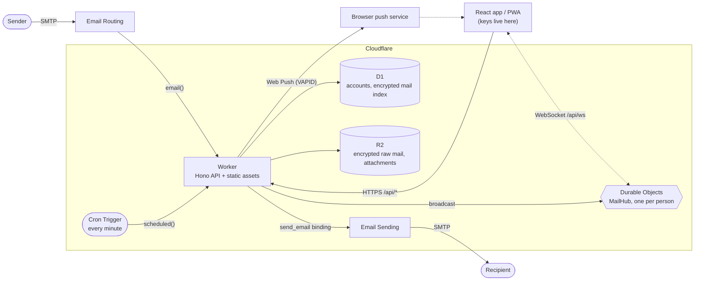

# Architecture

Edging Mail is one Cloudflare Worker plus the storage and messaging services around it, serving several people from one deployment. There is no server, container or
queue to run. Mail is stored encrypted to each person's own key; [Security](security.md) says what that does and does not promise.

## Components

| Part                 | Where                                                                               | Job                                                                                                                                                                                                  |
| -------------------- | ----------------------------------------------------------------------------------- | ---------------------------------------------------------------------------------------------------------------------------------------------------------------------------------------------------- |
| Worker entry         | `src/worker/index.ts`                                                               | Three handlers: `fetch` (API, public site, static assets), `email` (inbound mail), `scheduled` (the cron)                                                                                            |
| Sign-in and accounts | `src/worker/auth/`                                                                  | Sessions, gates, sign-in, two-step verification, keys, forgot password, Setup and break-glass, throttles, security notices                                                                           |
| Admin API            | `src/worker/admin/`                                                                 | Accounts, aliases, domains (with the DNS check), organisation settings, audit log, health. See the [API reference](api.md#admin)                                                                     |
| Mail API             | `src/worker/mail/`, `src/worker/drafts.ts`                                          | Folders, lists, labels, batch actions, send, end-to-end send between people here, downloads, drafts, per-person settings. Every query is scoped to the signed-in person                              |
| Inbound              | `src/worker/inbound.ts`, `services/email-parser.ts`                                 | Routes a message to its owner, seals it and stores it                                                                                                                                                |
| Outbound             | `src/worker/services/email-sender.ts`                                               | Validates a send request, calls the `send_email` binding, seals the Sent copy                                                                                                                        |
| Shared crypto        | `src/shared/crypto/`                                                                | The only place that touches keys: two entry points, `server` (seal-only) and `client` (everything). See below                                                                                        |
| `MailHub`            | `src/worker/realtime.ts`                                                            | One Durable Object per person holding that person's open WebSockets                                                                                                                                  |
| Web Push             | `src/worker/push.ts`                                                                | RFC 8291 encryption and RFC 8292 VAPID signing on WebCrypto, no library; creates its own key pair                                                                                                    |
| Security notices     | `src/worker/security.ts`                                                            | Notice rows plus a best-effort push in the recipient's language, text from `src/shared/i18n/locales/server/`                                                                                         |
| Error codes          | `src/worker/errors.ts`                                                              | The registry of stable error codes; every error answer carries one                                                                                                                                   |
| Cron jobs            | `snooze.ts`, `mail/pending.ts`, `encrypt-job.ts`, `locked-job.ts`, `maintenance.ts` | Return snoozed mail, seal pending mail, convert old plaintext mail (and sweep the plaintext objects a crash left behind), delete locked old mail whose seven days have passed, prune sign-in records |
| Database             | `src/worker/db/`                                                                    | Drizzle schema and client for D1. Migrations live in `drizzle/` and are applied by Wrangler                                                                                                          |
| Public site          | `src/worker/site/`                                                                  | The landing pages and the app shell (when `LANDING_PAGE` is `on`)                                                                                                                                    |
| React app            | `src/client/`                                                                       | Single-page app built by Vite into `dist/client`, served by the Worker's static assets binding                                                                                                       |
| Service worker       | `public/sw.js`                                                                      | App shell cache for offline start, push notifications, notification click handling                                                                                                                   |

### Request routing

`wrangler.jsonc` sets `assets.run_worker_first` to `["/api/*"]`: those requests reach the Worker, everything else is answered by the static assets binding, with
`single-page-application` fallback to `index.html`. Inside the Worker, every `/api/*` request goes through these middlewares in order:

1. `sameOriginOnly`: refuses cross-site requests (`Sec-Fetch-Site`) and cross-origin WebSocket handshakes (`Origin`).
2. `secureHeaders` from Hono, skipped for WebSocket upgrades. `Strict-Transport-Security` is sent over https only.
3. `noStoreJson`: `Cache-Control: no-store` on JSON answers.
4. `withErrorCodes`: an error answer that left a route without a `code` gets one from the registry.
5. `authenticate`: a valid session of an account that exists, is active and was not signed out; then the **gate** check (new password, key setup, two-step enrolment).
   Only `GET /api/health`, sign-in, Setup, break-glass and the forgot-password pair are public.
6. `requireAdmin` on `/api/admin/*`: the admin role, with no pending administrator-password change.

`authenticate` is registered above every route so that a route added later is private by default; a test derived from the route table (`test/gate.test.ts`) fails
for a route nobody classified, and another (`test/admin-p1.test.ts`) for an admin route that accepts a password or key.

## The shared crypto module

`src/shared/crypto/` is used by the Worker and by the browser and is the only code that handles keys. It has two entry points:

- `server`: seal-only. HPKE seal, AES-GCM, HMAC, HKDF and the PBKDF2 verifier. It has no HPKE open, no private-key import and no ECDH with a stored key, so the Worker
  can write mail for a person and cannot read it. The one thing the Worker decrypts is what it sealed for itself under `DATA_KEY` (`data-key.ts`).
- `client`: everything, including key derivation from the password and the recovery key, HPKE open and the recovery-key codec.

`npm run check:bundle` builds the Worker the way a deploy does and fails when a module of ours calls a forbidden function or a `crypto.subtle` method outside its
per-module allow-list. Known-answer tests (`test/crypto/`) pin the encodings to vectors that were written independently.

## Data flows

### Inbound mail

1. Email Routing delivers the message to the Worker's `email()` handler (the routing rule's destination is the Worker).
2. `resolveRecipient` maps the envelope recipient to a person: a primary address or an alias, with a `+tag` ignored. Any other recipient is rejected
   (`Unknown recipient`), so a catch-all rule is safe. Before Setup nobody exists yet, and mail is accepted without an owner.
3. A message over 20 MiB is rejected (`Message too large`): parsing, the raw copy and every encrypted blob live in the Worker's memory at once.
4. `parseAndStoreEmail` parses the raw message with `postal-mime` and **seals** it: a random content key per message, the summary (subject and snippet), the bodies,
   the raw message and every attachment each encrypted under a key of their own, and the content key sealed (HPKE) to the owner's public key.
5. If the owner has no keys yet (a new account, or no owner before Setup), the content key is sealed under `DATA_KEY` instead and the row is marked `wrap_kind = 'server'`
   ("pending"). If there is no `DATA_KEY` either, the message is rejected (`Message could not be processed`), never stored as plaintext. Cloudflare documents
   `setReject` as a permanent error, so the sender is bounced.
6. The encrypted raw message and attachments go to R2 first, then one batch writes the rows. Its thread is the thread of the stored mail it answers, otherwise its own
   `In-Reply-To`, `Message-ID` or id. The ids and the sealed content are fixed before the first write, so the batch can be repeated (step 8) without writing anything new.
7. `notifyNewMail` broadcasts `mail.new` to the owner's open tabs (awaited) and sends the Web Push in the background. Neither carries a subject or a snippet. A failure
   there is logged and never fails the delivery.
8. **When a step fails.** The owner lookup (step 2) and the row batch (step 6, with the thread lookup before it) are the D1 steps, and a hiccup there must not bounce a
   customer's mail: each is tried up to three times in all, with a pause of about 100 ms and then 400 ms. Every attempt is the same write: the message id, the attachment
   ids and the R2 keys are the ones fixed before the first try, and an attempt that D1 had committed but whose answer was lost finds its own row and counts as done (one
   row, no duplicate, no orphan object). The R2 objects are removed again only when the row is known not to be there; if D1 cannot even be asked, the sealed objects of a rejected
   mail may stay in R2 (ciphertext) and a mail may be stored although the sender was told it failed (a duplicate, not a loss). Nothing else is repeated: a failed parse, seal or
   object write fails at once.
   What still fails after the repeats is **final**: the handler rejects the mail with `setReject('Message could not be processed')`, a permanent error, so the sending
   server is told the delivery failed and the mail is not stored. Cloudflare documents no temporary-failure answer for an Email Worker; as reported by users (a community report,
   not Cloudflare's documentation), an uncaught exception also ends in a permanent error, so throwing instead would not make the sender try again. Where to look: the Worker's log (for example `npx wrangler tail`, or the Logs page of the Worker in the Cloudflare dashboard) has one line,
   `Failed to process inbound email at stage <stage>: <error class>`, where the stage is one of `resolve`, `parse`, `seal`, `store-object` or `store-row`; nothing else about
   the mail is logged (no address, subject or error text). Each repeated attempt logs one warning with the stage, the number of the attempt and the class.

When the owner later sets up keys, `rewrapPending` re-seals each held content key to the new public key (a small backlog at once, the rest by the cron).

### Mail between people on this deployment

1. The browser asks `POST /api/keys/lookup` for the public key of every address (`auth/lookup.ts` reads addresses and keys; the same lookup serves the route below). If every
   address is on this deployment it posts `POST /api/messages/internal`: one sealed copy per recipient person (its own content key and ids) and one for the sender.
2. `mail/internal.ts` claims the throttle first (`internal:<person>`), then `mail/internal-request.ts` and `internal-parts.ts` check the **shape** only (canonical
   base64url, version byte, the key id inside each wrapped key, size windows, the caps in `internal-limits.ts`): the Worker has no private key and cannot tell whether a
   blob opens.
3. Recipients and copies must match exactly (one copy per person). Every sealed copy must carry the person's **current** `key_id`, the sender's own too, else `409 key_changed`
   with the fresh keys. A copy for a person without keys arrives as `plain` and is sealed by the Worker (`seal.ts`): to the person's key if they have one by now, else under
   `DATA_KEY` as pending, like inbound mail.
4. `mail/internal-store.ts` writes the R2 objects first, then one D1 batch. Each row is inserted only while the person's key is still the one it was sealed to; if any row did
   not land, everything of the message is taken back and the answer is `409 key_changed`.
5. The sender, display name and `Message-ID` are set by the server; `SEND_EMAIL` is never called; `is_e2e = 1` only when no copy was `plain`. Realtime and push carry the sender's
   name and ids only.

### Outbound mail

1. The browser posts to `POST /api/messages/send`. The sender is always the signed-in person's own primary address (and display name); another `From` is refused.
2. The Worker builds the archive `.eml`, then calls `env.SEND_EMAIL.send(...)`. Cloudflare adds `Date`, `Message-ID` and the DKIM signature.
3. Only after that does the Worker seal the Sent copy **to the sender's own key**, write it with its attachments, delete the originating draft and broadcast
   `mail.changed`. A refused send stores nothing and answers `502`. A person without keys cannot send (`key_setup_required`).

### Sign-in, keys and recovery

- The browser derives two values from the password (PBKDF2 600,000 iterations, then HKDF): `auth`, which it sends, and a key that wraps the person's private key.
  The server stores a verifier of `auth` (PBKDF2 100,000 iterations) and the wrapped key; it never receives the password or an unwrapped key.
- Every person has a recovery key, made at key setup. Forgot-password proves possession of it, gives a single-use ticket and ends with a new password and a new
  recovery key. Break-glass (the setup key) restores an admin's console access with a new key pair. See [Security](security.md).
- Key changes use a compare-and-swap on `users.keys_version`; the audit entry and the security notice are written in the same guarded batch as the change.

### Realtime and push

- Every signed-in browser opens `GET /api/ws`; the Worker forwards the upgrade to that person's own `MailHub` instance (`idFromName('user:<id>')`). The Durable Object
  uses the hibernatable WebSocket API, so idle sockets cost nothing. `ping` is answered with `pong` by the runtime without waking the object.
- `broadcast(env, userId, event)` POSTs the event to that person's Durable Object, which sends it as JSON text to every socket and drops dead ones. Revoking a
  person's sessions closes their sockets.
- `notifyPush` encrypts a notification for each of the person's stored subscriptions (at most 20) and posts it to the browser's push service (`TTL: 86400`,
  `Urgency: high`, 8 s timeout, no redirects). `404`/`410` answers delete the subscription.
- The VAPID key pair is created the first time push is needed. Its private half is kept in `push_keys`, sealed under `DATA_KEY` (see
  [Web Push keys](configuration.md#web-push-keys)).
- The client reconnects with exponential backoff (1 s up to 30 s) and refetches when the tab becomes visible again, so a missed event is repaired.

More in [Realtime, Web Push and PWA](pwa-and-push.md).

### The cron

A Cron Trigger fires `scheduled()` every minute and starts four jobs, each of which never throws: `returnSnoozedMail` moves due snoozed mail back to the Inbox (see
[Mail features](mail-features.md#snooze)); `rewrapPending` seals pending mail to owners who have keys by now; `encryptLegacyMail` converts mail from the single-user
version in small chunks; `applyDueTwoFactorResets` applies an admin's reset of their own two-step verification when its 24 hours are up. Once an hour (at minute 7)
`pruneActivity` deletes old sign-in records.

## Data model

Defined in `src/worker/db/schema.ts`; the SQL is in `drizzle/`.

| Table                   | Holds                                                                                                                                                                                                                                                  |
| ----------------------- | ------------------------------------------------------------------------------------------------------------------------------------------------------------------------------------------------------------------------------------------------------ |
| `users`                 | One row per person: primary address, display name, role, status, language, the `auth` verifier, TOTP secret (sealed), public key and the wrapped private key and recovery key material, `keys_version`, `sessions_valid_after`                         |
| `addresses`             | Every address a person receives on (primary and aliases) and the domain it belongs to; unique across the deployment                                                                                                                                    |
| `domains`               | The mail domains an admin onboarded                                                                                                                                                                                                                    |
| `user_keys`             | Keys retired by break-glass, kept so that mail sealed to them can be opened with the old recovery key                                                                                                                                                  |
| `recovery_codes`        | The MACs of a person's two-step recovery codes (never the codes)                                                                                                                                                                                       |
| `two_factor_challenges` | One open second step of a sign-in: single use, five minutes                                                                                                                                                                                            |
| `recovery_tickets`      | The forgot-password tickets (as MACs): single use, ten minutes, one open ticket per person                                                                                                                                                             |
| `user_security_events`  | The notices a person sees (a 2FA reset, a recovery key used, a break-glass, an alert about an admin action), not dismissible for seven days                                                                                                            |
| `user_sign_ins`         | A person's own sign-in history and notes of security actions                                                                                                                                                                                           |
| `audit_log`             | What admins and the system did, newest first, for admins to read                                                                                                                                                                                       |
| `messages`              | Every mail in every folder, including drafts, owned by one person: plaintext columns for legacy rows, `summary_blob`, `body_blob`, `wrapped_cek`, `key_id` for sealed rows, flags, `labels`, thread columns, `snoozed_until`, `r2_key` of the raw copy |
| `attachments`           | One row per attachment: size, `r2_key`, and `meta_blob` (the encrypted file name, type and content id). Cascades when the message row is deleted                                                                                                       |
| `settings`              | Key/value for the organisation: `require_2fa`, `default_language`                                                                                                                                                                                      |
| `push_subscriptions`    | One row per subscribed device, owned by a person: unique `endpoint`, `p256dh`, `auth`, `user_agent`, `last_success_at`                                                                                                                                 |
| `push_keys`             | One row (`id` 1): the VAPID `public_key` and the `private_key_sealed` (under `DATA_KEY`), created on first use                                                                                                                                         |
| `login_attempts`        | The throttle counters, one row per key space and client/account, plus one `global` row                                                                                                                                                                 |

Every table that holds a person's data cascades when the `users` row is deleted. Folders are a text column on `messages`: `inbox`, `sent`, `archive`, `trash`,
`spam`, `drafts`, `snoozed`. `starred` is a flag, shown as a view.

R2 layout (objects are ciphertext and carry no custom metadata; their names hold ids only):

| Key                                               | Content                                                                           |
| ------------------------------------------------- | --------------------------------------------------------------------------------- |
| `em1/<owner id>/<message id>/raw`                 | The raw message, encrypted                                                        |
| `em1/<owner id>/<message id>/att/<attachment id>` | One attachment, encrypted                                                         |
| `em1/pending/<message id>/…`                      | The same, for mail that arrived before Setup (no owner yet)                       |
| `raw/…`, `sent/…`, `attachments/…`                | Plaintext objects from the single-user version, until the cron has converted them |

## Client

React 19, TanStack Query v5 and Tailwind CSS v4 with Lucide icons. There is no client router: the mailbox, the reader and the dialogs are state in `App.tsx`.
The list loads 50 mails per page, updates optimistically and rolls back on a failed request. A `401` on any call returns to the sign-in screen. Passwords, the
private key and the recovery key exist only in the browser; mail is opened there. HTML mail is rendered in a sandboxed frame (see
[Security](security.md#mail-content)). The theme choice is kept in `localStorage` (`edging-mail-theme`).

## Design notes

- **One Durable Object per person.** A person's sockets live in their own object, so an event can only reach that person and a deleted account leaves nothing behind.
- **Web Push without a library.** `push.ts` is WebCrypto for the encryption and signing. The common Workers libraries only accept `https` endpoints, which would rule out
  testing against a local fake push service.
- **Seal-only Worker.** The Worker can write mail for a person and cannot read it, and a build check enforces that. What it must read back (pending mail, TOTP secrets,
  tickets, the push signing key) is sealed under `DATA_KEY`, which is not the key of anyone's mailbox.
- **`instr()` instead of `LIKE`.** D1 refuses `LIKE` patterns over 50 bytes, which would turn a long search or a CJK label into an HTTP 500. Search covers only the
  sender and recipient addresses and names: the server cannot read subjects or bodies.
- **Wrangler applies migrations, Drizzle generates them.** `drizzle-kit` only diffs the schema; it never touches a database. See
  [Development](development.md#database-migrations).
- **Fail closed.** A missing or malformed secret disables sign-in and Setup instead of weakening them, a throttle store that cannot be read refuses the request, and a
  missing `send_email` binding is an error rather than a silent success.
- **Stable error codes.** Every failure answers a `code` from one registry (`src/worker/errors.ts`); the app shows its own translated text for it.

## Limits that follow from the platform

- Sealed summary and body blobs are stored in D1 (base64), and D1 caps a row at 2 MB. A mail whose text or HTML body is near that size is expected to fail to store; the
  sending server then gets the rejection described above. This is derived from D1's documented limit and has not been tested. Attachments live in R2 and do not count.
- D1 binds at most 100 parameters per statement, which is why a batch action takes at most 100 ids and some writes go in groups.
- A password check is about 40-50 ms of CPU, so the whole install needs the Workers Paid plan (the Free plan allows 10 ms per request).
- Email Routing accepts inbound messages up to 25 MiB; this app seals up to 20 MiB. On the Workers Free plan an Email Worker can run out of CPU time on large messages
  ([limits](https://developers.cloudflare.com/email-service/platform/limits/)).
